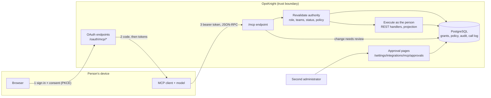

# OpsKnight MCP: threat model, data flow and control matrix

Scope: the built-in Model Context Protocol server (`/mcp`), its OAuth endpoints (`/oauth/mcp/*`), personal access tokens and the review pages. This is an engineering threat model written from the code. It is **not** a third-party assessment, a penetration test or a compliance attestation; see [What this is not](#what-this-is-not).

Companion pages: [architecture](../v2.2.0/operate/mcp/architecture.md), [certification status](../v2.2.0/operate/mcp/certification.md), [monitoring](../v2.2.0/operate/mcp/monitoring.md).

## What is being protected

| Asset                                                                                              | Why it matters                                                                       |
| -------------------------------------------------------------------------------------------------- | ------------------------------------------------------------------------------------ |
| Incident, service, schedule and runbook data                                                       | Operational detail; can include customer and infrastructure information in free text |
| The right to change things (acknowledge, resolve, configure, run runbooks)                         | A wrong change can silence a page, reroute on-call, reach customers or run code      |
| Credentials: access tokens, refresh tokens, personal access tokens, device and authorization codes | Anyone holding one acts as the person for its lifetime                               |
| The administrator policy                                                                           | It decides what every assistant may do                                               |
| The audit trail and request log                                                                    | Evidence after an incident                                                           |

## Actors and trust

| Actor                                                | Trusted for              | Not trusted for                                                                         |
| ---------------------------------------------------- | ------------------------ | --------------------------------------------------------------------------------------- |
| Signed-in person                                     | Their own role and teams | Anything beyond them; consent is theirs to give, never an admin's                       |
| Administrator                                        | Policy, approvals        | Approving their own assistant's change when strict review is on                         |
| The assistant (a model plus its client)              | Nothing by default       | Everything it reads is untrusted input; everything it asks for is checked as the person |
| The MCP client software                              | Holding a token safely   | Being the person: it is a public client with no secret                                  |
| Content in OpsKnight (titles, notes, alert payloads) | Nothing                  | Instructions: it is data, and is labelled as untrusted in tool output                   |

## Data flow and trust boundaries

Boundaries that matter: (1) the network edge to `/mcp` and `/oauth/mcp/*`; (2) the assistant, which is outside the boundary and untrusted; (3) the review pages, reachable only with a normal browser session; (4) the database, where the grant, the frozen request and the policy live.

## Threats (STRIDE)

| #   | Threat                                         | Category                | Main controls                                                                                                                                                                                                                                                                                            | Residual risk                                                                                                                                                          |
| --- | ---------------------------------------------- | ----------------------- | -------------------------------------------------------------------------------------------------------------------------------------------------------------------------------------------------------------------------------------------------------------------------------------------------------- | ---------------------------------------------------------------------------------------------------------------------------------------------------------------------- |
| T1  | Stolen access token replayed                   | Spoofing                | 5-minute access tokens; refresh rotation with reuse detection that revokes the grant; digests, not secrets, stored; per-peer failure limiter                                                                                                                                                             | A token is a bearer secret for up to five minutes. No DPoP or mTLS binding.                                                                                            |
| T2  | Stolen personal access token                   | Spoofing                | Off by default; admin-set maximum lifetime (90 days at most); scope list set by the admin; `runbooks:execute` never allowed; secret-scanner prefix; created only after a fresh sign-in; instantly revoked when the feature is turned off                                                                 | A long-lived secret in someone's CI. Mitigated by scope and lifetime, not eliminated.                                                                                  |
| T3  | Hostile client tricks a person into consenting | Spoofing / Elevation    | PKCE S256 required; exact redirect match; consent page names the assistant and exact permissions; client metadata documents and registered clients are labelled unverified unless an admin trusts the host; device flow shows a "only continue if you started this" warning                              | A person can still approve a lookalike they started themselves.                                                                                                        |
| T4  | Assistant acts beyond the person               | Elevation               | Authority read from the database on **every** call (role, teams, status); scopes are the intersection of client, grant, token, role and policy; a row-level check in each REST handler                                                                                                                   | None known beyond bugs in individual handlers, which the shared authorization tests cover.                                                                             |
| T5  | Access outlives the person's role              | Elevation               | Role and team edits apply on the next request; deactivation, password change, demotion from ADMIN and sign-out-everywhere bump a revocation version and end every grant                                                                                                                                  | Delay equals one request.                                                                                                                                              |
| T6  | Prompt injection through stored text           | Tampering               | Output is labelled untrusted; no tool takes instructions from data; changes need the person's own permission, and risky ones a second human; invisible and bidirectional Unicode is stripped                                                                                                             | **No content scanner.** A model can still be persuaded to ask for something the person is allowed to do. Direct incident actions run without review by design.         |
| T7  | Secrets or personal data leak in results       | Information disclosure  | Key-name redaction, URL query stripping, bearer-shaped string and email-address removal; strict field allowlists for the user directory and audit log (no emails, no IPs); sensitive configuration reads are off until an admin enables them and are audited                                             | Redaction elsewhere is a denylist. A secret pasted into a free-text field is not guaranteed to be caught.                                                              |
| T8  | A change is made without a second look         | Tampering / Repudiation | Configuration and runbook changes are frozen, hashed, approved by a different active administrator or approver, single-use and expiring; the assistant can never approve; optional **strict four-eyes** removes administrator self-approval                                                              | By default an administrator may approve their own assistant's change after an explicit confirmation (recorded as self-approved). Turn on strict review to remove this. |
| T9  | Denial of service by an assistant              | Denial of service       | Per-connection and optional per-person request limits; per-process and per-person in-flight caps; 64 KiB request and 256 KiB response limits; 8-step plans; weighted cost; a separate small database pool with a 5-second statement timeout; stream caps (2 per connection, 32 per process); kill switch | A determined authenticated user can still use their quota.                                                                                                             |
| T10 | SSRF through client metadata fetch             | Information disclosure  | Public addresses only, DNS pinned, no redirects, 3-second timeout, 5 KiB cap                                                                                                                                                                                                                             | None known. This is the only outbound request the server makes for a client.                                                                                           |
| T11 | Admin action cannot be attributed              | Repudiation             | Policy changes, grants, revocations, approvals, token issue and dormant-connection resume, usage exports and sensitive reads are audited; every request has an id returned to the client                                                                                                                 | Ordinary reads are in the request log (30 days by default), not the audit table.                                                                                       |
| T12 | Policy loosened by a hijacked admin session    | Elevation               | Widening changes need a recent sign-in; narrowing never does; optimistic concurrency on policy saves                                                                                                                                                                                                     | A session that is both fresh and hijacked.                                                                                                                             |
| T13 | Usage data misuse                              | Information disclosure  | The request log stores ids and bounded labels only (never arguments or results); the Usage tab and its export are administrator-only; each export is audited; CSV cells that look like formulas are neutralised                                                                                          | An administrator can see who called which tool and when.                                                                                                               |

## Control matrix

| Control                                                           | Threats | Where it lives                                                                         | Evidence                                                                                                                                                                               |
| ----------------------------------------------------------------- | ------- | -------------------------------------------------------------------------------------- | -------------------------------------------------------------------------------------------------------------------------------------------------------------------------------------- |
| PKCE S256 required; exact redirect match                          | T3      | `src/app/oauth/mcp/token/route.ts`, `src/lib/mcp/auth/redirect-uri.ts`                 | `tests/integration/mcp-security-database.test.ts` ("requires PKCE and persists only keyed digests"), `tests/mcp/redirect-uri.test.ts`                                                  |
| 5-minute access tokens, refresh rotation, reuse revokes the grant | T1      | `src/lib/mcp/auth/oauth-model.ts`                                                      | `tests/integration/mcp-security-database.test.ts` ("rotates refresh tokens, downscopes, detects reuse and revokes the entire grant")                                                   |
| Secrets stored as keyed digests                                   | T1, T2  | `src/lib/mcp/auth/config.ts` (`digestMcpSecret`)                                       | `tests/integration/mcp-security-database.test.ts`                                                                                                                                      |
| Device flow (RFC 8628) with lockout after 5 wrong codes           | T3      | `src/lib/mcp/auth/device-flow.ts`                                                      | `tests/integration/mcp-device-flow.test.ts`                                                                                                                                            |
| Personal access tokens, admin-gated                               | T2      | `src/lib/mcp/auth/personal-tokens.ts`                                                  | `tests/integration/mcp-personal-tokens.test.ts`                                                                                                                                        |
| Authority recomputed on every call                                | T4, T5  | `src/lib/mcp/auth/principal.ts`, `src/lib/mcp/auth/effective-access.ts`                | `tests/integration/mcp-security-database.test.ts` ("reloads the current role, memberships and scope intersection", "immediately rejects disabled users and revoked clients or grants") |
| Mutation re-check under row locks                                 | T4      | `src/lib/mcp/core/mutation-authority.ts`                                               | `tests/integration/mcp-security-database.test.ts` ("runs the canonical mutation once ... across retries"), `tests/integration/mcp-curated-incident-actions.test.ts`                    |
| Redaction and field allowlists                                    | T7      | `src/lib/mcp/core/projection.ts`                                                       | `tests/integration/mcp-directory-reads.test.ts`                                                                                                                                        |
| Sensitive reads off by default, audited                           | T7, T11 | `src/lib/mcp/core/execution.ts`                                                        | `tests/integration/mcp-sensitive-reads.test.ts`, `mcp-sensitive-reads-config.test.ts`, `mcp-sensitive-reads-post.test.ts`                                                              |
| Frozen, hashed, expiring, single-use approvals                    | T8      | `src/lib/mcp/approvals/operation.ts`                                                   | `tests/integration/mcp-operation-approval.test.ts`                                                                                                                                     |
| Strict four-eyes (optional)                                       | T8      | `src/lib/mcp/approvals/distinct-reviewer.ts`                                           | `tests/integration/mcp-round6-four-eyes.test.ts`                                                                                                                                       |
| Request budgets and weighted quota                                | T9      | `src/lib/mcp/core/budget.ts`, `src/lib/mcp/auth/principal.ts`                          | `tests/mcp/boundary.test.ts`, `tests/integration/mcp-security-database.test.ts` ("caps actual serialized MCP results")                                                                 |
| Per-person request cap (optional)                                 | T9      | `src/lib/mcp/auth/principal.ts`                                                        | `tests/integration/mcp-round6-person-cap.test.ts`                                                                                                                                      |
| Stream caps, access re-check every 30 s                           | T9      | `src/lib/mcp/protocol/subscriptions.ts`                                                | `tests/mcp/operability-signals.test.ts`, `tests/mcp/monitoring-docs.test.ts`                                                                                                           |
| Kill switch (`MCP_FORCE_DISABLED`)                                | T9      | `src/lib/mcp/core/kill-switch.ts`                                                      | `tests/integration/mcp-security-database.test.ts` ("rejects authority changes and the MCP kill switch between plan steps"), `tests/integration/mcp-auth-resilience.test.ts`            |
| SSRF-safe metadata fetch                                          | T10     | `src/lib/mcp/auth/cimd-transport.ts`                                                   | `tests/mcp/client-metadata.test.ts`, `tests/integration/mcp-client-metadata.test.ts`                                                                                                   |
| Fresh sign-in for widening policy                                 | T12     | `src/lib/mcp/auth/policy-widening.ts`, `src/lib/mcp/auth/fresh-admin.ts`               | `tests/mcp/policy-widening.test.ts`                                                                                                                                                    |
| Audit of grants, policy, approvals, token issue, usage export     | T11     | `src/lib/audit.ts` callers throughout `src/lib/mcp`                                    | `tests/integration/mcp-easy-onboarding.test.ts`                                                                                                                                        |
| Request log with ids only, admin-only export                      | T13     | `src/lib/mcp/core/call-log.ts`, `src/app/(app)/settings/integrations/mcp/usage.ts`     | `tests/integration/mcp-round6-usage.test.ts`                                                                                                                                           |
| Alerts and dashboard                                              | T9, T11 | `monitoring/prometheus/opsknight-alerts.yaml`, `monitoring/grafana/opsknight-mcp.json` | `monitoring/prometheus/mcp.test.yml`                                                                                                                                                   |
| Protocol fuzzing                                                  | T9      | `tests/integration/mcp-protocol-fuzz.test.ts`                                          | the test itself                                                                                                                                                                        |

## Residual risk and decisions for owners

1. **Direct incident actions** (acknowledge, resolve, assign, escalate, reopen, unsnooze, add a note, create an incident, add a watcher or tag) run without a second person, as the person, when changes are on. This is deliberate and documented in the permissions reference. An organisation that wants every change reviewed can leave changes off.
2. **Self-approval by an administrator** is allowed by default with an explicit confirmation. Regulated teams should turn on _Require a different reviewer_, and keep at least two administrators.
3. **Bearer tokens** are not sender-constrained. Short lifetimes and rotation are the mitigation.
4. **Redaction is a denylist** outside the directory and audit-log allowlists. Treat results as data that may contain whatever users typed.
5. **No network allow-list** on `/mcp`. Restrict it at your proxy or firewall if you need to.
6. **Every credential belongs to a person.** There is no non-human identity; see the [service-account design](mcp-service-accounts-design.md).

## What this is not

- Not an independent security assessment or penetration test. None has been performed on the MCP server.
- Not a SOC 2, ISO 27001 or similar control mapping. The matrix above maps this feature's controls to its own threats only.
- Not a guarantee. It describes the code as reviewed; see the [certification page](../v2.2.0/operate/mcp/certification.md) for which gates have evidence and which do not.

Report a suspected vulnerability following [vulnerability response](vulnerability-response.md).
