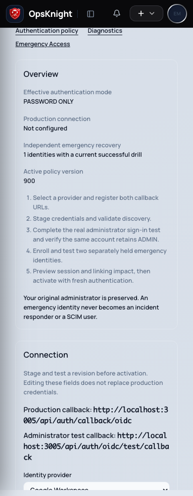

# Choose an authentication mode

For administrators and deployment operators. Personal password, linked identity and session controls remain in **Settings → Security**. System policy is in **Settings → System → SSO / Authentication**.

## Prerequisites

Apply migrations, keep all replicas on the same PostgreSQL database and preserve the encryption key. Set a canonical public HTTPS origin. Register both production `/api/auth/callback/oidc` and staged `/api/auth/oidc/test/callback` redirect URIs at the IdP. Read [Configure OIDC](configure-oidc/) for provider-specific boundaries.

## Select the policy

1. **Password Only**: Permits ordinary password authentication and password operations. OIDC sessions and sign-in are rejected even if a connection is stored.
2. **SSO Optional**: Permits passwords and OIDC. Existing-account linking requires an explicit expiring approval; email alone never establishes ownership.
3. **SSO Required**: Permits ordinary OIDC authentication and rejects ordinary passwords, password creation/change, reset issuance/completion and password invitation activation. **Users → Invite with SSO only** creates a bound first-link approval without a password token. Required selects this invitation type automatically.

Administrators must have signed in within the last two hours to change authentication settings (emergency recovery sessions keep a stricter five-minute step-up). Stage the connection, run a real administrator login test, and activate Optional first. Required activation additionally needs two active, independently held hardware-key emergency identities with successful drills for their current credential versions in the last 90 days. Discovery validation alone cannot satisfy administrator readiness. Drills and administrator proofs are bound to the verified public origin; changing it requires new verification. The tested administrator must remain active and ADMIN, and the proof expires after seven days. See [Test and enforce SSO](test-and-enforce-sso/).

## Verify and observe session effects

Inspect **Overview**, then **Sessions & Policies → Preview enforcement impact**. Confirm the authoritative mode and version, affected password sessions, users requiring identity links, administrator verification and recovery blockers. Confirm the activation checkbox before applying the exact tested revision. A stale version or changed administrator refuses activation transactionally.

Disallowed sessions fail on the next protected server request. Password cutoffs persist across a later return to Optional; old revoked sessions do not return. Changing the production provider advances the OIDC cutoff. Long-lived streams recheck policy at their existing server intervals; already delivered data is not recalled. Users must sign in again after their issuing method is revoked. Settings → Security shows the current sign-in method separately from system policy.

## Recovery and rollback

An IdP outage never automatically enables passwords. Use [Emergency Access](configure-emergency-access/) to repair and test a staged provider while preserving Required, or deliberately use [lockout recovery](sso-lockout-recovery/) to restore password access. A normal fresh administrator can deliberately select Optional, or prove their current password to select Password Only. Those changes are audited and enqueue durable security alerts.

Emergency recovery sessions have a one-hour hard cap and a 15-minute idle timeout. Passive reads do not extend either limit.

A fresh installation with no Users starts in Password Only so the first administrator can configure and verify SSO, even if deprecated local-login environment flags were preset. Existing installations retain their imported effective policy.

Legacy environment controls are imported once under a PostgreSQL advisory lock. Later environment edits do not override policy. Imported Required installations keep their policy but are not automatically certified as recovery-ready. The imported emergency password now opens only the restricted recovery console at `/recovery`; it never creates an ordinary administrator session. Retire it after two independent drills.

PostgreSQL outage and missing imported policy fail closed. Emergency authentication also needs PostgreSQL. Restore the database externally; do not delete policy/import records to force environment fallback. Before application downgrade, explicitly reconcile the older application's environment controls because it does not understand this policy.
