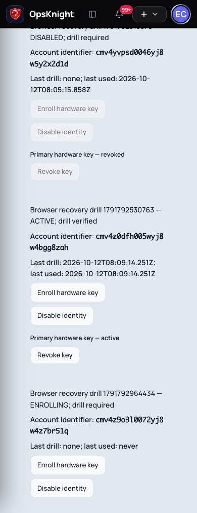

# Configure independent emergency access

For administrators and recovery custodians. Emergency identities are separate principals, never responders, normal Users, SCIM users, JIT identities or trusted devices.

## Prerequisites and custody

Use the canonical public HTTPS origin. Hold two separately controlled identities outside the IdP failure path; each can use a generated vault password or a hardware security key. Two passwords, two hardware identities, or one of each are supported. Hardware enrollment requires a browser with WebAuthn support. Keep backup keys and account identifiers in a tested external recovery procedure. Synced passkeys and backup-eligible credentials are rejected. User verification (for example a key PIN) is required.

For hardware identities, the server stores public keys only. For password identities, it stores only a salted scrypt hash; the generated 256-bit password is returned once to the freshly authenticated custodian. With privacy-preserving attestation, it cannot cryptographically prove that two registrations represent different physical keys or different custodians. The custody confirmation is an operator obligation: use distinct independently held hardware, and test each in a separate browser session. Changing the public RP hostname requires deliberate re-enrollment; existing credentials are bound to that RP.

## Enroll and drill

1. Sign in freshly as an administrator. Open **Settings → System → Emergency Access**.
2. Create an identity with a recognizable custodian label and choose the recovery method and confirm independent custody. Record its generated account identifier externally.
3. For a hardware identity, enter a key label, choose **Enroll hardware key**, and complete the user-verification ceremony. For a password identity, copy the one-time generated password into a vault accessible without the IdP; acknowledge secure storage. It cannot be retrieved again.
4. Open `/login/emergency` in a separate browser. Choose the recovery method and enter its account identifier; authenticate with the key or generated recovery password.
5. Verify that only the restricted recovery console opens. It must not open incidents, ordinary settings or a normal User session.
6. Repeat with a second independently held identity. Return to Emergency Access and confirm both are verified for their current credential versions.

Enrollment alone does not establish readiness. A successful independent sign-in using the configured method marks an identity active and verifies the current credential version. Any enrolled/revoked key, password rotation or method change invalidates the drill and revokes sessions for that identity. Drill again after changes and at least every 90 days.

## Session limits, alerts and key maintenance

Recovery sessions have a hard 60-minute maximum and a 15-minute inactivity timeout. Passive page reads never extend idle time. Visible keyboard/pointer activity updates idle time; sensitive operations need credential verification within five minutes. Reauthentication rotates the cookie but retains the original hard expiry. Logout, disablement and credential-version changes revoke access immediately.

Enrollment, login successes/failures, revocation, policy changes and recovery repairs commit audit events and durable high-priority security notifications. Email outages retain pending intents and in-app alerts; inspect Diagnostics and restore the delivery worker/provider.

Enroll and drill a replacement independent identity before disabling a ready account or rotating its last key under Required. For an actual compromised key, use the explicit compromise confirmation; this may reduce readiness and demands an immediate replacement drill. Even the final verified credential can be revoked when explicitly declared compromised. This records a critical recovery-degraded state, invalidates that identity’s sessions immediately, and keeps SSO Required enforced. Revoking your own last key ends your recovery capability; use a different custodian, a valid normal SSO administrator, or externally governed infrastructure recovery for remediation.

After two successful independent drills, use **Retire legacy emergency password**. The original User and references remain intact; the imported password bridge and its recovery sessions are removed. See [Emergency troubleshooting](../../troubleshooting/login/emergency-access/) for lost keys and database outages.

## Deployment origin and key custody record

Record the exact public HTTPS origin, the WebAuthn RP hostname, emergency account
identifier, custodian, primary/backup key labels, and last independent drill time.
Record identifiers, not private keys or recovery-session cookies. Keep this record
available when SSO, the corporate password manager, or a normal administrator
session is unavailable. Confirm PostgreSQL and the configured encryption keys are
included in the separately governed infrastructure recovery plan.

For an installation that needs recovery during canonical URL mistakes, set
`AUTH_RECOVERY_ORIGIN` to the same trusted HTTPS origin used when enrolling the
keys. This is an operator-controlled deployment setting, not a browser-provided
Host override. Existing keys cannot authenticate on a different RP hostname.
Restart every web replica after changing deployment controls, then drill through
the public reverse proxy. See [lockout recovery](sso-lockout-recovery/) for repair.

## Independent drill acceptance

1. Sign out of ordinary OpsKnight sessions and open a separate browser profile.
2. Open `/login/emergency` at the recorded origin, enter the identifier, and use
   the assigned generated password or hardware key with its PIN/user-verification prompt.
3. Confirm the restricted recovery console opens. Attempt an incident URL and
   confirm it redirects to normal sign-in. An emergency principal is not a User.
4. Return to Emergency Access, confirm the identity’s successful current drill,
   and sign out of recovery. Reopening `/recovery` must request authentication.
5. Repeat using the second custodian and independently controlled identity.
6. Practice backup-key use without reusing an ordinary logged-in browser profile.

Run a drill after enrollment, credential revocation, origin changes, and before
Required enforcement. Readiness expires after 90 days. Maximums are 20 enabled or
enrolling identities and ten active keys per identity. Replace obsolete keys
rather than allowing an unbounded credential list to accumulate.

## Compromise exercise and degraded recovery

For a lost but uncompromised key, enroll and drill a replacement before voluntary
revocation would reduce Required readiness below two identities. For actual
compromise, select the compromise declaration and revoke promptly, including the
last ready credential. Confirm the credential displays revoked and its sessions
no longer authorize operations. A critical alert and degraded-recovery marker
must appear; SSO Required must remain unchanged. Recover two independently ready
identities promptly. Successful current drills clear the degraded marker when two
identities are ready again. If none remain, a normal SSO administrator may enroll
replacements; otherwise use the documented infrastructure incident procedure.

## Recovery availability under abusive traffic

Unknown account requests do not share a global budget with legitimate recovery.
New ceremonies are limited per network (30 per five minutes) and per known account
(20 per five minutes). Verification of an issued ceremony requires its unguessable
browser cookie and has a separate three-attempt budget. Invalid cookies cannot
consume that reserve. Authenticated reauthentication has its own ten-ceremony
budget per session; hard session expiry still applies. Legacy password recovery
uses separate network and designated-account limits and cannot spend hardware-key
budgets.

Keep account identifiers in the external custody procedure. A targeted attacker
who knows an identifier can exhaust that account's new-ceremony allowance; an
already-issued ceremony can still finish, and another custodian's account remains
independent. Use ingress request/body/connection limits and a tested restricted
recovery access path for volumetric attacks. Application quotas cannot guarantee
availability when the database, network or host is saturated. Preserve the exact
WebAuthn origin when providing that access path.

Security mutations commit mandatory audit evidence and at most 100 immediate
recipient alerts, plus a durable cursor for remaining administrators. The scheduler
materializes up to five further batches of 100 per pass; cursor advancement and
alert creation commit together. Additional recipients receive alerts asynchronously.
Anonymous failures retain their existing aggregate notification cap. Verify the
scheduler and notification workers are healthy in split deployments.

## Evidence during sustained throttling

Already-throttled requests increment a shared rejection counter instead of creating
an event and audit row for every request. Each five-minute window has at most three
forensic samples per internal rejection category, at counts 1, 100 and 1,000. The
counter remains exact across replicas; samples contain the category, window start
and observed count rather than attacker-supplied identifiers. Counter rows are
retained until expired authentication-data cleanup (at least one additional day).
Export them before cleanup when longer retention is required. Requests admitted by
the limiter still retain individual authentication-failure evidence.

This bounds audit/notification amplification, not all database work: limiter and
aggregate counters still require database writes. Configure ingress request and
connection limits to keep volumetric traffic within the database's tested capacity.

### Optional edge admission protection

`deploy/nginx/emergency-rate-limit.conf` is an opt-in NGINX HTTP-context example
for the exact `/api/auth/emergency` endpoint: two requests/second per source with
a burst of ten and at most four concurrent emergency requests per source, returning
429 before proxying excess requests. See the
[NGINX rate-limit module](https://nginx.org/en/docs/http/ngx_http_limit_req_module.html)
for directive semantics. Tune these example limits against shared-NAT custodian
traffic and rehearse completing a hardware ceremony during abuse before deployment.

Place this private listener behind your trusted TLS terminator, replace the
upstream service address and block direct public access to the application.
If another proxy precedes NGINX, configure real-client-IP extraction only from
explicitly trusted proxy ranges; never accept arbitrary forwarded client headers.
Otherwise the example intentionally keys on the connecting address. The limiter
is shared by workers in one NGINX instance, not across independent edge replicas.
It limits all emergency actions, including verification; maintain a separately
protected custodian network path for same-NAT abuse and distributed saturation.
Do not exempt requests merely because an unvalidated cookie/header is present.
Ordinary login and OIDC callback paths are outside this example's limit.

Security emails that exhaust central retries or are skipped stop automatic polling
and appear under **Diagnostics → Security notifications → FAILED**. Correct the
provider before using the explicit retry action. This requires fresh authority
and preserves an audit event. Pending transport retries remain automatic; cancelled
recipient deliveries remain terminal. In-app security evidence is independent.

## Authorization at queued email dispatch

Authentication-security email is checked both when enqueued and immediately before
calling each provider, including fallback providers. A recipient must still be an
active administrator and the queued address must match the user's current email.
Demotion, deactivation, deletion or an address change suppresses queued delivery as
`SKIPPED`; the authentication intent subsequently records terminal failure for
explicit review. Unavailable authorization reads defer delivery without sending.
Mail already accepted by a provider cannot be recalled.

Diagnostics reports **Fan-out work pending**, **Emails awaiting acceptance** and
**Awaiting delivery confirmation** separately. A fan-out job may represent many
recipients. Historical delivered and cancelled totals are not queried for the summary.
**Security notifications** supports all five delivery states, with 25, 50 or 100
records per page and bounded **Previous / Next** navigation. Retry confirmation stays
open after a server rejection and explains the failure inside the dialog. A successful
retry refreshes the affected page while retaining other diagnostic views. Retention
remains 90 days for terminal delivery metadata; audit/in-app evidence follows its
separate policy.

## Identity recognition and administrator readiness

Claims preview reports stable issuer/subject identity recognition separately from
administrator verification readiness. A recognized identity with group overage is
shown as **Identity recognized** with **Administrator verification blocked by
incomplete group claims**. It cannot satisfy the staged administrator test until
those claims are resolved. Sample claims remain a preview; a real signed-token
administrator test is required before activation. Editing claims or provider rules
invalidates the displayed preview.

## Submission and delivery receipts

**Sent to provider** records transport acceptance. **Delivery confirmed** requires
a delivery receipt or a central notification already confirmed as delivered.
Providers without final-delivery feedback remain **Sent to provider**; acceptance
is never presented as recipient delivery. Pending, accepted, confirmed, failed and
cancelled history filters report distinct states. A terminal bounce, complaint,
suppression or invalid-recipient receipt moves the accepted message to failed.

Receipt processing is serialized with linking the alert to its current transport
notification, so an early receipt is retained. Retrying clears that link and creates
a new generation; a late receipt for the old attempt cannot confirm the replacement.
Older completion timestamps are migrated conservatively into provider-acceptance
metadata because the old field did not distinguish acceptance from delivery.
Review the original provider evidence separately when auditing historical delivery.
Accepted messages without confirmation and other terminal delivery metadata use
bounded 90-day retention; security audit and in-app evidence remain independent.

## Password custody, rotation and method changes

Generated recovery passwords belong to `EmergencyAccount`, never a normal `User`.
They work when normal password login is disabled under SSO Required, but issue only
the restricted recovery cookie and cannot open an ordinary application session.
The public login screen lets the custodian choose a method locally; it does not expose
an account-discovery endpoint. Unknown identifiers, wrong passwords and disabled
accounts return the same password-authentication failure. PostgreSQL network/account
limits apply before hashing, with a separate current-session reauthentication budget.

Hashing uses Node's built-in scrypt at N=32768, r=8, p=3 (32 MiB), random 128-bit salt
and constant-time comparison. This is an [OWASP documented alternative](https://cheatsheetseries.owasp.org/cheatsheets/Password_Storage_Cheat_Sheet.html)
when Argon2id is unavailable; it avoids adding native binaries across supported images.
Hash work is partitioned per web process: one unknown-identifier check, two known-identity
logins (at most one per identity), one current-session reauthentication and two fresh
administrator credential-generation operations. There is no application waiting queue;
Node's bounded worker pool schedules at most these six operations (about 192 MiB of
scrypt working memory plus runtime overhead at the full lane limits). Unknown probes
cannot allocate the login or reauthentication slots. PostgreSQL also limits unknown
password identifiers to ten attempts per second across source IPs and replicas; known
identities retain their separate account and network budgets. Responses remain generic,
but admission timing is not an account-existence confidentiality guarantee. Treat the
random account identifier as recovery material and store it with the credential.

Use the [ingress abuse protection](#optional-edge-admission-protection) procedure
and the NGINX example when exposing recovery publicly. Enforce trusted client-IP headers
and block direct access to web replicas. These bounds preserve hash capacity during
unknown-identifier traffic; they cannot guarantee availability against saturation of
the database/network or an attacker who already possesses a custodian's identifier.
Keep a separately protected recovery route and an independent hardware identity where
that threat requires stronger availability. No cluster-wide quota may consume the
reserved authenticated reauthentication lane.
Independent passwords contain 256 random bits. Do not save them in a vault whose only
unlock route depends on the same SSO service being repaired.

For rotation or a method change, use the identity's control in Emergency Access and
confirm that its existing sessions and readiness will be revoked. Switching to hardware
requires new enrollment and a drill; switching to password displays a newly generated
secret once and requires a new password drill. Both preserve the emergency identity ID.
Under SSO Required, first establish two ready alternatives before voluntarily removing
a ready identity's credential. If actually compromised, explicitly confirm compromise;
the old credential/session is revoked immediately, the policy remains enforced and a
degraded-recovery alert demands prompt replacement. This also applies to disabling a
compromised password identity. Never reuse the original normal administrator password
as an independent recovery secret. The imported legacy-password bridge remains separate.

Password reauthentication rotates the recovery cookie, preserves the original one-hour
absolute expiry and enforces the existing fifteen-minute idle timeout. Sensitive writes
still require five-minute freshness. Concurrent rotation or disablement is checked again
inside the PostgreSQL authorization transaction after password verification; a password
verified against an older credential version cannot create a surviving session.

### Routine rotation with two ready identities

Under SSO Required, keep two drilled identities available throughout routine rotation.
Create a third temporary identity with independent custody, store its credential and
complete a separate emergency sign-in drill. Rotate the original identity, store its
replacement and drill it again. Only then disable the temporary identity. The console
shows this sequence when exactly two identities are ready. This uses the existing
creation and drill flow; it does not leave two active passwords on one identity.
Compromise confirmation is reserved for an actually exposed credential, permitting
immediate revocation while clearly reporting degraded recovery readiness.
