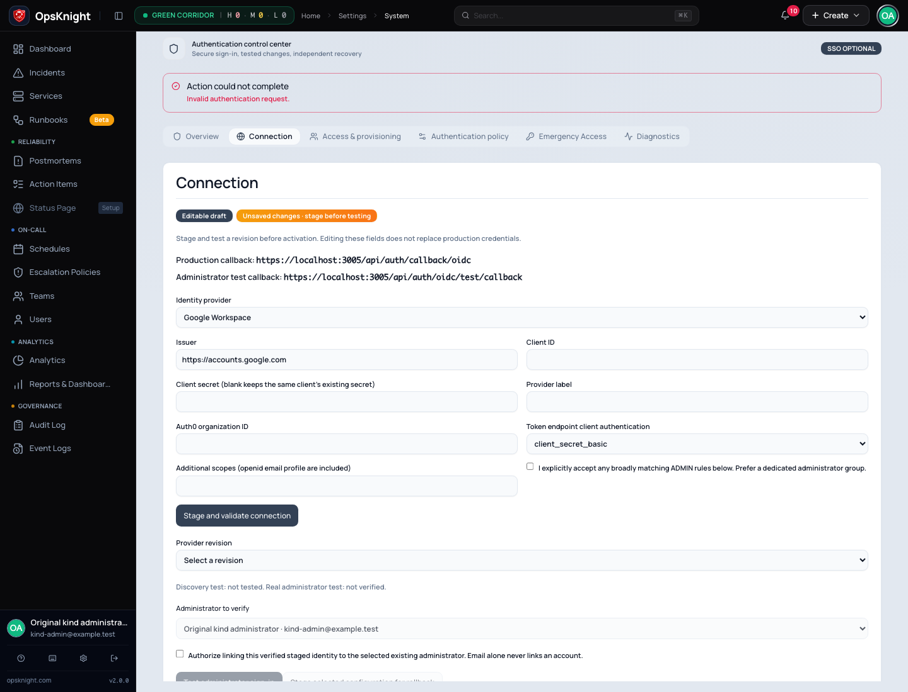
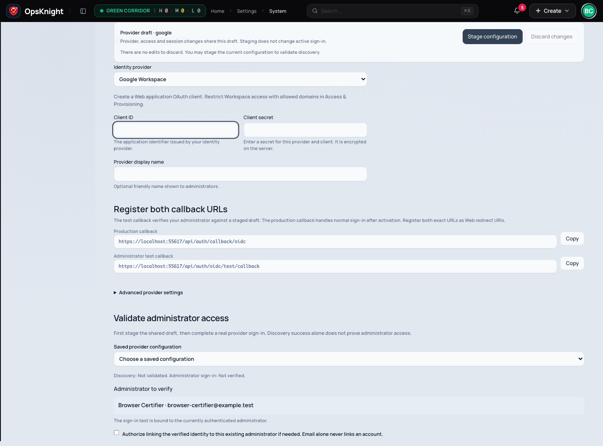
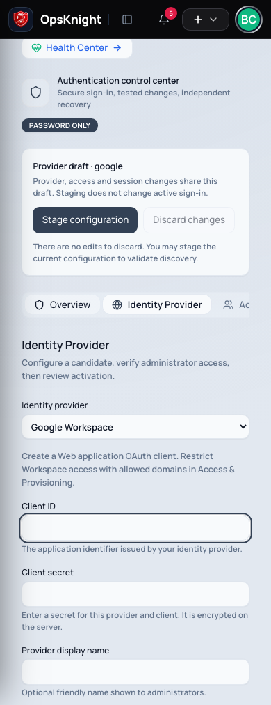
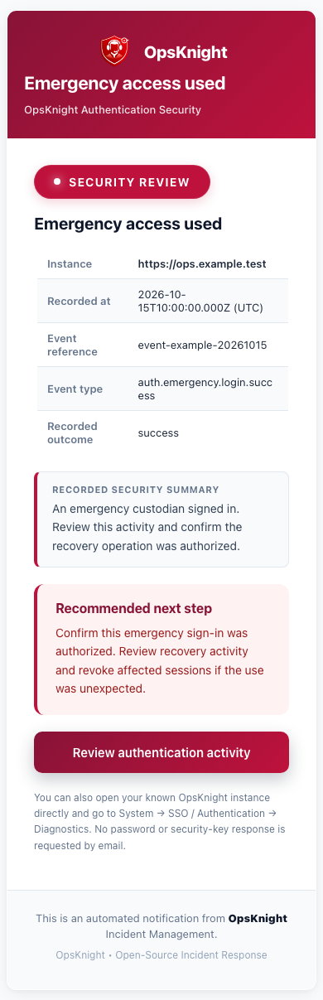
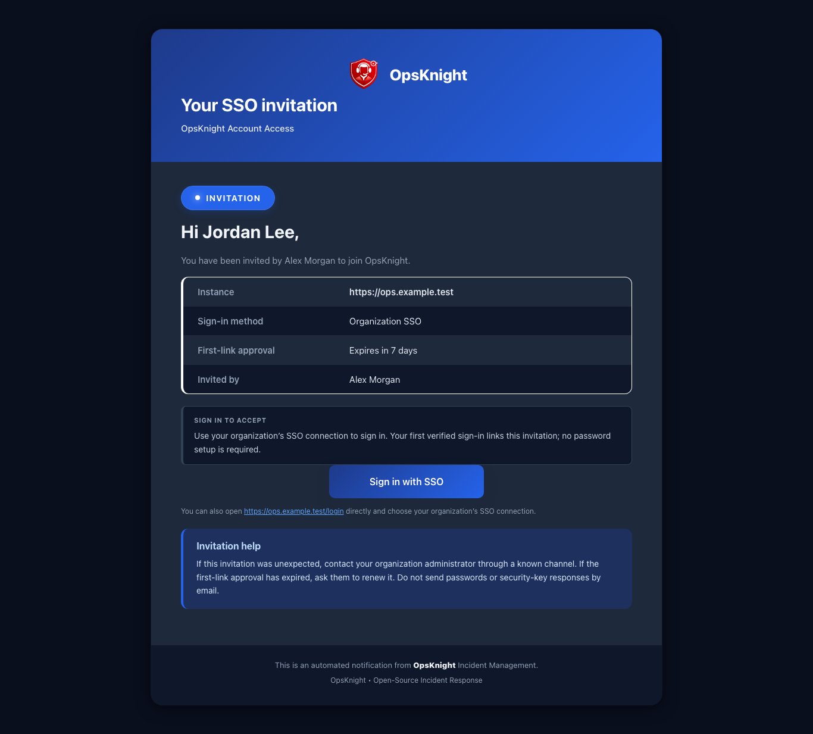

# Rehearse SSO upgrades and local failures

Use disposable fixtures and a restored copy of the actual deployment before
production acceptance. The local evidence below covers application/schema
boundaries; real provider tenants, physically independent keys and custody remain
separate acceptance requirements. Read [Upgrade existing SSO](./upgrade-existing-sso/)
for the maintenance window, controller suspension and rollback boundaries.

## Prerequisites

- Access to a local or staging PostgreSQL instance capable of creating disposable test databases.
- Node.js runtime (v20+ or matching production container baseline).
- Disposable database name `enterprise_sso_upgrade_test` with matching permissions.

## Released-version migration and concurrent callbacks

The upgrade harness now defaults to the exact **v2.0.0** commit
`097f4916a38ddcc6d1512f71b72bde36abbeb171`. Create a fresh disposable database named
`enterprise_sso_upgrade_test`, set `DATABASE_URL` and `DIRECT_URL` to it, then run:

```bash
node scripts/certify-sso-upgrade.cjs
```

It refuses an already-upgraded database and never drops or resets one. Existing
users, provider ciphertext, links, approvals, teams, incidents and an encrypted
OIDC session are seeded before applying branch migrations. The tests cover Optional
and Required import, break-glass compatibility, Entra without email_verified,
replica cache convergence, historical configuration, linked-identity registration
checks, and rotation between resolution and role/profile synchronization. A further
case deactivates the user and advances its security version in that interval;
claim synchronization must leave the deactivated user unchanged.

The registration locks apply to already-linked identities too. Claim writes hold
the policy/provider locks until commit, check the user's captured security version,
and retain the last-administrator invariant. A rejected callback returns a fresh
sign-in message; it does not persist the obsolete role or profile claims.

## Bounded read and HTTP probes

For the database probe, use a fresh upgrade fixture, a five-connection pool and a
unique application name. Add `application_name=sso-auth-certification` and
`connection_limit=5` to its database URL, then run:

```bash
DATABASE_POOL_SIZE_INTEGRATED=5 SSO_CERT_AUTH_LOAD=1 node scripts/certify-sso-upgrade.cjs
```

The probe executes 1,600 operations across policy/provider and protected-session
profiles at concurrency 1, 10, 25 and 50. It records latency distributions, CPU time,
errors and observed PostgreSQL connections in the versioned certification JSON.
Provider metadata is injected in this probe; it does not measure external OAuth,
bcrypt sign-in, HTTP or production capacity. Image transfer or other host activity
can affect local tail latency. Compare controlled runs with equivalent resources.

For an actual local HTTPS deployment, record a private Playwright storage state
from a fixture user's successful login. Keep it outside the repository with mode
0600 and run:

```bash
SSO_CERT_BASE_URL=https://localhost:3005 \
SSO_CERT_SESSION_STATE=/private/path/fixture-storage-state.json \
SSO_CERT_EXPECTED_USER_ID=fixture-user-id \
node scripts/certify-authentication-http.cjs
```

This tool permits only localhost HTTPS. It records the first request separately,
warms up with 100 requests at each concurrency level, then measures three rounds
of 500 requests at concurrency 1, 10, 25 and 50 (6,000 measured requests). It verifies the same User ID on every response and never
prints cookies or authentication headers. Its self-signed-certificate exception is
restricted to that local fixture. Results are written to
`plans/certification/enterprise-sso-2.1-http-steady-state.json`. Latencies include
Playwright client IPC and JSON validation; responses are disposed after every
request. Compare repeated rounds, median and tail latency with equivalent server
and client resources. The historical 300-request run used a TLS proxy, nginx and a
Kubernetes NodePort/Service with two ready application replicas; a port-forward
transport was not used for the final browser/load measurements.

## Signed provider, recovery-abuse and alert-fan-out checks

Create a disposable `enterprise_sso_test` database and point `DATABASE_URL` and
`DIRECT_URL` at it. Configure an isolated test `NEXTAUTH_SECRET`, then run:

```bash
npx prisma migrate deploy
npx vitest run -c vitest.int.config.ts --no-file-parallelism tests/integration/authentication-policy-database.test.ts tests/integration/emergency-authentication-database.test.ts tests/integration/oidc-staged-authentication-database.test.ts
```

The local HTTPS issuer signs actual RS256 ID tokens and exercises code exchange,
PKCE, nonce, JWKS and identity ownership. Entra-style tokens omit email and/or
email_verified: an existing issuer/subject link succeeds, while a new link still
requires explicit approval and matching email ownership. Removing a tested existing
link before activation cannot silently recreate it. Claims preview follows the same
ownership rules. Provider metadata uses a local fixture, not a live Entra tenant.

The WebAuthn suite uses real local signatures and PostgreSQL rate limits. It injects
400 unknown-account attempts from 40 clients and 40 foreign-browser verifications,
then completes a legitimate ceremony despite a saturated new-ceremony account
budget. It also verifies a reserved authenticated reauthentication path. A second
case creates 1,200 additional administrators, checks that the security-operation
transaction creates only 100 recipient alerts, and drains the remainder using two
concurrent workers without duplicates. Results are recorded in
`plans/certification/enterprise-sso-2.1-resilience.json`.

Further regressions exercise 3,000 already-throttled requests with exact shared
counts and at most three event/audit samples per category/window. The fan-out crash
test terminates the worker's actual PostgreSQL connection after alert inserts and
cursor advancement but before commit, verifies rollback, then drains the backlog
with two workers. It also changes administrator membership between batches.

The delivery-backlog fixture simulates 30-day-old intents with 100 prior attempts,
a stale worker lease, a removed administrator and an unavailable queue. Queue
acceptance alone must not mark delivery; after a simulated database delivery
acknowledgment, 240 retained intents drain. Transport is stubbed: this tests durable
application recovery and recipient checks, not SMTP/vendor delivery. A real provider
outage, exhausted central notification retries and operator requeue must still be
rehearsed with the configured delivery integration before release acceptance.

The **Enterprise SSO certification** GitHub workflow runs these suites and the exact
published-release upgrade on isolated PostgreSQL services, including a bounded
read-load artifact. This complements the deployment and ordinary unit workflows.

## Actual Kind and Helm cutover evidence

The recorded `c59a20c` rehearsal used a dedicated Kind cluster (Kubernetes v1.37.0), one node,
its own PostgreSQL StatefulSet and a local fixture namespace:

1. Extract the Helm chart from the exact v2.0.0 tag. Install its published image with
   a pre-created fixture Secret, a disposable database, zero application replicas
   and the one-shot migration owner. Confirm the image revision label matches the
   tagged commit. Seed the existing administrator/provider/identity/team, then start
   two application replicas. Sign in normally and retain private browser state.
2. Take a database dump after that login. The published release fixture had **177**
   migration records. Keep encryption keys and the NextAuth secret stable.
3. Attempt the current-chart upgrade with a tested image while those replicas are
   live. The authentication cutover Job must fail before migration; confirm the
   old Deployment still has two ready replicas and the original database still
   has 177 migration records.
4. Stop all application Deployments and wait for complete pod deletion. Inject an
   unreachable migration database endpoint in the disposable fixture Secret.
   The cutover gate succeeds, the migration Job fails, and application replicas
   remain zero. Confirm the original database has not advanced.
5. Restore the correct Secret and retry with the tested new image. The migration
   owner advanced that tested source to **198** migration records (subsequent additive
   migrations increase this count); two new
   application replicas become ready. Verify the original administrator, unchanged
   provider ciphertext and the browser session created by the old application.
6. Run Chromium/Firefox/WebKit console, keyboard, desktop/mobile and validation
   checks through the Service. Chromium additionally enrolls a virtual authenticator
   and signs into recovery in a separate context with secure production cookies.
   These are protocol/browser checks, not proof of physical hardware independence.
7. Delete the disposable PostgreSQL pod by scaling its StatefulSet to zero.
   Protected access must be unavailable while the database is absent. Restore it
   and verify the original session recovers without an automatic policy downgrade.
8. Restore the pre-upgrade dump into a separate rollback database. Deploy the
   **published old image and old chart against that restored database**, retaining
   its encryption/JWT keys. Confirm 177 migrations, no AuthenticationPolicy table,
   the original administrator and its session. Never run the old image against the
   upgraded database as a rollback experiment.

The new certification image packaged the optimized application bundle with Linux
production dependencies and a freshly generated Linux Prisma client. Its image ID
and application source hashes are recorded in the result JSON. This rehearsal does
not certify the release image's full supply-chain provenance, multiple-node HA,
split worker load, customer ingress, live IdP sign-in or outbound email providers.
Repeat those acceptance cases in the target topology before release approval.

## A verified staging failure

Clear a required Client ID in a saved provider draft, then attempt to stage it. The
console shows an error; production remains unchanged and the unsaved draft cannot
be tested or activated. This screenshot was captured on the upgraded Linux/Kind
application after the server rejected that request:



Correct the draft, save and validate it, then complete real administrator sign-in
and independent recovery drills before activating a revision. A local error screen
or a virtual-key success does not replace those live acceptance steps.

## Terminal delivery and sustained admission tests

Staged verification, claims preview and production login use the same boolean-claim
normalizer. Explicitly unverified email rejects even an existing issuer/subject
binding. Missing email and missing verification claims still follow the existing
provider/link ownership rules; absence is not an explicit rejection.

Removed or inactive administrators' email intents receive a terminal cancellation
timestamp. Restoring administrator access does not restart those old intents.
The diagnostics page separates fan-out jobs, materialized pending emails, failed, completed and cancelled deliveries. The scheduled cleanup
retains delivered, cancelled and failed metadata for 90 days from the terminal timestamp,
then removes up to 1,000 of each per pass. Pending delivery and fan-out work, security
events, audit rows and in-app alerts are unaffected by this cleanup. Existing
notification/audit retention policies remain separate. Cancellation cannot recall
mail already handed to a provider.

The PostgreSQL abuse test runs at concurrency 30 for at least 30 seconds and at
least 3,000 rejections. Its artifact records actual request count, duration and
bounded audit samples. This measures local counter contention, not distributed
production capacity.

Run `python3 scripts/certify-sso-edge.py` with Docker to test the optional
`deploy/nginx/emergency-rate-limit.conf` example against an isolated fixture
upstream. It verifies early 429 rejection, ordinary login isolation and admission
after refill; `plans/certification/enterprise-sso-2.1-edge.json` records results.
No real authentication or database requests occur in that edge fixture.

## Connection-termination evidence correction

The original fan-out crash fixture incorrectly allowed any transaction error to
satisfy its expectation. PostgreSQL could reject `pg_terminate_backend(bigint)`
before a connection was terminated. Reports produced through `adeda2ccc` therefore
must not be used as evidence of real connection termination.

The corrected fixture casts the PID to `integer`, requires the termination call
to return true, forces another operation on that transaction, and independently
requires the PID to be absent from `pg_stat_activity`. It then checks rollback of
both alert rows and cursor, concurrent recovery, and recipient changes. A SQL
type error or a false termination result now fails certification. Refreshed reports
include `backendAbsentFromActivity` alongside the termination acknowledgment.

## Failed security email recovery

Diagnostics distinguishes pending emails from terminal failures. Exhausted `FAILED`
notifications, failed notifications with expired/missing payloads, and `SKIPPED`
notifications stop the authentication worker's automatic polling. A retryable
`FAILED` notification remains pending while the central queue has attempts and a
live payload. `UNKNOWN` outcomes remain with central reconciliation; they are not
automatically resent. Inspect Notification History for provider-specific details.

After correcting the provider, open **System → SSO / Authentication → Diagnostics**.
The delivery history loads 25 records per page and supports status filtering. Choose **Retry email**
and confirm the new attempt. Fresh administrator or independent recovery authority
is required. The operation checks recipient eligibility, rejects stale/concurrent
requests and commits a mandatory audit event. It rebuilds a new payload from the
retained security intent under a new idempotency key, so an expired old payload
does not block recovery. Repeated clicks cannot create multiple retry generations.
An explicit retry may duplicate a message whose earlier delivery was uncertain.
Cancelled recipients cannot be retried. Failed metadata joins delivered/cancelled
metadata in the bounded 90-day retention policy; export delivery metadata before
that window if needed. Security audit and in-app evidence retain their own policies.

Local tests cover terminal failure reconciliation, retryable/unknown state
preservation, fresh-authority enforcement, concurrent retry rejection, new delivery
keys, real central enqueue with rebuilt encrypted payloads and deduplication,
simulated delivery acknowledgment, and the confirmation UI. They do not claim
real SMTP/vendor acceptance; those checks remain external acceptance work.

## Authorization at queued email dispatch

Authentication-security email is checked both when enqueued and immediately before
calling each provider, including fallback providers. A recipient must still be an
active administrator and the queued address must match the user's current email.
Demotion, deactivation, deletion or an address change suppresses queued delivery as
`SKIPPED`; the authentication intent subsequently records terminal failure for
explicit review. Unavailable authorization reads defer delivery without sending.
Mail already accepted by a provider cannot be recalled.

Diagnostics reports **Fan-out work pending**, **Emails awaiting acceptance** and
**Awaiting delivery confirmation** separately. A fan-out job may represent many
recipients. Historical delivered and cancelled totals are not queried for the summary.
**Security notifications** supports all five delivery states, with 25, 50 or 100
records per page and bounded **Previous / Next** navigation. Retry confirmation stays
open after a server rejection and explains the failure inside the dialog. A successful
retry refreshes the affected page while retaining other diagnostic views. Retention
remains 90 days for terminal delivery metadata; audit/in-app evidence follows its
separate policy.

## Identity recognition and administrator readiness

Claims preview reports stable issuer/subject identity recognition separately from
administrator verification readiness. A recognized identity with group overage is
shown as **Identity recognized** with **Administrator verification blocked by
incomplete group claims**. It cannot satisfy the staged administrator test until
those claims are resolved. Sample claims remain a preview; a real signed-token
administrator test is required before activation. Editing claims or provider rules
invalidates the displayed preview.

## Submission and delivery receipts

**Sent to provider** records transport acceptance. **Delivery confirmed** requires
a delivery receipt or a central notification already confirmed as delivered.
Providers without final-delivery feedback remain **Sent to provider**; acceptance
is never presented as recipient delivery. Pending, accepted, confirmed, failed and
cancelled history filters report distinct states. A terminal bounce, complaint,
suppression or invalid-recipient receipt moves the accepted message to failed.

Receipt processing is serialized with linking the alert to its current transport
notification, so an early receipt is retained. Retrying clears that link and creates
a new generation; a late receipt for the old attempt cannot confirm the replacement.
Older completion timestamps are migrated conservatively into provider-acceptance
metadata because the old field did not distinguish acceptance from delivery.
Review the original provider evidence separately when auditing historical delivery.
Accepted messages without confirmation and other terminal delivery metadata use
bounded 90-day retention; security audit and in-app evidence remain independent.

### Receipts before provider acceptance persistence

Provider feedback is stored durably before reconciliation. A callback arriving before the
send result's message ID is persisted remains pending. The central dispatcher replays
pending receipts after persisting that result; queue processing also reconciles up to
100 due events per pass. Unmatched events yield for one minute, so an unknown message
cannot monopolize the batch. Concurrent replay locks each event and notification;
endpoint counters apply once per provider event ID. Terminal authentication delivery
failures cannot be reversed by a later delivery receipt.

Correlation requires both the message ID and the sending provider. Existing records use
recorded delivery-attempt evidence; unknown provider identity is never inferred from a
callback. New send results persist provider identity even if attempt-ledger persistence
fails. Existing feedback that may already have changed endpoint counters is preserved
as processed during migration. A follow-up migration repairs idempotent authentication
transport states for historical receipts with recorded provider evidence, without
repeating endpoint counters. Previously unmatched messages without a notification
remain eligible for reconciliation. Historical records without provider evidence require
operator investigation and are not automatically confirmed.

The HMAC endpoint accepts at most 64 KiB of raw request bytes, including streamed bodies
without a Content-Length header, and requires a bounded SHA-256 signature header.
Oversized bodies receive HTTP 413 before signature hashing or event ingestion.
These local ordering checks do not replace acceptance against a real provider's callback
adapter, physical WebAuthn keys, live identity tenants, or production HA deployments.

### Receipt replay failure isolation and quarantine

Core notification dispatch runs before background receipt maintenance. Successful
provider submission and fan-out accounting are persisted before immediate replay;
a replay or receipt-selection failure cannot turn that submission into a failed send.
Each receipt reconciles in its own bounded transaction. A failed transaction rolls
back its notification, alert, endpoint and subscription changes together. Retry state
is then persisted independently; failure to persist that state leaves the original
receipt durable for a later worker pass. Database unavailability still affects core
dispatch itself; this isolation does not claim that notifications work without PostgreSQL.

Replay selects at most 100 due events and stops starting new events after a two-second
processing budget. Transactions use a one-second timeout and a 500 ms acquisition
limit, with PostgreSQL statement and lock timeouts of 750 ms and 250 ms; a transaction already started, retry-state persistence and batch selection can
extend the overall maintenance duration. Maintenance runs after queued delivery, and
its errors are logged separately from delivery success. Integrated schedulers poll at
least every two minutes when otherwise idle; dedicated notification workers retain
their configured idle polling interval.

Missing subscription records and invalid stored event types enter terminal quarantine.
Unmatched provider/message pairs and transient reconciliation errors use exponential
backoff capped at one hour. The worker attempts provider-matched reconciliation before considering receipt age or
search exhaustion. Only an unmatched provider/message pair is quarantined after twelve
attempts or 24 hours of age at reconciliation. A valid matched receipt can complete
after a 48-hour worker outage or more than twelve infrastructure failures. Infrastructure
errors remain retryable with backoff capped at one hour; they do not permanently
quarantine recoverable receipts. Invalid event types and deleted recipients remain terminal.
An additive upgrade repair releases legacy infrastructure quarantines and matched
receipts incorrectly quarantined by the previous age rule. Quarantined events retain their
provider/event IDs, occurrence time, attempt count and classification for investigation;
they are excluded from automatic replay. Processed and quarantined evidence is retained
for 90 days and cleaned in indexed batches of at most 100 records per terminal state.
Unprocessed active receipts are never removed by that cleanup.

Operators can inspect pending and quarantined receipts directly through the
`NotificationProviderFeedback` table using `processedAt`, `quarantinedAt`,
`reconciliationAttempts`, `nextReconcileAt` and `reconciliationReason`. Reasons include
`RECIPIENT_DELETED`, `INVALID_EVENT_TYPE`, `UNMATCHED_PROVIDER_MESSAGE`,
`RECONCILIATION_ERROR` and `RECONCILIATION_EXHAUSTED`. Investigate provider mapping,
message persistence and target deletion before manually changing quarantine state.
Event deduplication is guaranteed while its evidence remains within the retention window;
provider adapters should not replay receipts beyond that window.

The local regression executes a PostgreSQL trigger that rejects receipt processing,
checks that accepted mail and fan-out counts remain successful, then verifies that a
later valid receipt in the same batch completes. A second injected failure rejects
retry-state persistence too; the durably ingested event completes after storage recovers.
Deleted-subscriber soft bounces are quarantined while real queued critical notifications
drain. These checks use mocked provider sends/admission with real PostgreSQL queue
claims, transactions, receipt updates and fan-out counters.

The authenticated `/api/metrics` endpoint exposes the cluster snapshot gauges
`opsknight_provider_feedback_pending`, `opsknight_provider_feedback_retried` and
`opsknight_provider_feedback_quarantined`. Retried is a subset of pending. These have
no provider, event-ID or recipient labels. Their database collection uses the existing
cached, bounded metrics collector; collection failures omit the receipt gauges and
increment the metrics collection-error signal rather than reporting false zeroes.
Alert on sustained retry backlog or new quarantined records and investigate the stored
classification. The upgrade regression applies quarantine repair twice and verifies
that delivery and bounce receipts from a 48-hour outage update transport and linked-alert
state using their original occurrence timestamps.

### Selectable password or hardware emergency identities

The password integration suite exercises generated salted hashes, account separation,
generic failures, two independent drills, SSO Required password-login denial for ordinary
users, recovery-only login during that policy, absolute/idle session limits, separate
reauthentication admission, compromise rotation/degradation, method changes, competing
rotations and verification racing with rotation or disablement. A readiness fixture
combines password evidence with hardware evidence; signed WebAuthn verification remains
covered by the existing independent-hardware suite.

Receipt certification includes quarantined unmatched events becoming provider-matched
only after a notification is committed. Only `UNMATCHED_PROVIDER_MESSAGE` quarantine is
eligible for that bounded, provider-checked reopening; deleted-recipient and invalid-type
quarantines remain terminal. A 100,000-row PostgreSQL backlog benchmark captures
`EXPLAIN (ANALYZE, BUFFERS)` and concurrent critical-mail dispatch in
`plans/certification/enterprise-sso-2.1-receipt-metrics.json`. Exact receipt counts now run
with PostgreSQL statement/lock deadlines (500/100 ms), a 250 ms transaction acquisition
limit and the existing metrics cache. The JS scrape timeout is not the only work bound.
Do not generalize local timings to production capacity without deployment-specific load tests.

Run the production-browser certification with Docker, OpenSSL, Node 22 and the
repository dependencies installed:

```sh
npx playwright install --with-deps chromium firefox webkit
python3 scripts/certify-enterprise-authentication-browser.py --build
```

The harness creates a disposable PostgreSQL database, applies all migrations, builds
for its own HTTPS origin, runs the production server and removes its processes and
container afterward. A fresh build is mandatory because the public origin is embedded
in the browser bundle. It does not use your application database or contact live
identity/email providers. `SSO_CERT_CAPTURE_DIR` optionally retains screenshots after
the generated secret has been dismissed. These flags configure certification only.

The recorded local run passed seven browser checks with two intentional hardware
skips (virtual WebAuthn is Chromium-only). Password recovery and console responsiveness
passed in Chromium, Firefox and WebKit, including cookie restriction, one-time display,
rotation revocation and preservation of the original HTTP expiry during reauthentication.
Chromium also recovered after restarting the owned PostgreSQL fixture. The secret-free
report is `plans/certification/enterprise-sso-2.1-password-browser.json`.
Live IdP tenants, physical keys, real mail providers and production HA acceptance remain
pending; this local evidence does not certify those external environments.

### Password admission under distributed probes

The password integration suite now enables the real PostgreSQL admission counters
and overlaps 100 unknown-account password attempts from distinct source addresses
with four successful custodian logins and four current-session reauthentications.
The secret-free outcome is recorded in
`plans/certification/enterprise-sso-2.1-password-admission.json`. Unit tests hold real
scrypt work in the unknown lane while login and reauthentication succeed, and check
that one targeted known identity cannot allocate both login slots. Excess hash work
is rejected without an application queue; lane counters release on completion.
The NGINX fixture verifies excess ingress requests are rejected before upstream work,
ordinary login is unaffected and admission resumes after refill. These isolated tests
do not certify resistance to network/database saturation or coordinated targeting of
all known custodian identifiers. Preserve the independently protected ingress path.

## Authentication workspace certification

The authentication workspace uses six focused sections: Overview, Identity Provider,
Access & provisioning, Sessions & Policies, Emergency Recovery, and Diagnostics.
`?section=sso&authTab=connection` opens provider settings without replacing the outer
settings section. Diagnostics adds `authView=sessions|deliveries|audit|replicas`.

Provider, access and session settings share one in-memory draft. Use **Stage
configuration** from any editing section; staging validates discovery without changing
active sign-in. Complete **Test administrator sign-in**, then **Preview enforcement
impact** and **Activate verified SSO**. A saved configuration selection replaces the
whole draft after confirmation. A concurrent active-provider update requires reloading
and reviewing the active configuration. Draft secrets are never saved in browser storage.

Provider switching clears client credentials, issuer, provider-specific organization,
scopes and claim rules after confirmation. Microsoft Entra accepts a Directory tenant
ID and derives the public-cloud issuer; advanced editing supports an exact issuer.
Auth0 organization settings appear only for Auth0. A blank secret retains the saved
secret only for the matching issuer and client. Session limits offer inherited defaults,
presets and custom units; the effective active policy remains visible separately from
pending changes. These limits do not change the IdP's tenant policy.

Diagnostics performs filtering in PostgreSQL before selecting a page. Each view retains
its own filters, page size and navigation position while switching views. Previous/Next
uses signed cursors tied to the actor, policy version and filters, with a one-hour
snapshot lifetime. At most 100 previous boundaries are kept in browser memory. Start
with **First page** after a cursor expires or to see newly changed sessions; mutable
records can leave an older snapshot. Search matches prefixes, rather than arbitrary
substrings. Page sizes are 25, 50 or 100. No exact lifetime count is needed.

Session details never include session tokens or JTI values. Audit details explicitly
identify `EmergencyAccessEvent` as their source and show only allowlisted context;
this is not a complete history of ordinary sign-ins. Delivery timelines show only
persisted stages. Provider acceptance does not mean delivery confirmation. Retrying a
failed security email requires acknowledgment of possible duplicate delivery and a
current generation check. Replica observations separate recent reports from retained
history; operators must reconcile deployment settings and restart affected replicas.

Recovery identities use a compact list and account detail dialog. Enrollment, rotation,
credential switching, disablement and key revocation each use a focused confirmation.
Compromise acknowledgment applies only to that action. Routine rotation with exactly
two verified identities under Required mode needs a third verified replacement first.
Generated passwords require explicit independent-vault storage acknowledgment before
closing; they cannot be retrieved again. Changing your own credential revokes the old
session, so store the new password before signing in again for a drill.

Run component/API regressions, `authentication-diagnostics-database.test.ts` against an
isolated `enterprise_sso_test` database, published-release upgrade certification, and
`python3 scripts/certify-enterprise-authentication-browser.py --build` before release.
The diagnostic fixture exercises 0, 1, 24, 25, 26, 50, 100, 10,000 and 100,000 records,
tied timestamps, method filtering before limits, cursor context changes and mutable
session state. Production browser certification uses a disposable HTTPS origin and
virtual hardware authenticator. Live IdP tenants, physical keys and multi-node failure
drills remain deployment acceptance checks.

### Verified workspace views

These captures use the disposable local certification administrator. Callback URLs
are examples from that fixture. No generated recovery password is shown.





When Docker is unavailable, certification can use a separately installed PostgreSQL
bin directory with `--postgres-bin /path/to/postgresql/bin`. The harness creates and
removes its own cluster, database, HTTPS origin and application processes. This adds
no application dependency or authentication environment switch.

### Online diagnostic deployment

Use `npm run prisma:migrate:safe`, the Docker entrypoint, or the Helm migration Job.
All three run `scripts/prepare-authentication-diagnostics.cjs` after schema migration.
For custom deployments, run that script explicitly with a direct PostgreSQL connection
(`DIRECT_DATABASE_URL` takes precedence over `DATABASE_URL`; transaction pooling is
not supported by this session-scoped installer).

The schema change adds a nullable projection without rewriting historical rows.
The installer builds indexes concurrently, repairs invalid interrupted index builds,
and verifies index validity. It then projects historical session metadata in transactions
of at most 250 rows, with a 250 ms lock timeout, two-second statement timeout,
`SKIP LOCKED`, and a pause between batches. Already projected rows are not rewritten.
Original session metadata and activity timestamps remain unchanged. An explicit
`sessionDiagnosticProjectedAt` marker records completion even when historical metadata
legitimately contains no policy version or expiry. New session registrations populate
this marker immediately. Up to ten reconciliation passes revisit skipped locks, with
500 ms pauses and a 15-minute backfill deadline. Persistent contention makes preparation
fail; it never reports success while historical work remains.

Migration-skipping replicas wait for all diagnostic indexes to be valid and for the
indexed pending-projection check to be empty. Session Diagnostics also rejects reads
while projection is incomplete, rather than classifying unfinished historical rows.
Authentication continues to validate original session metadata independently. Retry a
failed preparation after contention subsides; completed rows are not rewritten.

This migration is being revised before its first published release. Recreate only owned
disposable preview/test databases that applied the earlier PR migration. Never reset a
shared database or edit migration bookkeeping to hide a checksum difference. Existing
preview installations already containing the projection can run the online installer
without reapplying the column addition.

The database certification now records online build/backfill duration, WAL generated,
concurrent session authorization plus durable security-event latency, and sampled
exclusive locks in `plans/certification/authentication-experience-online-deployment.json`.
These are local fixture measurements, not production capacity guarantees.

Session diagnostics intentionally uses live pagination: ordinary session use, renewal
or revocation can remove a row from later pages. Signed cursors bound ordering and
filters; they do not freeze mutable records. Use First page for current activity.
The audit view is immutable recorded emergency security-event evidence, not a complete
ordinary-provider sign-in history.

### Authentication security email presentation

SSO, emergency-access and authentication-policy alerts use the incident email design
system: responsive branded headers, semantic status badges, a recorded-event details
card, a framed summary and a direct action to the authentication audit view. Emergency
access use and degraded recovery coverage remain prominent security warnings even when
the underlying operation succeeded. Other events distinguish verification, configuration
changes, rejected attempts and credential changes. Plain-text messages carry the same
recorded evidence and next steps. SSO invitations use the same components and explain
verified first sign-in, approval expiry and renewal without offering password setup.

Only event type, outcome and recorded timestamp are selected for presentation, in one
bounded metadata query per delivery batch. Raw event context, claims, keys and passwords
are never included. Links use the configured authoritative authentication origin;
retained alerts without event metadata show a generic security notification rather
than inventing an outcome. Existing delivery leases, retry generations and recipient
authority checks remain in place. Subject lines now use readable event-specific titles
prefixed with `[OpsKnight]`.

Local synthetic mobile/light and desktop/dark previews:





Local Chromium rendering checks layout and dark-mode styling. Actual Outlook, Gmail
and other mail-client rendering still depends on each client's HTML/CSS support.

Self-session revocation returns an explicit backend disposition. The authentication
workspace skips protected summary and diagnostics refreshes, redirects to login, and
displays a successful revocation notice. Revoking another session retains the ordinary
refresh path. Browser certification covers both across Chromium, Firefox and WebKit.

Production builds bundle the same Manrope and Playfair Display Latin variable fonts
under `src/app/fonts`, including their SIL Open Font License notices. Certification
no longer depends on a Google font download succeeding during the build.
