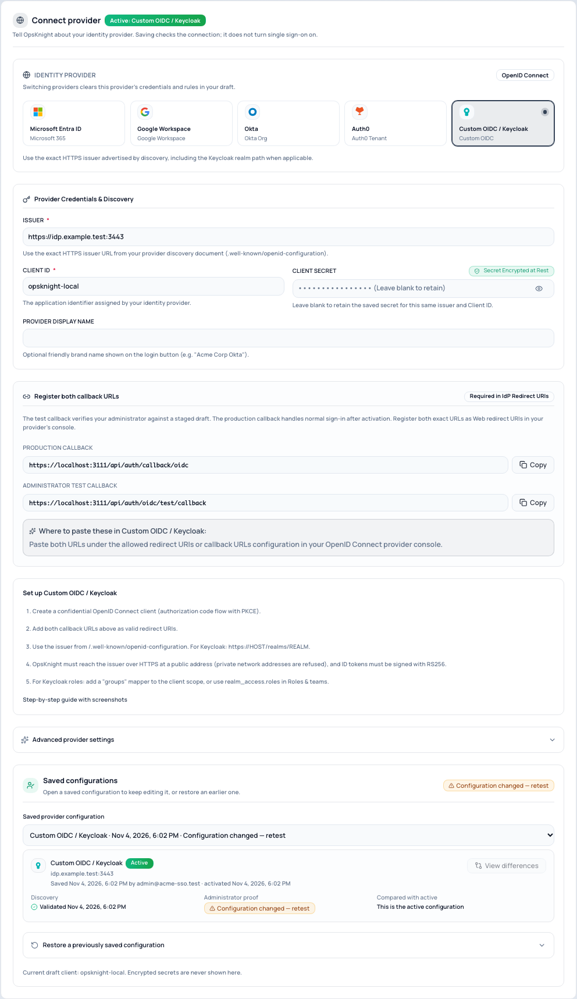

# Configure single sign-on

This guide takes you from nothing to working single sign-on. It usually takes 15–30 minutes,
most of it in your identity provider's console. Nothing changes for your team until the very
last step.

## Before you begin

You need:

- an OpsKnight administrator account whose email is your real work email (the one your
  identity provider uses);
- OpsKnight reachable at a public **HTTPS** address, with `NEXTAUTH_URL`,
  `NEXT_PUBLIC_APP_URL` and **App URL** (Settings → System) all set to that same address;
- permission in your identity provider to create an application and a client secret.

If the console shows **"Single sign-on settings need OpsKnight to run at an HTTPS address"** or
**"OpsKnight is configured with more than one address"**, fix those settings first and reload.

> Changing security settings needs a sign-in from the last two hours. The console warns you
> 30 minutes before that window closes, with a **Sign in again** link that brings you back.

## Step 1 · Connect provider

Open **Settings → System → SSO / Authentication → 1 · Connect provider** and pick your
provider. Each provider shows its own checklist next to the fields.

Copy both callback URLs into your provider as allowed redirect URIs:

| Callback | Used for |
| --- | --- |
| `https://<your-opsknight>/api/auth/callback/oidc` | Everyone's normal sign-in |
| `https://<your-opsknight>/api/auth/oidc/test/callback` | Your test sign-in before you turn SSO on |

Register them exactly: scheme, host, port and path all matter. Then fill in the fields for your
provider and select **Save changes**. Saving checks that OpsKnight can reach your provider and
that its discovery document is valid. It does not turn anything on.

### Microsoft Entra ID

1. Entra admin center → **App registrations → New registration**. Account type: *accounts in
   this organizational directory only*.
2. **Authentication → Add a platform → Web** → paste both callback URLs.
3. **Certificates & secrets → New client secret** → copy the **Value** (not the Secret ID).
4. **Token configuration → Add optional claim → ID** → add `email`. To let existing accounts
   connect automatically, also add `xms_edov` (see
   [linking existing accounts](./link-existing-accounts/)).
5. In OpsKnight, enter the **Directory (tenant) ID**, **Application (client) ID** and secret.

OpsKnight builds the issuer `https://login.microsoftonline.com/<tenant-id>/v2.0` for you and
refuses the shared `common`, `organizations` and `consumers` authorities. For US Government or
China clouds, open **Advanced provider settings** and edit the exact issuer
(`login.microsoftonline.us` or `login.partner.microsoftonline.cn`).

For roles, prefer **App roles** (the `roles` claim): create roles such as `OpsKnight.Admin`,
assign groups to them in **Enterprise applications → Users and groups**, and map `roles` in
[Roles & teams](./map-roles-and-teams/). The `groups` claim stops working for people in more
than 200 groups.

### Google Workspace

1. Google Cloud Console → **APIs & Services → OAuth consent screen** → *Internal*.
2. **Credentials → Create credentials → OAuth client ID → Web application** → paste both
   callback URLs under **Authorized redirect URIs**.
3. In OpsKnight, enter the client ID and secret. The issuer is set for you.
4. In **2 · Who can sign in**, add your Workspace domain. OpsKnight checks it against Google's
   signed `hd` claim, so only accounts in your Workspace can sign in.

Google does not include groups in the ID token. Manage roles by hand or with
[SCIM](./configure-scim/).

### Okta

1. Okta Admin Console → **Applications → Create App Integration → OIDC → Web Application**.
2. **Sign-in redirect URIs** → paste both callback URLs. Assign the people or groups who should
   use OpsKnight.
3. **Security → API → Authorization Servers → default** → copy the **Issuer URI** (it ends in
   `/oauth2/default`) into OpsKnight, with the client ID and secret.
4. For roles: in that authorization server add a `groups` claim (ID token, filter *Matches
   regex* `.*`, or a narrower filter) and add `groups` to **Additional scopes** in OpsKnight.

### Auth0

1. Auth0 Dashboard → **Applications → Create Application → Regular Web Application**.
2. **Allowed Callback URLs** → both callback URLs, separated by a comma.
3. Use your tenant domain as the issuer (`https://YOUR_TENANT.auth0.com/`).
4. To restrict sign-in to one Auth0 Organization, enter its ID under **Advanced provider
   settings**.
5. For roles, add a post-login Action that sets a namespaced claim such as
   `https://opsknight/roles` and use that claim in Roles & teams.

### Keycloak and other providers

1. Create a confidential OpenID Connect client using the authorization code flow with PKCE.
2. Add both callback URLs as valid redirect URIs.
3. Use the issuer from `/.well-known/openid-configuration`, for Keycloak
   `https://HOST/realms/REALM`.
4. For roles, either add a `groups` mapper to the client scope, or map
   `realm_access.roles` in Roles & teams.

OpsKnight must reach the issuer at a public HTTPS address (private network addresses are
refused to prevent server-side request forgery), and ID tokens must be signed with **RS256**.

## Step 2 · Who can sign in

See [link existing accounts](./link-existing-accounts/). In short:

- **Create an account on first sign-in** gives new people an account automatically. Leave it
  off to allow only people you invite.
- **Allowed email domains** limits sign-in to your company domains (how it is checked depends on
  the provider; the console explains it for yours).
- People who already have an OpsKnight account connect on their first SSO sign-in once you
  approve them, in bulk or one at a time, or automatically for verified company emails.

## Step 3 · Roles & teams (optional)

See [map groups to roles and teams](./map-roles-and-teams/).

## Step 4 · Test & activate

See [test and turn on single sign-on](./test-and-enforce-sso/). You sign in once yourself
through the provider. If it fails, the result page says exactly why and links to the fix.

## What OpsKnight checks

When you save, OpsKnight checks the issuer is HTTPS and matches its discovery document, that the
authorization, token and key endpoints are usable, that signing uses RS256, and that every
endpoint resolves to a public address.

At every sign-in it also checks state, nonce and PKCE, the token's issuer, audience and
signature, a stable subject (`sub`), your organization or domain rules, and email verification.
An account is identified by issuer and subject, never by email alone, so a renamed or recycled
email can never take over someone else's account.

OpsKnight requests the `openid email profile` scopes. It does not use refresh tokens and refuses
`offline_access`. Do not add `groups` or `roles` as scopes for Entra or Google; they are claims,
not scopes.
