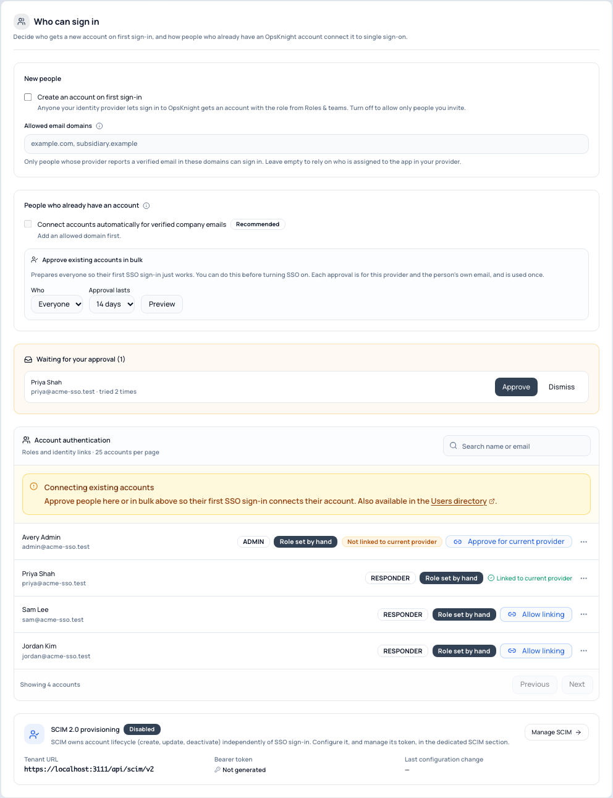

# Link existing accounts

When someone who already has an OpsKnight account signs in with single sign-on for the first
time, OpsKnight connects their SSO identity to that account. A matching email alone is never
enough to do this, because whoever controls an email address at the identity provider would
otherwise get the account. You choose how the connection is authorized, in **2 · Who can sign
in**.

## Before you begin

- You need the OpsKnight Administrator role. Changing these settings needs an administrator
  sign-in from the last two hours (see [authentication modes](./authentication-modes/)).
- Connect your identity provider first, in **1 · Connect provider**. See
  [configure single sign-on](./configure-oidc/).
- To connect verified company emails automatically, or to approve *Everyone in the allowed
  domains*, set your **Allowed email domains** in **2 · Who can sign in**.

## Open Who can sign in

Open **Settings → System → SSO / Authentication → 2 · Who can sign in**. The options below,
the account list and **Waiting for your approval** are all on this step.

## Configure how existing accounts connect

Use one or more of these options.

### Option 1 · Connect verified company emails automatically (recommended)

Turn on **Connect accounts automatically for verified company emails**. People whose verified
email is in one of your **Allowed email domains** connect on their first SSO sign-in, with no
approval.

- **Administrators always need your approval.**
- It needs proof from the provider that the email domain is really the person's:
  - **Google Workspace**: the signed `hd` claim must equal the email domain.
  - **Microsoft Entra ID**: the token must include `xms_edov` (email domain owner verified).
    Add it in **App registration → Token configuration → Add optional claim → ID**. Without it,
    people fall back to approval. Entra's `email` claim on its own can be edited and is not
    verified for guests.
  - **Okta, Auth0 and other providers**: `email_verified` must be `true`.
- Turning it on confirms that every verified mailbox in those domains belongs to someone your
  company controls.

### Option 2 · Approve in bulk

1. Under **Approve existing accounts in bulk**, choose *Everyone in the allowed domains* or
   *Everyone*.
2. Choose how long approvals last (7, 14 or 30 days).
3. Select **Preview**, then **Approve**.

- You can do this **before** turning SSO on, so the first sign-in just works.
- Administrators are not included; approve them one at a time.
- Each approval is only for this provider and the person's own email, and works once.
- Up to 500 people are approved per run; run it again for more.

### Option 3 · Approve one person

In the account list, select **Allow linking** for that person. You can also approve from
**/users**.

### Access requests

If someone tries to sign in before they are approved, they see *"Your administrator needs to
approve your first SSO sign-in"* and administrators get a notification: *"Priya Shah tried to
sign in with SSO for the first time and needs your approval."* The notification opens **Waiting
for your approval** in Who can sign in, where you can **Approve** or **Dismiss** the request.
Repeated attempts update the same request and notify again at most once a day.

## How account linking works

### What happens when you change providers

Approvals are tied to the provider's issuer and client ID.

- Turning on a new configuration for the **same** issuer and client keeps pending approvals
  valid.
- Switching to a **different** issuer or client cancels pending approvals, because they were
  given for the other provider. The preview in step 4 says how many approvals carry over and how
  many are cancelled.

### Audit trail

Every connection is recorded in the audit log with how it was authorized: approval, verified
company email, or directory (Microsoft Entra with SCIM trusted linking).

## Verify

- In the account list in **2 · Who can sign in** (or in **/users**), an approved person shows
  **Linking approved**, with the date the approval ends.
- After the person signs in with SSO, their account shows **Linked to current provider**.
- The audit log records the connection and how it was authorized.

## Revoke an approval

Select **Revoke** next to **Linking approved** for that person, then **Revoke approval**. The
person can no longer connect a new SSO identity. Their password access, role and account status
are not affected, and an identity that is already connected stays connected.

To stop automatic connection, turn off **Connect accounts automatically for verified company
emails**. People then need approval again.

## Troubleshooting

- **The person sees *"Your administrator needs to approve your first SSO sign-in"*.** Approve
  them, or turn on automatic connection. See
  [sign-in problems with single sign-on](../../troubleshooting/login/oidc-access/#sso_link_not_approved).
- **The approval expired before they signed in.** Approve them again. See
  [Your SSO approval has expired](../../troubleshooting/login/oidc-access/#sso_link_approval_expired).
- **The account shows *Approval for previous provider*.** The approval was given for an earlier
  issuer or client. Select **Renew**.
- **The account shows *Not linked to current provider*.** Its SSO identity is from an earlier
  issuer or app registration. Select **Approve for current provider**.
- **Microsoft Entra users still need approval with automatic connection on.** The token does
  not include `xms_edov`. Add the optional claim as described in Option 1.

## Next steps

- [Map groups to roles and teams](./map-roles-and-teams/)
- [Test and turn on single sign-on](./test-and-enforce-sso/)
- [Sign-in problems with single sign-on](../../troubleshooting/login/oidc-access/)
