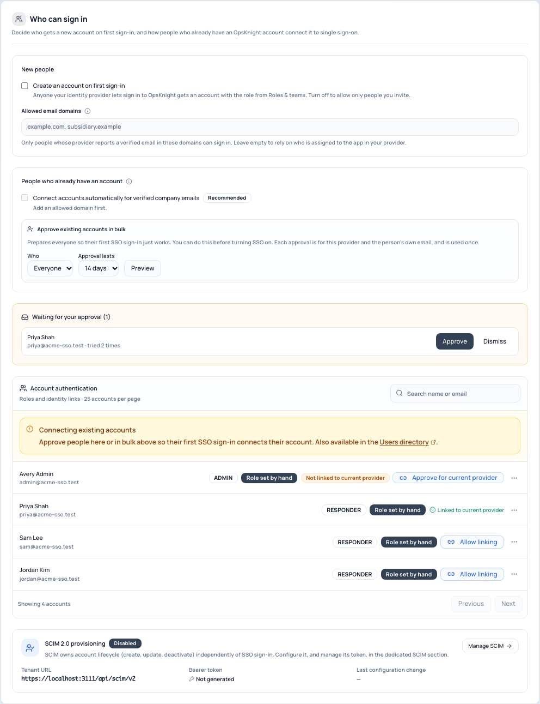

# Link existing accounts

When someone who already has an OpsKnight account signs in with single sign-on for the first
time, OpsKnight connects their SSO identity to that account. A matching email alone is never
enough to do this, because whoever controls an email address at the identity provider would
otherwise get the account. You choose how the connection is authorized, in **2 · Who can sign
in**.

## Option 1 · Connect verified company emails automatically (recommended)

Turn on **Connect accounts automatically for verified company emails**. People whose verified
email is in one of your **Allowed email domains** connect on their first SSO sign-in, with no
approval.

- **Administrators always need your approval.**
- It needs proof from the provider that the email domain is really the person's:
  - **Google Workspace**: the signed `hd` claim must equal the email domain.
  - **Microsoft Entra ID**: the token must include `xms_edov` (email domain owner verified).
    Add it in **App registration → Token configuration → Add optional claim → ID**. Without it,
    people fall back to approval. Entra's `email` claim on its own can be edited and is not
    verified for guests.
  - **Okta, Auth0 and other providers**: `email_verified` must be `true`.
- Turning it on confirms that every verified mailbox in those domains belongs to someone your
  company controls.

## Option 2 · Approve in bulk

Under **Approve existing accounts in bulk**, choose *Everyone in the allowed domains* or
*Everyone*, choose how long approvals last (7, 14 or 30 days), select **Preview**, then
**Approve**.

- You can do this **before** turning SSO on, so the first sign-in just works.
- Administrators are not included; approve them one at a time.
- Each approval is only for this provider and the person's own email, and works once.
- Up to 500 people are approved per run; run it again for more.

## Option 3 · Approve one person

In the account list, select **Allow linking** for that person. You can also approve from
**/users**.

## Access requests

If someone tries to sign in before they are approved, they see *"Your administrator needs to
approve your first SSO sign-in"* and administrators get a notification: *"Priya Shah tried to
sign in with SSO for the first time and needs your approval."* The notification opens **Waiting
for your approval** in Who can sign in, where you can **Approve** or **Dismiss** the request.
Repeated attempts update the same request and notify again at most once a day.

## What happens when you change providers

Approvals are tied to the provider's issuer and client ID.

- Turning on a new configuration for the **same** issuer and client keeps pending approvals
  valid.
- Switching to a **different** issuer or client cancels pending approvals, because they were
  given for the other provider. The preview in step 4 says how many approvals carry over and how
  many are cancelled.

## Audit trail

Every connection is recorded in the audit log with how it was authorized: approval, verified
company email, or directory (Microsoft Entra with SCIM trusted linking).
