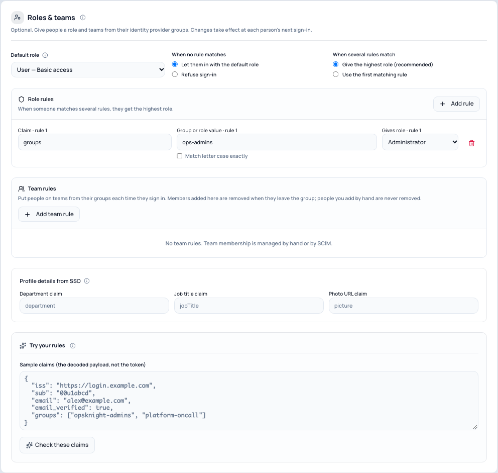
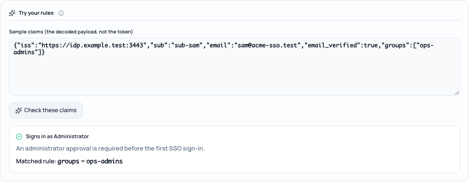

# Map groups to roles and teams

In **Settings → System → SSO / Authentication → 3 · Roles & teams**, you can give people a role
and put them on teams based on the groups or roles your identity provider sends. Rules are
applied every time someone signs in with single sign-on.

This step is optional. Without rules, everyone gets the default role, and you manage roles and
teams by hand.



## Roles

| Role | What it allows |
| --- | --- |
| Administrator | Everything, including settings and single sign-on |
| Responder | Handle incidents and be on call |
| Auditor | Read-only access to everything |
| User | Basic access |

### Add a role rule

1. Select **Add rule**.
2. **Claim**: the claim that holds groups or roles, usually `groups` or `roles`. Nested claims
   use dots, for example `realm_access.roles` (Keycloak) or
   `resource_access.opsknight.roles`. Namespaced claims such as `https://opsknight/roles`
   work as written.
3. **Group or role value**: the exact value your provider sends. Once people have signed in,
   the field suggests the values OpsKnight has seen, with how many people have each one. A
   warning appears if nobody has signed in with the value yet.
4. **Gives role**: the role for people with that value.

Matching ignores letter case and surrounding spaces. Tick **Match letter case exactly** only if
your provider has two groups that differ only by case.

> **Microsoft Entra:** with the `groups` claim, enter the group's **Object ID** (a GUID), not
> its name, unless you configured Entra to emit names. App roles (`roles`) avoid this and the
> 200-group limit.

### When several rules match

- **Give the highest role** (recommended): someone in both `ops-responders` and `ops-admins`
  becomes an Administrator. Rule order does not matter.
- **Use the first matching rule**: rules are checked top to bottom; reorder them with the
  arrows. Installations upgraded from v2.1 start here, because that is how they behaved before.

### When no rule matches

- **Default role** — the role for people whose groups match no rule, and the role new accounts
  start with. Most teams choose User or Responder. Administrator cannot be the default; give it
  with a rule.
- **When no rule matches** — *Let them in with the default role*, or *Refuse sign-in*. Refusing
  shows the person "Your account is not assigned to OpsKnight". People whose role an
  administrator set by hand are never refused this way.

### Who owns a role

Every account's role is **set by an administrator**, **from SSO**, or **from SCIM**. The
people directory and the console show which.

- A role you set by hand stays as you set it. Single sign-on never changes it.
- New accounts created by single sign-on get their role from the rules.
- An existing account moves under SSO control on its **first** SSO sign-in if a rule matches.
- A role from SCIM changes only when a rule matches. If no rule matches, the SCIM role stays.
- To hand a role back to the rules, open the account's menu in **2 · Who can sign in** and
  choose **Let role rules manage this role**. It applies at their next SSO sign-in.

### Safety rules

- **Incomplete group lists.** Microsoft Entra replaces the `groups` claim with a "too many
  groups" marker for people in more than 200 groups. OpsKnight then cannot tell which groups
  they are in, so it fails safe: no rule can raise their role, and a role from SSO above the
  default role is lowered to the default. Otherwise, removing someone from an admin group would
  never take effect. Roles set by an administrator or by SCIM do not change, team memberships
  are kept, and administrators get one alert per person per day. If you refuse people no rule matches, a *new* person with an incomplete list is refused
  too ("OpsKnight could not read your groups"), because they cannot be evaluated. Switch to App
  roles to fix it.
- **The last administrator.** If a rule would take Administrator away from the only active
  administrator, OpsKnight keeps their role, lets them sign in and alerts you, rather than
  locking everyone out.
- **Broad administrator rules.** A rule that gives Administrator to everyone (for example
  `groups = everyone`) needs an explicit confirmation.
- **Your own test.** The administrator test in step 4 fails if your rules would remove your own
  Administrator role.

## Teams

Team rules put people on teams from their groups at each sign-in.

1. Create the team first in **Teams**.
2. In **Team rules**, select **Add team rule**, choose the claim and group value, and pick the
   team.

What happens at each sign-in:

- People matching a rule are added to the team as members.
- People who no longer match are removed, but only from memberships a team rule created.
  Members you added by hand, members SCIM added, and anyone whose team role you changed (for
  example to owner) are never removed.
- If the provider reports an incomplete group list, nobody is removed.
- Deleting every team rule removes the memberships those rules created, at each person's next
  sign-in.

The team roster labels these members **SSO group** (or **Directory** for SCIM).

## Try your rules

**Try your rules** checks sample claims against your current rules, including changes you have
not saved yet. Paste the decoded ID token payload (not the token itself), for example:

```json
{
  "iss": "https://login.example.com",
  "sub": "00u1abcd",
  "email": "alex@example.com",
  "email_verified": true,
  "groups": ["opsknight-admins", "platform-oncall"]
}
```

The result shows whether the person can sign in, their role, which rule matched, their teams,
and any warning such as a missing claim.



## See the impact before you turn it on

**Preview what will change** in step 4 uses the values people sent at their last SSO sign-in to
show how many people would get a different role, who would be refused, and how many team
memberships would be added or removed.

OpsKnight stores only the values of the claims your rules use, never the token. They are
included in privacy exports and erased with the account.
