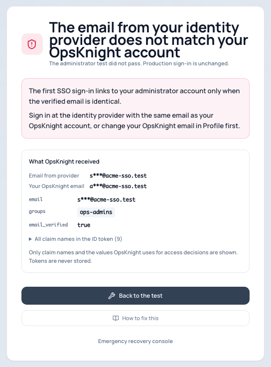
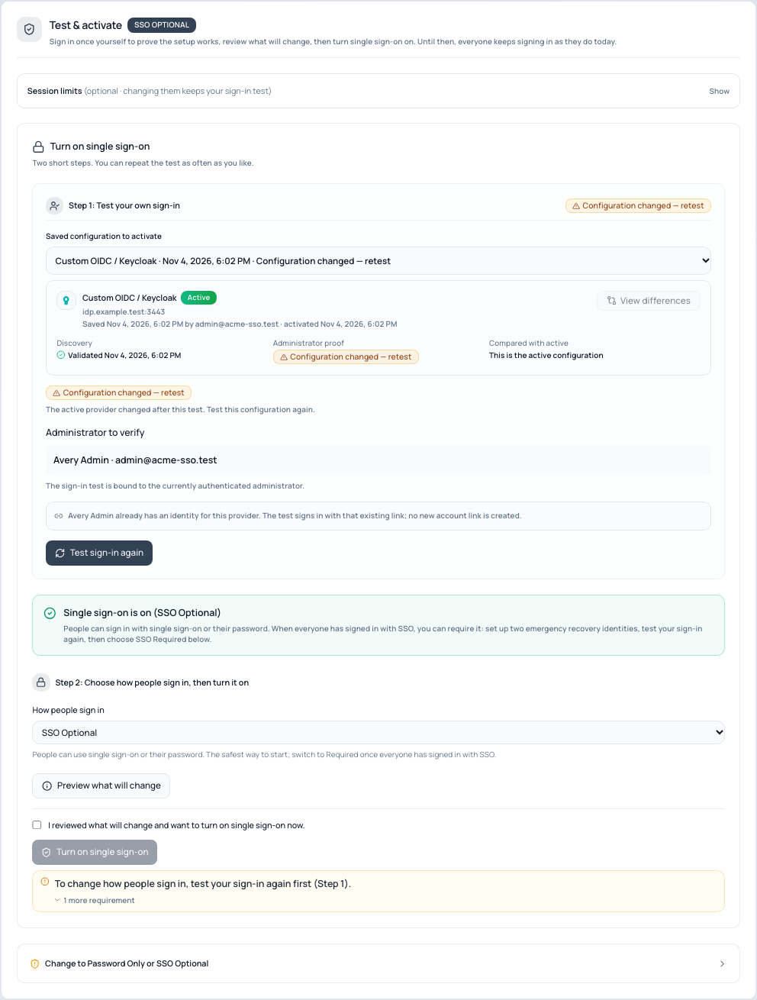

# Test and turn on single sign-on

Open **Settings → System → SSO / Authentication → 4 · Test & activate**.

## Step 1 · Test your own sign-in

You sign in once through your identity provider. This proves the whole setup works, and that you
will still be an administrator afterwards, before anyone else is affected.

1. Tick **Allow this SSO identity to link to …** the first time. It links your SSO identity to
   your administrator account only if the verified email matches exactly.
2. Read **Before you test**: it lists anything that would make the test fail, such as your
   email domain not being allowed or Microsoft Entra not sending the email claim.
3. Select **Test my sign-in**. If you have unsaved changes, the button says **Save and test
   sign-in** and saves them first.
4. Sign in at your provider as yourself. Use a private window if you are signed in to the
   provider as someone else.

The result page says **Administrator sign-in verified**, or names exactly what failed, shows the
claims OpsKnight received (names and the values your rules use, never the token), and links to
the step where you fix it. See [administrator test failures](../../troubleshooting/login/admin-test-failures/).

A passing test stays valid for seven days. It stays valid if you only change session limits, the
button label, profile details or team rules. Changing the provider, client, secret, scopes,
allowed domains, linking policy or role rules needs a new test.

## Step 2 · Preview and turn it on

1. Choose **How people sign in**: **SSO Optional** to start.
2. Select **Preview what will change**. It shows:
   - password sessions that end (only for SSO Required);
   - how many existing accounts are approved, connect automatically, or still need approval,
     with a link to approve them;
   - approvals that carry over or are cancelled;
   - whose role changes and which team memberships change at their next sign-in;
   - anything still blocking the mode you chose.
3. Tick the confirmation and select **Turn on single sign-on**.

People now see **Continue with …** on the sign-in page. Nothing else changes for people who keep
using their password under SSO Optional.

## Requiring single sign-on

When everyone has signed in with SSO:

1. Set up two [emergency recovery identities](./configure-emergency-access/) and sign in with
   each once.
2. Test your sign-in again.
3. Choose **SSO Required**, preview, confirm and turn it on.

Password sessions end and people sign in again with SSO. The preview lists anything still
missing.

## Session limits

**Session limits** (optional) set how long an SSO session lasts and how long it can be idle.
Defaults: 12 hours, 4 hours idle. People are asked to sign in again with the provider when their
session reaches its limit, and see why on the sign-in page.
