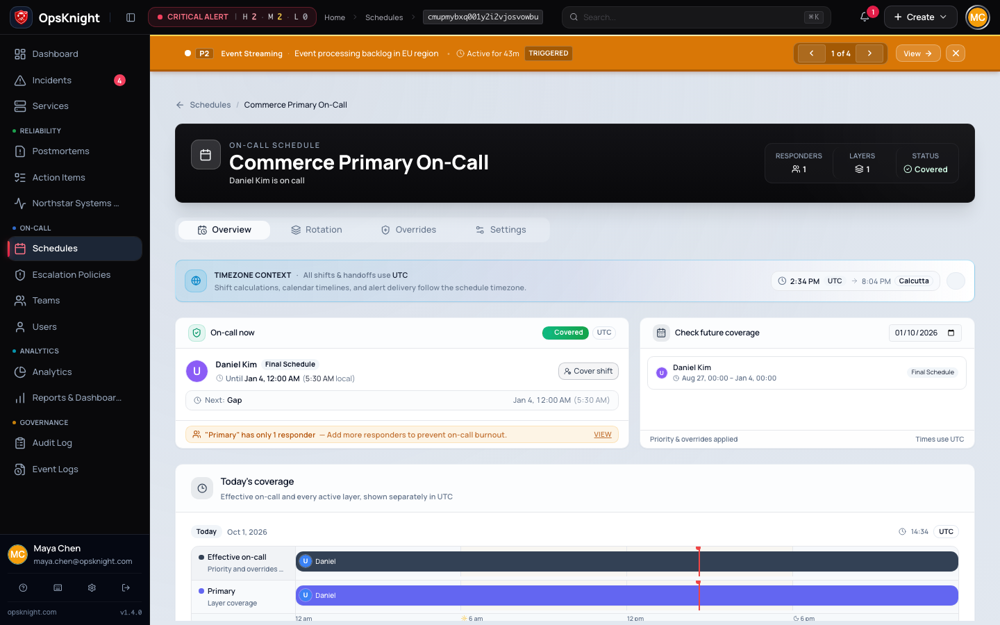

# Add an on-call override

## Before you begin

Identify the covered responder, replacement responder, and exact time window.

## Open the feature

Open **Schedules → select schedule → Overrides**.

## Configure the override

1. Select the replacement responder and explicit start/end times.
2. Verify effective on-call ownership inside and outside the override window.

Open the schedule, create an override with replacement responder, start, and end
times, and verify the resulting coverage preview. Use an override for a bounded
exception; edit the layer only when the recurring rotation itself is wrong.

Avoid overlapping overrides for the same responder and interval. Record times in
the schedule's displayed time zone and verify their stored UTC boundaries.

## What OpsKnight does

The bounded override replaces effective ownership during its window without rewriting recurring layer order. After the window, schedule computation returns to the underlying layers.

### Cover suggestions

When the intelligence master switch and **Suggest people** are on (both off by
default), the override form suggests up to five people to cover the window. It
does so only when the window leaves time uncovered or the override replaces
someone, and only for windows up to 14 days. Candidates come from the
schedule's layer members and the teams whose services this schedule pages,
minus whoever is already on call and the person being replaced. They are ranked
by whether the window falls in their daytime, then by fewest pages and night
pages over the last 28 days. Page counts are shown only for people whose load
you may see (yourself, as team lead, or as an admin). Only users who can create
overrides on the schedule get suggestions; picking one is still your decision.

### Load and fairness

When **Compute operations insights** and its **On-call schedules** area are on
(both off by default), the schedule page shows a **Load & fairness** panel:
pages and on-call time per person over a recent window, with nights counted as
22:00–07:00 in each person's time zone.

## Verify it worked

Inspect a timestamp before, inside, and after the window. Confirm the expected responder and run a controlled route test when the override affects production paging.

## Remove or change the override

Edit/remove the override through the schedule controls, then recheck inside/outside timestamps. For a recurring change, update the layer instead.

## Troubleshooting

**Wrong window:** verify schedule display time zone, entered local time, stored UTC boundary, and DST.

**Override loses to another exception:** inspect overlapping overrides and remove ambiguity rather than relying on implicit precedence.

## Next steps

- [Verify handoffs](./handoffs)
- [Test on-call](./test-on-call)
