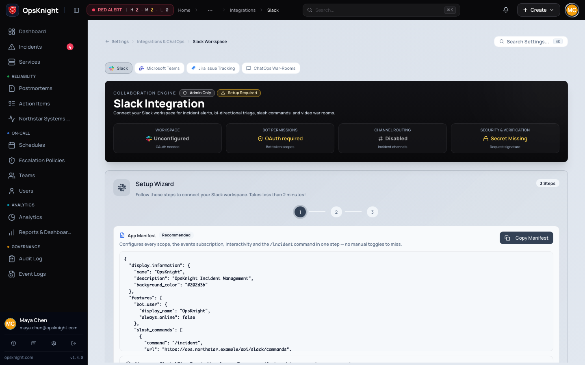

# Integrations

The machine-readable `integrations/catalog.yaml` includes inbound alert adapters,
Slack, Microsoft Teams, Jira, outbound webhooks, notification delivery, OIDC,
and SCIM. Inbound provider pages are generated from source-derived contracts;
the communication and identity pages are maintained as workflow documentation.

Each inbound page records the handler type, lifecycle actions actually present
in its adapter, authentication and conditional signature behavior, and available
delivery identity. Do not assume every provider supports acknowledge, signatures,
or durable delivery fencing merely because another provider does.

## Communication and work management

- [Slack ChatOps](./communication/slack/) — OAuth, destinations, incident
  actions, identities, war rooms, permissions, and troubleshooting.
- [Microsoft Teams ChatOps](./communication/microsoft-teams/) — Entra and Bot
  setup, Adaptive Cards, destinations, war rooms, consent, and troubleshooting.
- [Jira](./issue-tracking/jira) — issue creation, linking, synchronization, and
  authenticated webhooks.
- [Voice paging](./communication/voice) — Twilio voice delivery and callbacks.

## Change events

Change endpoints record deploys, configuration, feature-flag and
infrastructure changes as evidence for probable-cause analysis. They never
create an alert or an incident and never page anyone. Each one uses a generic
webhook integration and is authenticated like the generic webhook endpoint:
integration key, optional HMAC signature, rate limit and delivery
de-duplication. A change is scoped to the integration's service, or to the
service its component or app labels map to once the integration has a change
service mapping. A `serviceId` in the body is ignored.

| Endpoint (`POST …?integrationId=…`)     | Records                                                                                                                                                 |
| --------------------------------------- | ------------------------------------------------------------------------------------------------------------------------------------------------------- |
| `/api/integrations/changes`             | Any change in OpsKnight's own format: `source`, `kind` (default `DEPLOY`), `summary`, `version`, `component`, `labels`, `url`, `dedupKey`, `occurredAt` |
| `/api/integrations/argocd`              | Argo CD notification → deploy                                                                                                                           |
| `/api/integrations/github-deployments`  | GitHub `deployment_status` → deploy; verified with `X-Hub-Signature-256` when a signing secret is set                                                   |
| `/api/integrations/gitlab-deployments`  | GitLab deployment event → deploy; verified with `X-Gitlab-Token` when a signing secret is set                                                           |
| `/api/integrations/kubernetes-rollouts` | Forwarded Kubernetes Event about an Argo Rollouts Rollout → deploy                                                                                      |
| `/api/integrations/launchdarkly`        | LaunchDarkly webhook → feature-flag change                                                                                                              |
| `/api/integrations/unleash`             | Unleash webhook addon → feature-flag change                                                                                                             |
| `/api/integrations/terraform`           | HCP Terraform run notification → infrastructure change                                                                                                  |

A repeated delivery is answered as `change_duplicate` instead of recording a
second change.
