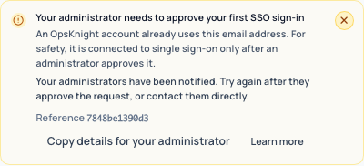

# Sign-in problems with single sign-on

When a single sign-on sign-in does not work, the sign-in page names the problem, says what to do
next, and shows a **reference ID**. The person can select **Copy details for your
administrator** to send you the message, code and reference.

**To investigate:** search the server log for the reference ID. The log entry
`[Auth] OIDC sign-in rejected` holds the internal reason, and the audit log has a matching
`LOGIN_FAILED` entry with failure reason `SSO_FAILED`.

## Messages on the sign-in page

### Your administrator needs to approve your first SSO sign-in

Code `SSO_LINK_NOT_APPROVED`. An OpsKnight account already uses this email address. For safety, it is connected to single sign-on only after an administrator approves it.

**What the person sees next:** Your administrators have been notified. Try again after they approve the request, or contact them directly.

**What an administrator can do:** Approve the person in **2 · Who can sign in** (the request appears under **Waiting for your approval**), or turn on automatic connection for verified company emails. See [link existing accounts](../../guides/identity/link-existing-accounts/).

### Your SSO approval has expired

Code `SSO_LINK_APPROVAL_EXPIRED`. The approval to connect your account to single sign-on expired before it was used.

**What the person sees next:** Your administrators have been notified. Ask them to renew the approval, then sign in again.

**What an administrator can do:** Approve the person again. Bulk approvals can last up to 30 days.

### This email domain is not allowed

Code `SSO_DOMAIN_NOT_ALLOWED`. Your identity provider account uses an email domain this workspace does not accept.

**What the person sees next:** Sign in with your work account, or ask an administrator to add your domain.

**What an administrator can do:** Add the domain to **Allowed email domains** in **2 · Who can sign in**, or ask the person to use their work account. For Google Workspace the signed `hd` claim is checked.

### This organization is not allowed

Code `SSO_ORGANIZATION_REJECTED`. Your identity provider account belongs to a different organization or tenant.

**What the person sees next:** Sign in with the account your company gave you for OpsKnight.

**What an administrator can do:** Check the Auth0 organization ID under **Advanced provider settings**, or that the person signs in to the right organization.

### You do not have an OpsKnight account yet

Code `SSO_AUTO_PROVISION_DISABLED`. This workspace only lets existing members sign in with single sign-on.

**What the person sees next:** Ask an administrator to invite you, then sign in again.

**What an administrator can do:** Invite the person in **Users**, or turn on **Create an account on first sign-in** in **2 · Who can sign in**.

### Your account is not assigned to OpsKnight

Code `SSO_ROLE_UNMATCHED_DENIED`. You signed in successfully, but none of your groups or roles grant access to this workspace.

**What the person sees next:** Ask your identity administrator to add you to an OpsKnight group.

**What an administrator can do:** Add the person to a group that a role rule matches, or change **When no rule matches** in **3 · Roles & teams**. See [map groups to roles and teams](../../guides/identity/map-roles-and-teams/).

### OpsKnight could not read your groups

Code `SSO_GROUP_CLAIMS_INCOMPLETE`. Your identity provider sent an incomplete group list (for
Microsoft Entra, a "too many groups" marker for people in more than 200 groups), and the
workspace refuses people no rule matches. OpsKnight cannot evaluate a new person without their
groups, so it does not create an account. People who already have an account can still sign
in, but a role from SSO above the default role is lowered to the default until the full group
list arrives.

**What the person sees next:** Ask your identity administrator to send OpsKnight the groups or
app roles it uses.

**What an administrator can do:** Use App roles (the `roles` claim) instead of `groups`, or emit
only groups assigned to the application. See
[map groups to roles and teams](../../guides/identity/map-roles-and-teams/).

### Your OpsKnight account is disabled

Code `SSO_ACCOUNT_DISABLED`. An administrator or your company directory has deactivated this account.

**What the person sees next:** Contact your administrator if you still need access.

**What an administrator can do:** Reactivate the account in **Users**, or in your directory if SCIM manages it.

### Your identity provider did not share an email address

Code `SSO_EMAIL_REQUIRED`. OpsKnight needs your email address to find or create your account.

**What the person sees next:** Ask your identity administrator to release the email claim to OpsKnight (for Microsoft Entra, add the optional "email" claim).

**What an administrator can do:** Release the email claim to OpsKnight. For Microsoft Entra add the optional `email` claim to the ID token.

### Your email address is not verified

Code `SSO_EMAIL_UNVERIFIED`. Your identity provider reports that the email on your account is not verified.

**What the person sees next:** Verify your email with your identity provider, then sign in again.

**What an administrator can do:** Verify the email at the identity provider. When allowed domains are set, providers other than Microsoft Entra must send `email_verified: true`.

### Your sign-in matches more than one account

Code `SSO_IDENTITY_CONFLICT`. OpsKnight could not tell which account this identity belongs to, so it stopped.

**What the person sees next:** Contact your administrator and share the reference below.

**What an administrator can do:** Search the server log for the reference ID. Two OpsKnight accounts claim this identity; remove the stale link.

### Your identity provider sent an incomplete response

Code `SSO_SUBJECT_MISSING`. The response did not include a stable account identifier.

**What the person sees next:** Contact your administrator and share the reference below.

**What an administrator can do:** Check the application at the provider is an OpenID Connect application, not plain OAuth.

### Single sign-on is not available right now

Code `SSO_NOT_AVAILABLE`. This workspace does not currently accept single sign-on.

**What the person sees next:** Use another sign-in method, or contact your administrator.

**What an administrator can do:** Check **Settings → System → SSO / Authentication**: SSO may be off (Password Only), or the provider may be unreachable. The server log has the detail.

### Something went wrong while signing you in

Code `SSO_INTERNAL_ERROR`. OpsKnight could not finish your sign-in. Nothing about your account was changed.

**What the person sees next:** Try again. If it keeps happening, contact your administrator with the reference below.

**What an administrator can do:** Search the server log for the reference ID shown on the sign-in page.

## Messages after being signed out

When a session ends, the sign-in page says why:

| Reason | Message | Detail |
| --- | --- | --- |
| `SESSION_REVOKED_BY_POLICY` | Your organization changed how you sign in | Your administrator changed the sign-in policy, which ended earlier sessions. |
| `AUTHENTICATION_POLICY_DENIED` | Your organization changed how you sign in | This sign-in method is no longer allowed for your session. |
| `OIDC_SESSION_IDLE_TIMEOUT` | You were signed out after a period of inactivity | Your organization signs people out when they have been idle for a while. |
| `OIDC_SESSION_RENEWAL_REQUIRED` | Please confirm your sign-in | Your organization asks you to sign in with your identity provider periodically. |
| `OIDC_CONFIGURATION_CHANGED` | Single sign-on settings were updated | An administrator updated single sign-on, which signs everyone in again. |
| `SESSION_EXPIRED` | Your session has expired | You were signed out for your security. |
| `SESSION_REVOKED` | You were signed out | Your session ended because your account or access changed. |
| `USER_DISABLED` | Your OpsKnight account is disabled | An administrator or your company directory has deactivated this account. |

## Password sign-in

- **Incorrect email or password** — the email or password is wrong, the account has no
  password, or password sign-in is blocked by policy. It never reveals which.
- **Your OpsKnight account is disabled** — shown only after the correct password, so it cannot
  be used to probe accounts.

## Still stuck

- Your own test sign-in fails: see [administrator test failures](./admin-test-failures/).
- You are locked out: see [SSO lockout recovery](../../guides/identity/sso-lockout-recovery/).
