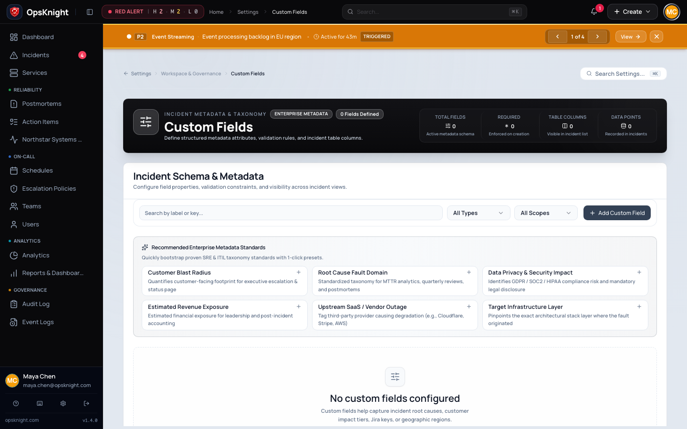

# Configure incident custom fields

Custom fields add structured, organization-specific metadata to incidents—for example environment, customer impact, change URL, or incident commander email. Administrators define fields; permitted responders enter values during incident creation or on the incident detail page.

## Before you begin

Sign in as an `ADMIN`. Decide the field owner, data classification, permanent key, type, default, and whether responders need it in the incidents table. Avoid secrets and sensitive personal data: field values can appear in operational views, exports, and—only when separately enabled—status-page output.

## Create a field

1. Open **Settings → Custom Fields**.
2. Select **Add Custom Field**.
3. Enter a display **Name** of 1–200 characters.
4. Enter a unique **Key** of 1–100 letters, digits, or underscores. Spaces, hyphens, and punctuation are rejected.
5. Choose one of the seven types: `TEXT`, `NUMBER`, `DATE`, `SELECT`, `BOOLEAN`, `URL`, or `EMAIL`.
6. For `SELECT`, enter one allowed option per line, in the order responders should see them. An option can contain commas (for example `Tier 1, Gold`); editing the field in the console keeps it as one option.
7. Optionally set **Required**, a **Default value**, and **Show in incident list**.
8. Save, create a synthetic incident, and test both a valid and invalid value.

Keys are unique across the workspace. Treat a key as an integration contract: the UI does not allow changing a field's key or type after creation.

## Validation and stored values

- `TEXT`: leading and trailing whitespace is removed; the remaining text is stored.
- `NUMBER`: the value must be a finite JavaScript number. It is normalized with `String(number)`, so `01.50` becomes `1.5`; `NaN` and infinity are rejected.
- `DATE`: the value must be accepted by `Date.parse`. OpsKnight stores the normalized UTC ISO timestamp.
- `SELECT`: when options exist, the value must exactly equal one configured option, including case.
- `BOOLEAN`: accepts `true` or `false` case-insensitively and stores lowercase `true` or `false`.
- `URL`: must begin with `http://` or `https://`.
- `EMAIL`: must match the current email form, contain no whitespace, and include an `@` plus dotted domain. It is stored lowercase.

Empty input becomes no value. An empty required field is rejected with `<field name> is required.` Required custom fields also block human/operator incident resolution (web, bulk, REST API, runbooks) until completed. Fields added after an incident was opened do not block it. Automated upstream resolution and surfaces that cannot fill fields (Slack/Teams, voice, mobile) are not subject to that gate.

When an incident is created without a value for a field, its default is used. On the New incident form a field starts with its default; clear an optional field to leave it empty and the empty value is kept (the default is not applied again). Clearing a required field shows `Required field missing` and the incident is not created. API clients can do the same by sending the field with an empty value.

On an incident's detail page, a field with no stored value (for example on an incident created before the default was set) shows its default only as a hint, "Default: … (not saved)". The field stays empty, and a required field still blocks resolve, until a responder enters or selects a value; entering the same value as the default saves it.

The create-definition endpoint accepts a default as text. Test that the default is valid for its type before relying on it; incident value validation is authoritative.

## Edit a definition

From **Settings → Custom Fields**, edit the name, required flag, default, select options, incident-list visibility, or order. Existing stored values are not rewritten when a default or option list changes. Before removing a select option, search retained incidents and integrations for that value.

An assistant connected through MCP can read an incident's custom-field values (`getIncidentCustomField` and `listIncidentCustomFields`) only while an administrator has turned on sensitive reads for MCP. Both are reviewed sensitive reads, with redaction and audit; without the opt-in, neither returns values.

## Incident-list and status-page visibility

**Show in incident list** controls the compact internal incidents table; it does not make the field public. Status-page publication is configured separately on the single status page through its privacy settings: custom fields must be enabled and the field must be in the allowed list. Keep customer identifiers, security context, emails, and internal runbook data out of public projections.

## Delete a field

Deletion is destructive. The API deletes every `CustomFieldValue` associated with the definition and then deletes the definition itself. Those historical values disappear from existing incidents; a later field with the same key does not restore them.

Before confirming deletion, export anything that must be retained, remove the field from status-page privacy settings and external workflows, and check templates/runbooks that tell responders to populate it. Confirm the `custom_field.deleted` audit event afterward.

The settings page always deletes the stored values together with the field. The v2 API and MCP are
stricter by default: `DELETE /api/v2/custom-fields/{id}` answers `409` while any incident holds a
stored value for the field (values cleared to empty do not count) and says how many. To delete the
field and its values in one transaction, send `?cascade=true` (MCP: `query: { "cascade": "true" }`,
which still goes through approval). The audit event then records `valuesDeleted`, the same as a
deletion from the settings page. A retry with the same `Idempotency-Key` but a different `cascade`
value is treated as a different request.

## Troubleshooting

If saving a field fails, the reason (for example a duplicate key or a default the type does not accept) appears at the top of the dialog, and the dialog stays open so you can correct it and save again.

- **“A custom field with this key already exists”:** locate the existing definition or choose a genuinely new stable key.
- **Key validation fails:** use only letters, numbers, and underscores, with no spaces or hyphens.
- **A number changes format:** normalization stores the numeric value, not presentation formatting; use `TEXT` when leading zeros are meaningful.
- **A date shifts timezone:** date input is normalized to a UTC ISO timestamp. Include an explicit timezone when supplying an API value.
- **A select value is rejected:** match the configured option exactly and refresh the incident form after an administrator changes options.
- **An incident cannot resolve:** complete every required custom field on the incident detail page.
- **A field appears publicly:** disable custom-field publication on the status page or remove it from the allowed list, then verify the newly published snapshot.
