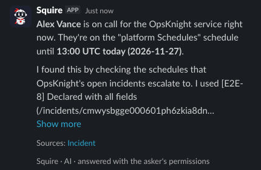

# Ask Squire in Slack, Microsoft Teams, MCP and on mobile

Squire answers the same way everywhere: in basic mode without AI, or with AI when a provider is configured. It always uses **your own OpsKnight permissions**, cites what it relied on, and never changes anything until you confirm a suggestion yourself.

## Turn it on

An administrator opens **Settings → Intelligence → Assistant**. The assistant itself must be on. Under **Assistant outside the web app**, each surface has its own switch, all off by default:

| Switch                                  | What it adds                                                                |
| --------------------------------------- | --------------------------------------------------------------------------- |
| **Slack and Microsoft Teams**           | `@OpsKnight` in Slack channels (and in incident war rooms and Teams war rooms), and `/incident ask` in Slack. |
| **AI assistants over MCP (ask_squire)** | The read-only `ask_squire` tool for connected assistants.                   |
| **Mobile incident pages**               | The assistant, full screen, on `/m/incidents/…`.                            |

Turning a switch off stops new questions at once. Suggestions already shown in chat can no longer be confirmed.

## Slack

Mention the OpsKnight app in any channel it is in, or in an incident channel:

- **`@OpsKnight what changed before this started?`** Squire replies in the thread, visible to the channel. In an incident channel it knows which incident the room is about; in any other channel it answers as a general question.
- **`/incident ask is this related to yesterday's outage?`** Squire replies only to you, in a war room.

Because a channel reply is visible to everyone in the channel, Squire uses only its channel-safe read tools there, and it still answers as you: it cannot show you, or the channel, anything your own OpsKnight account cannot read. Your Slack account must match an active OpsKnight account by its verified email address, as for the other `/incident` commands. Otherwise Squire tells you privately that it cannot answer for you. `investigate` needs an incident channel. Typing `@squire` as plain text works only in incident channels; elsewhere use the real `@OpsKnight` mention.

Mention the OpsKnight app you already installed (`@OpsKnight`); Squire is its assistant, not a separate app. The Slack app needs the `app_mentions:read` event subscription, which may ask you to re-approve the app once. The existing interactivity URL handles the buttons.

## Microsoft Teams

In an incident war room, mention the OpsKnight bot with your question. Squire replies in the thread. Your Teams account must be linked to OpsKnight (automatically through Entra ID, or with the account-link prompt the incident cards show). Squire answers only in incident war rooms.

## Confirm a suggestion from chat

When Squire suggests a change (for example "Acknowledge the incident"), the reply carries **Confirm** and **Dismiss** buttons (Slack) or a **Confirm** action (Teams).

- **Only the person who asked can confirm.** Anyone else gets a private message and nothing changes.
- Confirming runs the same command and permission checks as the button in OpsKnight. If the incident changed since the suggestion, or your access changed, nothing happens and you are told why.
- A success message is posted only after OpsKnight recorded the result. Clicking twice does not repeat the change.
- Chat can confirm acknowledge, resolve, add a note, reassign and mark incidents as related. Other suggestions (escalate, snooze, change urgency, Jira, status updates, runbooks, saving a service fact) show an **Open in OpsKnight** link instead, and you confirm them there.
- Suggestions expire after 10 minutes. Ask again for a fresh one.
- A suggestion that read alert or note text is marked: check that content before confirming.
- A long resolution or note does not fit in a Slack button. Squire then shows **Open in OpsKnight** instead.

Each person can ask 6 questions and confirm 20 suggestions per minute across Slack and Teams.

## MCP: ask_squire

With the MCP switch on, an AI assistant connected to OpsKnight sees an `ask_squire` tool, if its connection was granted the read permissions for incidents, services, schedules, teams, runbooks and postmortems. Pass a `question` and optionally an `incidentId`.

The answer never reads more than the connection could read itself. Squire looks up people only if the connection also has `users:read`, escalation policies only with `escalation-policies:read`, status pages only with `status-pages:read`, and service objectives only with `service-objectives:read`. Raw alert payloads and the knowledge index are used only while the MCP policy allows sensitive reads. Observability connections (metrics, logs, traces, errors, diffs) are never used over MCP.

The tool is read-only. Suggested actions come back as descriptions with a link (`executed: false`); a person confirms them in OpsKnight. Answers are limited to 10 per minute per person. See the [MCP tool reference](../../reference/mcp/tools.md).

## Mobile

With the mobile switch on, an **Ask Squire** button appears on mobile incident pages. It opens full screen and already knows which incident you are looking at.

## Page context in the web app

Squire knows the page you opened it on: an incident, service, team, schedule, runbook, alert or change. On a change page, "this service" means the service the change was recorded on. A page you cannot read is ignored.

The line under the panel header says what the conversation is about: **Discussing this incident**, **this service**, **this team**, **this runbook**, **this schedule**, **this alert** or **this change**, or **General conversation** on any other page.

The conversation follows you. When you open another page and ask again, the same chat continues and a
divider such as **Now on this service** marks where the page changed; "this" then means the new page.
Earlier questions stay in the thread, labelled with the page they were asked on. If you lose access to a
page, the turns asked there are hidden from the thread and from the assistant. **New chat** starts over
whenever you like.

A reload reopens the conversation you had open in that tab (when saved conversations are on). If an
answer is cut off by a reload, a closed tab or a dropped connection, the part already written is saved and
marked as interrupted; it is not used as context for later answers. An answer that stops arriving for 45
seconds is shown as stalled so you can ask again.

In AI mode Squire also knows your first name (when the provider is allowed personal data), your role and
teams, and what your role can and cannot do, so it can say who to ask when something needs another role.

## Mention records with @

Type `@` and at least two letters in the message box to pick an incident, service, schedule, team,
runbook or person from the same search as the command palette. Use the arrow keys and Enter (or click) to
pick one, and Escape to close the list. The pick is written into your question, such as `@Checkout API`,
and shown as a chip above the box; remove a chip to leave that record out. You can mention up to five
records in one question.

Squire reads each mentioned record with your own permissions. A record you cannot read is ignored without
saying so, and a person is only included if your role may see people. In basic mode, when you mention
exactly one incident or service, team, schedule or runbook and are not on a record's page, Squire answers
as if you had opened that record.

## Dock Squire beside the page

On a desktop-width window (1024 px and wider) the panel can sit beside the page instead of on top of it.

- Select **Dock beside the page** in the panel header. The panel becomes a full-height column on the right and the page narrows to make room, so nothing is covered. Select **Float over the page** to go back.
- Your choice is remembered in this browser, like the side the floating panel opens on.
- If you have not chosen, the panel floats. The one exception: when you ask about an item from an incident's insights, the panel docks for as long as you stay on that incident, so you can read the incident and the answer together.
- While docked, the **Expand chat** and **Move to the other side** controls are hidden; they only apply to the floating panel.
- `Esc` closes the panel and returns focus to where it was opened from, docked or floating. `⌘J` / `Ctrl+J` opens and closes it.

On narrower windows and on mobile the panel always opens over the page.

## Pinned incident briefing

While the conversation is about an incident, an **Incident briefing** is pinned above the messages: the likely changes, the most similar past incidents and the runbooks that worked, up to three of each. Each row opens that finding in the incident's insights. Select the heading to collapse or expand it; the panel remembers which you prefer.

The briefing is not shown when there is nothing to show: the service's intelligence mode is Off or Shadow, analysis has found nothing yet, or you cannot read the incident. It only ever lists what you are allowed to read.

Under an answer, a source that is one of the incident's findings has a second, small link next to it that jumps to that finding in the insights.

## Ask from the command palette

Type a question in the search box at the top of the app (`/` or `⌘K` / `Ctrl+K`). **Ask Squire** appears when the text names the assistant, starts with `ask`, or reads as a question (it ends with `?` or starts with a question word). The entry shows the question it will ask; choosing it opens the panel and asks it straight away. Typing only the assistant's name opens the panel without asking anything.

## Links that open Squire

Add `?squire=open&q=<question>` to any app address to open the panel with that question written in the message box, for example `/incidents/<id>?squire=open&q=What%20changed%3F`. The question is **not** sent until you send it, so opening a link never starts a conversation or spends AI budget on your behalf. The two parameters are removed from the address once the panel has opened.

Links to a single finding use `/incidents/<id>?insights=<section>#finding-<finding id>`.

## Charts in answers

When Squire reads metrics to answer you (the `query_metrics` read of a connected Prometheus, Grafana, Datadog, CloudWatch or base14 Scout backend), it draws the series as a line chart under the answer. This works in ordinary AI answers and in step-by-step investigations.

- The chart is built from what the metrics read returned, never from the model's text, so it shows exactly the numbers the answer relied on. Secrets and email addresses are removed before the chart is built, as they are for the model.
- Up to two charts per answer, four series per chart and 200 points per series. Series that came back with fewer than two points are left out. The chart plots the evenly spaced samples Squire reads, not every raw point; open the backend for full resolution.
- A chart is a figure you can reach with `Tab`. Screen readers announce the title and a sentence per series (first and last value, lowest and highest), and every value is in a table that assistive technology reads. Series differ by line style as well as colour, and the chart follows light and dark mode.
- With conversation history on, the chart is saved with the answer, so it is there again when you reopen the conversation. If you can no longer use the connection the numbers came from, the earlier answer is withheld, chart included.
- Charts appear in the web app only. Slack, Microsoft Teams and `ask_squire` give the text answer.

## Help Squire learn

Under every finished answer, rate it with 👍 or 👎. With 👎 you can say what went wrong (**Wrong facts**, **Missed the point**, **Too long**, **Wrong action** or **Other**) and add a note of up to 300 characters. Leave out secrets: the note is kept as you wrote it.

Squire stores the rating, the reason and note, the answer mode and a digest of your question, never the question or answer text. When you asked on an incident or service page, it also stores that incident and service, but only after checking again that you can open them.

Intelligence administrators review ratings in **Settings → Intelligence → Squire feedback** (`/settings/intelligence/ai/feedback`). Each row shows the reason, the mode, the basic-mode intent and the service, never who gave it. Filter by **New**, **Learned** or **Dismissed**, then:

- **Learn for this service**: write the fact Squire should remember (10 to 500 characters, no secrets). Squire turns it into the same confirmation card a chat suggestion shows; nothing is saved until you confirm the card, and confirming re-checks that the knowledge index is on and that you may curate the service. Only feedback asked on an incident can become a fact, because facts are learned from an incident.
- **Add to eval set**: produces a case in the basic or scripted evaluation shape to copy or download and add to `tests/evals/squire`. The question text is included only while the organisation keeps conversation history and the question is still in the person's saved conversation; otherwise the case carries the question's digest and a placeholder.
- **Dismiss**: marks the feedback as reviewed with no change.

**Learn** and **Add to eval set** mark the feedback **Learned**. Every action is recorded in the audit log (`intelligence.squire.feedback.learn_candidate`, `.eval_case`, `.dismissed`).

## Language

With AI, Squire replies in the language you wrote in. Record names, ids, commands, queries and links stay exactly as they are. Basic mode (no AI) always answers in English.
