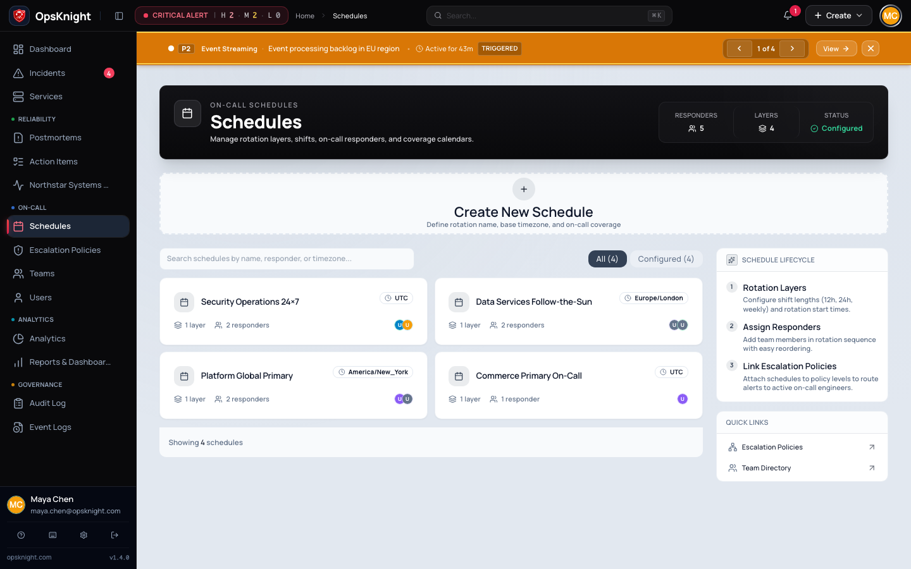

# Build an on-call schedule

A schedule answers who is on call at a given time. Admins and Responders can manage rotations. Build and verify coverage before using a schedule in an escalation policy.

## Before you begin

Activate every responder, choose the authoritative IANA time zone, and write down the responder order, handoff interval, first handoff time, and required coverage hours. The schedule time zone controls entered local times and daylight-saving transitions.

## 1. Create the schedule

1. Open **Schedules** and expand **Create Schedule**.
2. Enter a unique name such as `Payments Primary`.
3. Select the schedule time zone and create it.
4. Open it from the directory.

The new schedule has no coverage until it has an active layer and responder.

## 2. Add a rotation layer

Under **Rotation layers**, choose **Add Layer** and configure:

- **Name:** the layer's purpose.
- **Each responder is on call for:** the handoff interval, in whole hours from 1 to 8,760 (one year); 168 hours is weekly.
- **This layer is active for:** optional coverage within each handoff, in whole hours. Leave blank for coverage until the next handoff. It cannot exceed the handoff interval or 8,760 hours.
- **First responder starts:** the first handoff in the schedule time zone.
- **Rotation ends:** optional final date and time.
- **Repeating coverage hours:** optional days and whole-hour boundaries; leave empty for 24×7. Each day of the week can be chosen once.
- **Responders:** active users in rotation order.

Save the layer. The form checks these values against the same rules as the API and names the field that is wrong, for example `Rotation length must be a whole number of hours.` A responder can belong to only one layer in the same schedule; remove them from the existing layer before moving them.

### Edit the schedule or a layer

Open the schedule's settings to rename it or change its time zone. Changing the time zone asks you to confirm first (**Change schedule time zone?**), because every layer's coverage hours and handoff times are then read in the new zone and who is on call can change. After you confirm, schedule members get a notification that states the rename and the old and new time zone; a save that changes neither sends none.

If someone else changed the schedule or the layer after you opened the page, your save is refused with `Someone else changed this schedule after you opened it. Reload the page to see their changes, then make yours again.` Reload and repeat your change. API v2 fences the same revision with `If-Match` and answers `412` for a stale one.

### Who can change what

Admins and Responders (the `operations.manage` capability) can edit rotations and schedule settings. Only an administrator can delete a schedule, in the console and through API v2 (`DELETE /api/v2/schedules/{id}`). Overrides follow the rule in [Add an on-call override](./overrides#who-can-add-or-end-an-override).

Creating or renaming a schedule, adding, moving or removing a responder, and creating or deleting an override each write their audit entry (`schedule.created`, `schedule.updated`, `schedule.member.added`, `.reordered`, `.removed`, `schedule.override.created`, `.deleted`) in the same transaction as the change. If the audit write fails, the change is rolled back and the page reports it, so repeating the action is clean and a change is never saved without its audit entry.

## 3. Cover gaps deliberately

Add another layer only for a genuinely different rotation, such as weekends. New layers are appended as fallback coverage, and priority determines which assignment wins during overlap. If a 24-hour handoff is active for only 12 hours, another layer must cover the other 12.

## 4. Verify effective coverage

1. Check **Current coverage** and the next change.
2. Use **Check future coverage** across a complete rotation.
3. Inspect the timeline and explorer for gaps and overlaps.
4. Check handoff boundaries and the next daylight-saving change where relevant.

The preview applies layer priority and overrides. Every time requiring paging should show the intended effective responder.

## 5. Connect and test paging

Add the schedule as a **Schedule (On-Call)** target in an escalation-policy step, then attach that policy to the service. See [Configure an escalation policy](../escalation/configure-policy).

Create a test incident. Confirm the schedule resolves to the responder shown in **Current coverage** and that a selected channel is usable. A schedule with no linked policy never receives incident alerts.

## Troubleshooting

**No coverage:** confirm the layer has started, has not ended, matches its day/hour restrictions, and contains an active responder.

**Wrong responder at a boundary:** verify the schedule time zone, first start, rotation length, and responder order.

**Cannot add a responder:** the user must be active and not assigned to another layer in this schedule.

**Cannot delete the schedule:** only an administrator can delete one. Also remove it from every escalation-policy step first; the check and the delete run in one transaction, so a step added meanwhile also blocks the delete.

**Coverage is correct but no alert arrives:** verify the policy link, service link, matching policy step, selected channel, and responder endpoint.
