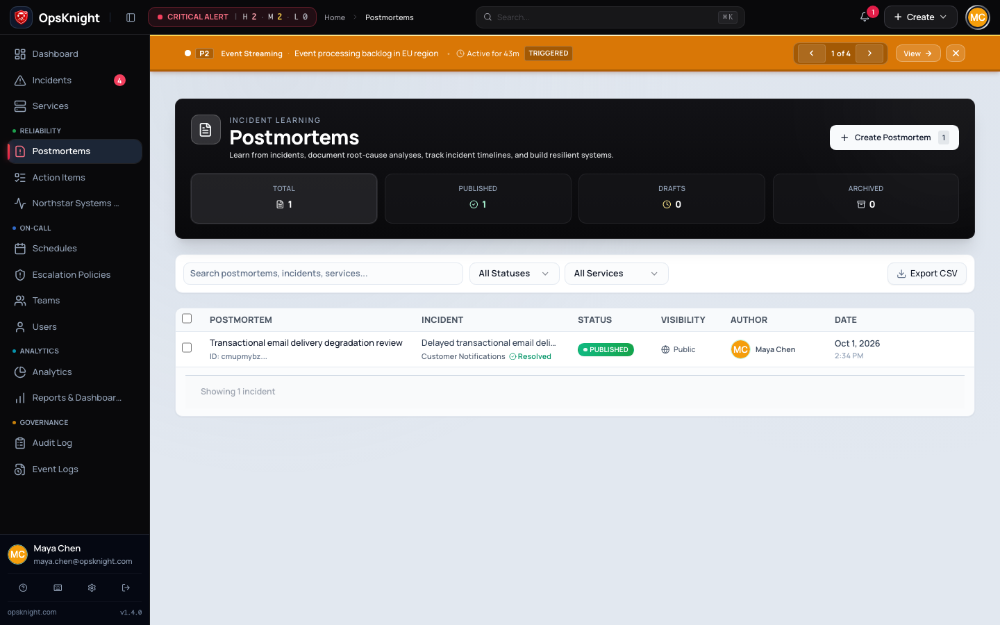

# Create, review, and publish a postmortem

## Before you begin

Resolve the incident first; OpsKnight rejects postmortem creation for an active
incident, and you must be able to read the incident (for an incident outside
your read scope the editor answers `Incident not found`). Only creating a
postmortem needs the incident to be resolved: once one exists it stays editable
if the incident is later reopened. Confirm the incident timeline and service
ownership are accurate and identify the review facilitator and action-item
owners.

## Open the feature

Open **Postmortems**, or open a resolved incident and select its **Postmortem** tab or **Create Postmortem** in the action bar. The tab appears only after the incident is resolved.

## Configure the draft

Open **Postmortems** and select **Create Postmortem**, or open a resolved
incident's **Postmortem** tab. Select the incident when prompted.

1. Enter a specific title (up to 200 characters, the same limit as the API) and
   stakeholder summary.
2. Keep status **Draft** while evidence and reviewers are incomplete. Use **In
   review** once reviewers have it; a postmortem set to **In review** through the
   API can be edited and saved in the editor like any other.
3. Use **Auto-Draft** when useful, then verify every generated statement against
   incident evidence; generated text is a starting point, not an approval.
   **Auto-Draft** replaces the summary, root cause, resolution, lessons,
   timeline, impact, Five Whys and contributing factors in one step and cannot
   be undone. When any of them already has content, it first asks **Replace what
   you have written?**; choose **Keep my content** to leave the form unchanged.
   An empty form is drafted straight away. It needs read access to the
   incident; for an incident you cannot read it answers `Incident not found`.
4. Review and correct timeline events.
5. Record impact metrics with known units and scope.
6. Document root cause narrative, contributing factors, and Five Whys without
   reducing systemic conditions to individual blame.
7. Record resolution and lessons.
8. Add action items with owner, due date, status, priority, and an observable
   completion outcome. A postmortem holds at most 100 action items; the editor
   refuses to save more with "A postmortem can have at most 100 action items."
   A draft generated from ChatOps keeps only the first 100 follow-up notes.
9. Save, reopen, and confirm the draft retained all sections.

### Drafting help

- **AI draft**: offered in the editor only while an administrator has turned
  AI on. It needs the same permission as **Auto-Draft** plus read access to
  the incident. Nothing is saved until you review the text and save it.
- **Evidence in the template draft**: when **Compute operations insights** and
  its **Postmortems** area are on (both off by default), **Auto-Draft** fills
  the template from what OpsKnight already knows about the incident, such as
  its time axis, response, similar incidents and runbook runs. No AI model is
  used. Sections with no evidence keep the template text, and the draft cites
  only incidents that readers of this postmortem can also see.
- **Editor side panel**: with the same switches on, the editor shows whether
  the problem recurred, suggestions for the action item you are typing (open
  look-alikes, a likely owner and the service) and the incident window for
  the quality checklist. These are hints only; they never block saving.

## How the workflow works

OpsKnight maintains one postmortem per incident and synchronizes its saved
follow-up list into operational Action Items.

## Verify, review, and publish

Run the review with incident responders and relevant service owners. Compare the
narrative to the incident timeline, alert history, and customer impact. Remove
secrets and unnecessary personal data. Resolve disputed facts in the incident
record or explicitly label uncertainty.

Change status to **Published** only after reviewers accept the learning record.
The first publication records its publication time. Publishing does not complete
action items. Use the public-status control separately when the postmortem is
appropriate for a status-page audience; verify the public rendering contains no
internal-only detail. The public page shows only the title, summary, root cause,
resolution, lessons, impact numbers, the incident title and resolution time, and
the timeline entries you wrote yourself plus the generated **Incident Started**
and **Incident Resolved** rows. Everything else is left out: the Auto-Draft and
ChatOps draft rows copied from responder notes (**Note by …**), captured chat,
alert, change and runbook-run evidence rows, and incident events (which can name
the responder), author names and emails, action items and SLA counts. To show a drafted event publicly, add your own timeline
entry for it. Still review the summary, root cause and lessons text yourself. The
public page serves only **Published** postmortems. On
a draft the control reads **Allow on Status Page** and the badge reads **Public
once published**; customers see nothing until the status is **Published**. If
the visibility change fails, a message shows the reason and the setting stays as
it was. Only people who can edit the postmortem can change this setting: an
administrator, its author, the incident assignee, or a member of the owning
service's team. Anyone else gets "Forbidden: You do not have permission to
change this postmortem". Each change is written to the audit log as
`postmortem.visibility.changed` on the incident, with the person who made it and
the old and new `isPublic` value.

## Who can see drafts and archived postmortems

Anyone who can read the incident can read its **Published** postmortem. **Draft**
and **Archived** postmortems are working material and are visible only to people
with the `postmortem.draft.read` permission (**View draft postmortems**): the
built-in Admin and Responder roles, and any custom role or temporary access that
includes it. Users and Auditors see published postmortems only. Action items follow
the postmortem they belong to everywhere: the Action Items page, API v2, Slack
`/incident actions` and Squire's follow-up answers and duplicate checks show an
item of a draft or archived postmortem only to people who can read that postmortem.

- On **Postmortems**, the Drafts and Archived counts and the matching status
  filter options appear only for people who can read them. A `DRAFT` or
  `ARCHIVED` status in the page address is ignored for everyone else, so a
  filtered list never falls back to showing published rows under the wrong
  heading.
- The same rule applies to API v2, MCP, the mobile postmortem pages, the Action
  Items page and global search. Search results cannot be used to probe draft
  root-cause or lessons text.
- If an incident already has a postmortem you cannot view, its postmortem page
  says "Postmortem not visible" instead of offering **Create Postmortem**.
- The **Edit** button on a postmortem appears only for people who can save the
  change (an administrator, the author, the incident assignee or a member of the
  owning service's team), not for every responder.

## Remove, archive, or follow up

Track follow-up work in **Action Items**. Completion should preserve its owner
and completion time. If Jira is connected, verify the durable issue key/link and
keep OpsKnight status consistent with the supported synchronization workflow.

Use **Archived** when the record should leave the active review set without
being deleted. Delete only when policy authorizes permanent removal; deletion
and bulk deletion are not substitutes for archival. Administrators can delete
any postmortem; anyone else can delete only postmortems they wrote. If a bulk
delete includes a postmortem written by someone else, nothing is deleted, an
error message says "Only administrators or the postmortem author can delete the
selected records", and the selection stays so you can adjust it. A successful
bulk delete reports how many postmortems were removed.

## Troubleshooting

- **Incident cannot be selected:** it must exist, be resolved, and be readable.
- **Edit is forbidden:** the user must be an administrator, creator, assignee,
  or qualifying service-team member under the current authorization rules.
- **Auto-Draft fails:** save manual work and review incident timeline data; do
  not block the review on generated narrative.
- **Published record is not public:** publication status and public visibility
  are separate controls.
- **Action item disappears:** save the full current action-item list; removed
  items are deleted during synchronization.

## Next steps

- [Postmortem workflow](../../concepts/postmortem-workflow)
- [Action Items](../incidents/action-items)
