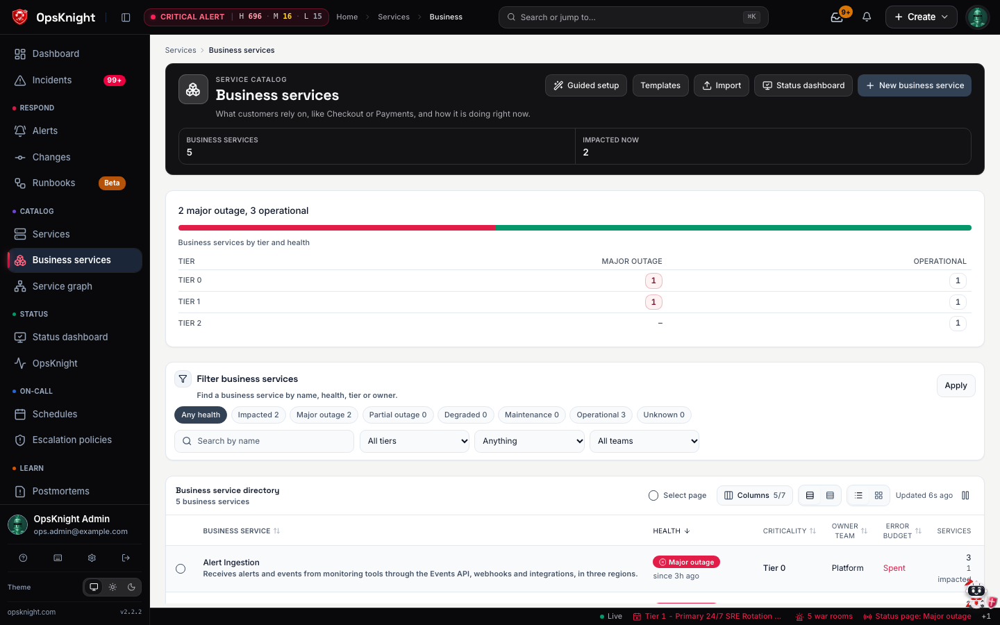
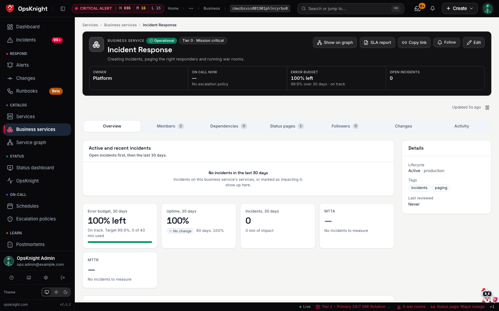
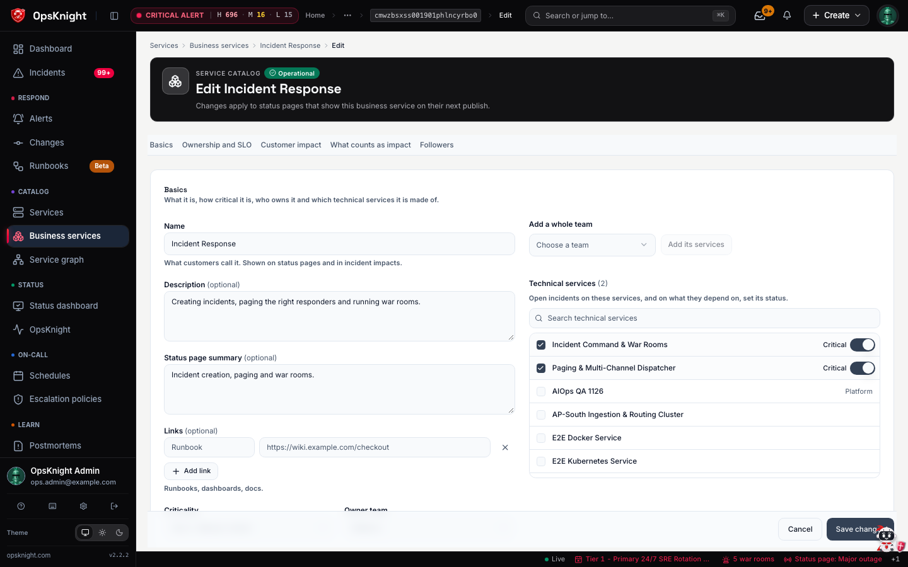
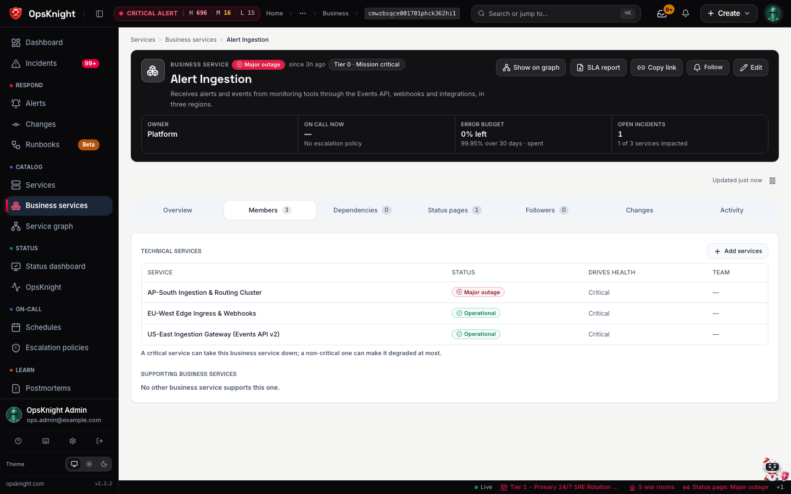
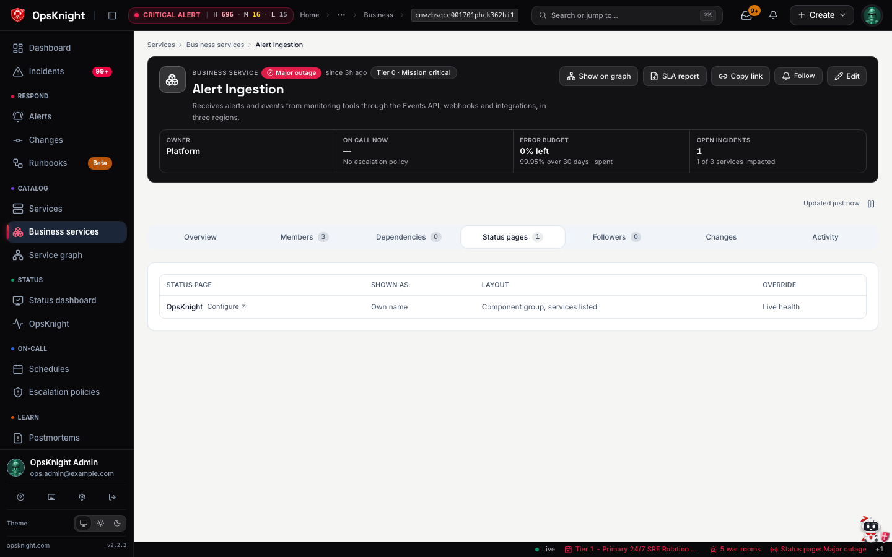

# Business services

A business service is something customers rely on, such as **Checkout** or **Payments**, made of
the technical services that run it. Its status comes from **open incidents**, not from the
hand-set status of its technical services: a high-urgency incident on Payments API makes Checkout
a major outage. Dependencies, supporting business services, maintenance and responder marks count
too; [Business service health](../../concepts/business-service-health) explains every rule.

Nothing changes until you create one. Technical services, alerts and paging behave exactly as
before.

## An example: how OpsKnight describes itself

The public OpsKnight status page groups the product into four business services. Each one is what
a customer would say they depend on, and each is built from the technical services that deliver it.

| Business service          | Tier   | Error budget target | Technical services                                                                                               |
| ------------------------- | ------ | ------------------- | ---------------------------------------------------------------------------------------------------------------- |
| Alert Ingestion           | Tier 0 | 99.95%              | US-East Ingestion Gateway (Events API v2), EU-West Edge Ingress & Webhooks, AP-South Ingestion & Routing Cluster |
| Incident Response         | Tier 0 | 99.9%               | Incident Command & War Rooms, Paging & Multi-Channel Dispatcher                                                  |
| Web & Mobile Console      | Tier 1 | 99.9%               | OpsKnight Web & Mobile Console                                                                                   |
| Analytics & SLA Reporting | Tier 2 | 99.5%               | Real-Time SLA & Analytics Engine                                                                                 |

All four are owned by the Platform team. When the AP-South cluster has a high-urgency incident,
**Alert Ingestion** becomes a major outage ("1 of 3 services affected") while **Incident
Response** stays operational, because none of its services are involved. That is the point of the
grouping: one row per thing customers care about, with the technical detail one click away.

## Browse the catalog

Open **Services** and select **Business services**, or press <kbd>⌘K</kbd> and type "business
services". Everyone who can see services can open it, including stakeholders.

- The header counts business services, how many are **impacted now** (degraded or worse) and how
  many sit in each tier. Select a count to filter by it.
- Filter by name, health (**Impacted**, a single status, or **Operational**), tier, owner team,
  **Needs** (no owner, no tier, no services) and **Attribute** (a custom attribute value, for
  example `region=eu`). Filters and sort live in the URL, so a filtered view can be shared.
- Rows are sorted worst health first. Select a column header to sort by name, health,
  criticality, owner team, error budget or open incidents instead.
- Each row shows the health and **since when**, the criticality, the owner team, the **Error
  budget** left (for business services with an SLO), how many technical services it has and how
  many are impacted, and open incidents. **Hygiene** and **Followers** columns are hidden by
  default; turn columns on or off from **Columns** and pick **Row density** beside it. Switch to cards
  with the view toggle; the choice is remembered.
- The list refreshes on its own and shows when it was last updated.

### Edit several at once

Responders and Admins can tick rows to open a bar at the bottom of the screen. It changes the
**Owner** team, **Criticality**, **Lifecycle**, **SLO** target and **Tags** of the selected
business services, and can **Mark reviewed today**. Select **Preview** to see what would change
for each one, then **Apply to N**. Up to 100 business services change at a time.

## Read a business service overview

Select a business service to open its overview. The header shows its health and since when, its
tier, and four figures: **Owner**, **On call now**, **Error budget** and **Open incidents**. The
header actions are **Show on graph**, **SLA report**, a copy-link button and **Follow**.
Responders and Admins also see **Edit**, which opens the edit form at
`/services/business/<id>/edit`.

When it is impacted, the overview starts with **Why this status**: a plain-language list of what
is driving it (for example "Payments API has an open high-urgency incident"), each linked to its
open incident when there is one. A healthy business service skips this card.

The **Details** panel beside the overview lists lifecycle, tags, links, custom attributes, the
contact channel, when it was last reviewed, and a dependency summary. A contact channel that is a
Slack channel ID or link, or a Microsoft Teams channel link, opens that channel.

| Tab              | What it shows                                                                                                                                                                                                                             |
| ---------------- | ----------------------------------------------------------------------------------------------------------------------------------------------------------------------------------------------------------------------------------------- |
| **Overview**     | Active then recent incidents, uptime for 30 and 90 days, MTTA and MTTR with the change against the 30 days before, the impact chart, and customer impact. Stakeholders see incident counts, not titles.                                   |
| **Members**      | Each technical service with its own status, worst first, and whether it is critical or non-critical (degraded at most), plus supporting business services. Responders and Admins can **Add services** here without opening the edit form. |
| **Dependencies** | Business services this one depends on and those that rely on it, and confirmed upstream technical services of its members.                                                                                                                |
| **Status pages** | The status pages that show it, under which name, in which layout, and any manual override.                                                                                                                                                |
| **Followers**    | Followers, subscribed teams, and the [status dashboards](../stakeholders/status-dashboard) it appears on.                                                                                                                                 |
| **Changes**      | Deploys, config, feature-flag and infrastructure changes recorded on its member services in the last 7 days, newest first.                                                                                                                |
| **Activity**     | Its audit trail, newest first, 50 at a time. Only people who can read the audit log see this tab.                                                                                                                                         |

The impact chart shows one column per day, coloured by how serious the impact was. Switch between
**7**, **30** and **90** days. Select a day, or move with the arrow keys, to list that day's
impacts.

**SLA report** downloads this month so far or last month as CSV or PDF: uptime, severity-weighted
uptime, whether the SLO was met, downtime and the incidents that impacted it. Months are in UTC.

If live health cannot be loaded, the overview says **Health is unavailable right now** and still
shows members, dependencies, status pages and followers.

## Create a business service

Responders and Admins can create and edit business services.

1. Open **Services** and select **Business services**.
2. Select **New business service**.
3. Give it the name customers use, an optional description, a tier and an owner team you can
   see.
4. Pick its **technical services**. Each picker shows the first 50 and searches as you type. A
   technical service can belong to several business services. You can only add services you can
   see; members you cannot see stay when you save.
5. Optionally pick **followers** (see below), then select **Create business service**.

The **Members** tab then lists each technical service with its current status and whether it
**drives health**. A critical service can take the business service down; a non-critical one can
make it degraded at most.

The **Status pages** tab shows where the business service is published and lets you open that
page's layout.

The form also has **Contact channel** (see [Status changes in Slack and
Teams](#status-changes-in-slack-and-teams)) and **Publish status page updates automatically** (see
[Status page updates](#status-page-updates)). Quorum and dependency depth are under **Advanced:
quorum and dependency depth**.

Only Admins can delete a business service. Deleting it removes it from status pages and stops
follower updates; its technical services are not changed. Status pages that show a business
service publish its technical services too. Removing a technical service from the business service
removes it from those pages again, unless another business service on the page still contains it
or an admin selected it on the page directly.

The form also sets its **criticality** (Tier 0 to Tier 3), **what counts as impact** (minimum
incident urgency and lowest priority; leave them on the tier default unless it needs its own
rule), which technical services are **critical** (select **Critical** beside a chosen service to
make it non-critical: it can then make the business service degraded at most) and the **business
services it depends on**. A dependency that would close a loop is rejected.

## Follow a business service

Anyone who can see a business service can **Follow** it from the catalog or its overview. Followers get a short,
plain-language in-app notification when a **public** incident that impacts it starts, when
responders pick it up, and when it is resolved, for example "Checkout is affected" and "Checkout
is back to normal". "Impacts" means the same as on the incident: directly, through a dependency or
a supporting business service, or marked by a responder. An incident a responder unmarked does
not notify followers.

Followers are never paged, and private incidents never notify them. Followers also get an in-app
notification when the business service's status changes, for example "Checkout is now partial
outage".

## Status changes in Slack and Teams

When a business service's status changes, OpsKnight posts it to:

- its **Contact channel**, when that is a Slack channel (an ID such as `C0123ABCD`, a `#name` or a
  channel link) or a Microsoft Teams "Get link to channel" URL; and
- the Slack and Teams channels set up on its member services that its owner team owns.

Up to 5 channels get each post. Slack or Teams must be connected. When you save a Slack channel ID
or Teams link, OpsKnight checks the connected workspace can reach it. Changes to one business
service are announced at least 3 minutes apart, so a status that flips back quickly is not
announced. Anything else in **Contact
channel**, such as an email address, is shown as text and gets no posts.

## Status page updates

When a business service becomes impacted, or recovers, OpsKnight writes an update on every
enabled status page that shows it, using the name the page shows. By default it is a **draft**:
an admin reviews it under the page's announcements (**Drafts**) and publishes it as usual.
When it recovers, an impact draft nobody published is removed. With automatic publishing on, the
published impact update also ends when the recovery is published, so the page stops showing it.

Turn on **Publish status page updates automatically** in the business service form to publish
these updates straight away and notify subscribers. It is off by default; keep it for business
services whose impact is always public, such as Tier 0. Every draft and publish is in the audit
log.

## Monthly review digest

The digest lists up to three top causes for each service. A cause is the first line of the root
cause of a **published** postmortem, or the incident title when the postmortem is a draft, archived
or missing. The digest goes to opted-in team members of any role, so a draft root cause is never
quoted in it.

## Error budget alerts

Admins can turn on **Alert on error budget changes** in **Settings → Notifications**, under
**Monthly service reviews**, then **Save**. It is off by default. Every 15 minutes OpsKnight
checks each business service with an SLO target. When its budget turns at risk or is exhausted,
it tells the owner, the owner team and followers in-app, by email and in the business service's
Slack or Teams channels. A recovery is announced only after an hour without another alert.

## Ownership reminders and scorecards

Both are in **Settings → Notifications** and only admins can change them.

- **Ownership reminders**, next to the service review settings, notify owners at most once a week
  per issue when a review is overdue, the owner is inactive or the owning team has no one on
  call. Off by default.
- **Business service scorecards** set the rules every business service is scored against,
  grouped into levels. A level is reached when its rules and every lower level's pass. Rules can
  check a field, a custom attribute, the SLO state or a hygiene flag, and can be limited to
  tiers or teams and given a deadline. Edit the **Rubric (JSON)** and **Save rubric**; **Load
  default** restores the default: Bronze (has an owner, a tier and member services), Silver (has
  an SLO target, links and a description) and Gold (reviewed in the last 180 days).

## Who sees what

People with organization-wide service access see every business service. Everyone else sees the
business services owned by one of their teams or containing one of their teams' services.

## Incidents show their impact

An incident shows **Impacts** with every business service it impacts that you can see, under the
incident title on desktop and mobile. Hover a chip for the reason (its service is affected, a
service it depends on is affected, a business service it relies on is affected, or marked by a
responder); select it to open the business service.

Responders can correct the list on desktop: **+ Impacted business service** marks one the engine
missed, even below its threshold, and the **x** on a chip unmarks one. An unmark is remembered, so
it does not come back when the incident changes. Both are audited.

`/m/status` lists business services with their engine status and how many of their services are
affected.

## Show business services on a status page

See [Status page layouts](../status-pages/business-service-layouts).

## API and MCP

| Operation                          | REST v2                                                                          |
| ---------------------------------- | -------------------------------------------------------------------------------- |
| List business services             | `GET /api/v2/business-services`                                                  |
| Create                             | `POST /api/v2/business-services`                                                 |
| Read, update, delete               | `GET/PATCH/DELETE /api/v2/business-services/{id}`                                |
| Incidents that impacted it         | `GET /api/v2/business-services/{id}/incidents`                                   |
| Impact timeline, uptime, MTTA/MTTR | `GET /api/v2/business-services/{id}/impact-timeline`                             |
| Error budget and burn state        | `GET /api/v2/business-services/{id}/error-budget`                                |
| Changes on member services         | `GET /api/v2/business-services/{id}/changes`                                     |
| Monthly SLA report                 | `GET /api/v2/business-services/{id}/sla-report`                                  |
| Scorecard                          | `GET /api/v2/business-services/{id}/scorecard`                                   |
| Scorecard rubric                   | `GET/PUT /api/v2/settings/business-service-scorecard`                            |
| Mark or unmark an incident impact  | `PUT/DELETE /api/v2/incidents/{id}/business-service-impacts/{businessServiceId}` |

Every business service in a response carries `health` (status, since, reasons, open incident
count). The list filters by `q`, `tier`, `status`, `ownerTeamId`, `impactedOnly` and `attribute`, and sorts by
`newest` (default) or `name`. `memberServiceIds` and `followerUserIds` replace the whole set when
present; `criticality`, `impactMinUrgency`, `impactMaxPriority`, `nonCriticalServiceIds` and
`dependsOnBusinessServiceIds` change only when sent. Writes need an `Idempotency-Key`.

Assistants read business services with the MCP tools `business_services_list`,
`business_service_get`, `business_service_health`, `business_service_incidents` and
`business_service_changes`. Creating or updating a business service, and marking or unmarking
impact, go through `operation_prepare` and need a person to approve them. Deleting a business
service stays in the web app and REST API.
