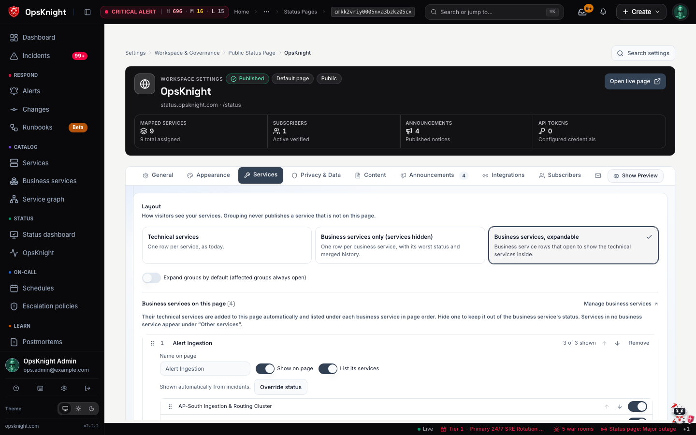
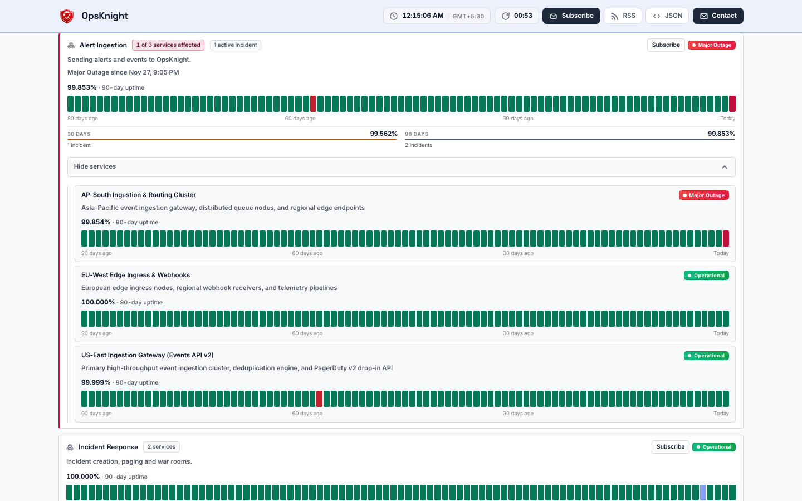
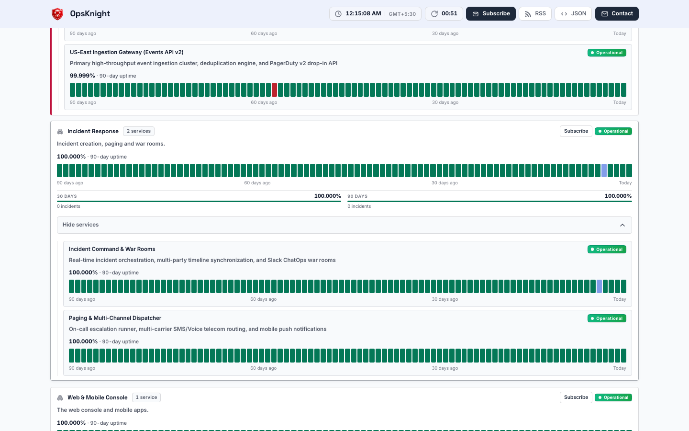
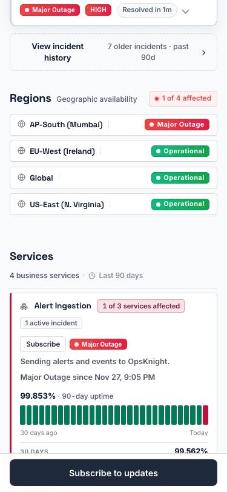

# Status page layouts

A status page can list its services in three ways. Choose one in **Settings → Status pages →
your page → Services → Layout**.

| Layout                                       | What visitors see                                                                                                       |
| -------------------------------------------- | ----------------------------------------------------------------------------------------------------------------------- |
| **Technical services**                       | One row per technical service, exactly as before.                                                                       |
| **Business services only (services hidden)** | One row per business service with its worst status, merged 90-day history and uptime.                                   |
| **Business services, expandable**            | The same rows as dropdowns: each opens to show its technical services with their own history. Affected ones start open. |

A page with no services yet starts on **Business services, expandable** when your organization
has business services; otherwise it starts on **Technical services**. Saving the Services section
keeps that choice. Pages that already list services keep their layout.

Every row shows its service count, for example "3 services", or how many are affected, for example
"1 of 3 services affected". On the expandable layout a full-width **Show services** bar under the history opens the row, and
flips to **Hide services**. A row with active incidents shows a chip such as "1 active incident" that jumps to
the incidents section. Technical services that are in no business service on the page appear under
**Other services**. On the expandable layout that is one more card, closed unless one of its
services is affected, so ungrouped services look like part of the page rather than an afterthought.
To keep a service out of that card, add it to a business service or hide it from the page.

Only **Active incidents** appear above the services, so an outage is the first thing a visitor
reads. **Past incidents** (resolved ones from the last 14 days, with older ones behind **View
incident history**) are listed below the services, so a long history never pushes the services off
the first screen. A page with no active incident has no section above the services.

With the expandable layout, **Expand groups by default (affected groups always open)** opens every
row when the page loads. Off (the default), only affected rows start open.

## How status, history and uptime are worked out

- **Status** is the worst current status of the business service's services on this page.
- **History** shows, for every moment in the last 90 days, the worst status of any of them.
- **Uptime** is the uptime of its least available service; incident counts are added up.

Only services published on this page count. Hide a technical service under its business service
in the editor to keep it out of the business service's status.

Click a day on a history bar to see that day's incidents for the row. On a business service row
this includes incidents on any of its services and incidents that name the business service.

## Set it up

1. [Create business services](../services/business-services) first.
2. In **Services → Layout**, pick **Business services** or **Business services, expandable**.
3. Add business services: type in **Find a business service to add** to narrow the list, then
   click one. Their technical services are added to the page automatically.
4. Order them by dragging or with the arrows. A business service that supports another one on the
   page is indented under it.
5. Save. The page republishes; removing a business service withdraws the page before it
   republishes, like any change that shows less.

Changing only the layout never publishes a service that is not already on the page.

## What visitors see

Each business service is one card with its worst status, merged 90-day history and uptime. A group
with an affected service opens by itself, as **Alert Ingestion** does here:

A group with nothing wrong stays closed. The **Show services** bar under its history opens it and
turns into **Hide services**:

On a phone the cards stack and the **Subscribe to updates** button stays pinned to the bottom:

## Rename, hide and order business services

Each business service on the page has its own settings, saved with the page:

- **Name on page**: what visitors see, for example "Buying things" instead of "Checkout".
- **Show on page**: off keeps it off the page. Updates that name it still count its services.
- **List its services**: off keeps the row closed even on the expandable layout, so visitors see
  the business service but not its parts.
- **Order**: drag or use the arrows to set the order on the page.

Each business service lists its technical services underneath, in page order, with a count such
as "2 of 3 shown". Drag a service or use its arrows to reorder it, and use its switch to hide it
from this page. The order is the page's one service order, so it also applies to the services list
and to the services inside each row on the public page.

The live preview shows the business service rows from your unsaved layout.

Hiding a business service or its services withdraws the page before it republishes, like any
change that shows less.

## Pin a status (override)

Sometimes the computed status is not what customers experience, for example during a partial
rollback. Click **Override status** next to a saved business service, pick a **Public status** and
**Apply now**. A business service you just added needs a page save first. The page
shows that status instead of the computed one until the end time you choose (blank means 30 days,
the maximum). **Automatic (from incidents)** removes the pin. Overrides apply at once, without
saving the page, and every set, clear and expiry is in the audit log.

When an override ends, the background sweep clears it on its next run and the page shows the
computed status again. A pinned row shows no "since" time.

## Status since

An affected business service shows when the problem started, for example "Partial outage since
22 Nov, 10:04", in the page's time zone. On a live page a row that becomes affected opens again
even if the visitor closed it.

## Updates that name business services

When you write an incident update or an announcement, tick **Affected business services** to name
them instead of each technical service. Every service inside counts as affected:

- a maintenance that names a business service puts its services in maintenance on the page;
- the update card lists the business services, and the services and regions inside them;
- subscribers to those business services or their services get the update.

Public incident cards also list the business services on the page the incident affects. The
incident filter lists business services as well as services; picking one shows the incidents that
affect it.

## Subscribers

On a grouped page the subscribe form offers business services, plus any services outside them. A
subscriber who picks Checkout hears about incidents and announcements on any of Checkout's
services. People who pick nothing still get every update.

## Themes, mobile and accessibility

The layouts use the page's theme colours, so every built-in theme and custom CSS keep working, in
light and dark. The Show/Hide services bar is a button that announces whether the row is open, work with the
keyboard and have 44px touch targets on phones.

## API

`GET /api/v2/status-pages/{id}/business-services` returns the layout and business services.
`PUT` with `{ "serviceLayout": "BUSINESS_EXPANDABLE", "businessServiceIds": [...] }` sets them; it
needs `If-Match` and an `Idempotency-Key`. Add `businessServiceConfigs`, keyed by business service
id, to set `displayName`, `showOnPage` and `showMembers`.

`PUT /api/v2/status-pages/{id}/business-services/{businessServiceId}/override` with
`{ "status": "MAINTENANCE", "until": "2026-11-23T06:00:00Z" }` pins a status; `{ "status": null }`
clears it. Announcements accept `businessServices: [...]` to name affected business services. The public snapshot (`schemaVersion` 3) adds
`page.serviceLayout` and `businessServices` only on grouped pages; a page on the default layout
publishes the same snapshot as before.
