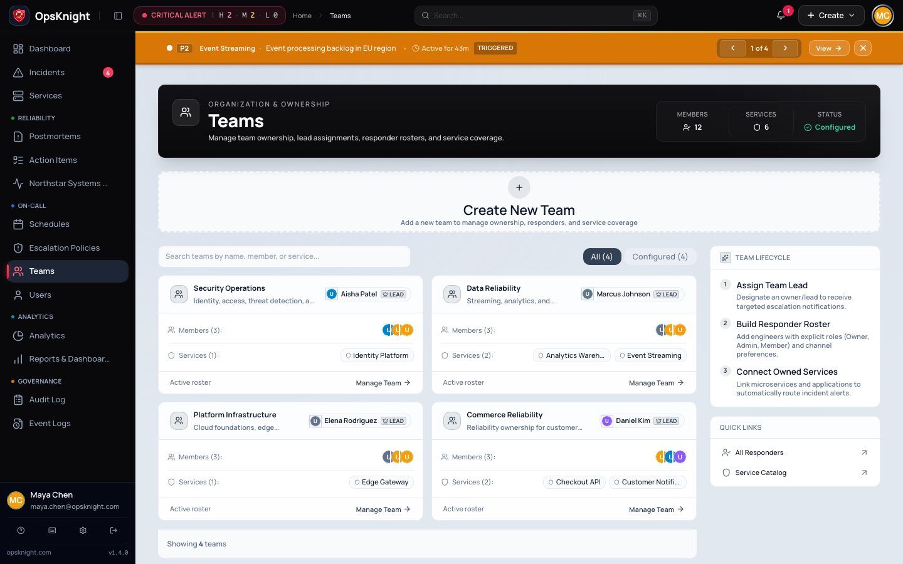

# Create and manage a team

## Before you begin

Identify the team owner/lead, responders, services, on-call participation, and
whether SCIM or OpsKnight owns membership.

## Open the feature

Open **Teams**, select a team, or choose the create action.

## Configure the team

1. Enter a unique team name and operational description. A name that is already taken is
   refused with "A team with that name already exists." in the form, including when two
   people create or rename teams to the same name at the same moment.
2. Add intended members and confirm each user is active. The add-member picker lists
   active users only; an invited user who has not accepted yet does not appear.
3. Set supported team leadership/ownership fields. The **Team lead** list offers active
   members only (a disabled lead stays listed, marked disabled, so you can see who it is).
   Appointing a disabled member is refused. Saving with the lead unchanged never fails because
   the current lead has since been disabled, so a name or description edit still saves.
   When an edit is refused, the form shows the actual reason (for example the lead is
   not active or you no longer have access to the team) instead of a generic failure message.
4. Assign services and verify the team can read and operate them.
5. Confirm members appear in on-call, notification, and collaboration selectors
   where their roles permit it.
6. Save and reload the team detail.

When a Responder creates a team, they are added to it as its **Owner** in the same step,
because only organization administrators and a team's owners and admins can manage its
members. Administrators who create a team are not added automatically.

To add several people at once, select them in the bulk add dialog. It stays open, tries
every selected person even if one fails, lists each person who could not be added with the
reason, removes the people who were added from the list and leaves the failed ones selected
so you can fix the cause and retry.

## How membership works

Team membership scopes service access and ownership but does not itself grant an
administrator or responder system role. When SCIM Groups own membership, change
the provider assignment and let provisioning reconcile it.

## Verify the team

Sign in as a representative member and confirm intended services are visible,
unowned services remain inaccessible, and notification/on-call participation is
correct.

## Remove members or delete the team

Before offboarding a member, transfer active incident assignments, schedules,
action items, and ownership. Before deleting a team, reassign services,
incidents, escalation targets, dashboards, and integrations. SCIM group DELETE
can also delete the mapped team; review that policy first.

OpsKnight refuses to delete a team that still has unresolved incidents or is a
target in an escalation policy step. Resolve or reassign those incidents and
remove the team from escalation steps, then delete it. The team and its audit entry are
removed in one transaction. If the team is already gone, for example from a second tab, the
console answers `This team no longer exists` instead of an error.

## Troubleshooting

- **Member cannot see a service:** verify both team assignment and system role.
- **Member returns after removal:** SCIM is likely authoritative.
- **Delete is unsafe or blocked:** inventory and reassign dependent objects.
- **On-call is wrong:** membership alone does not place a user in a rotation.

## Next steps

- [Manage services](../services/manage-service)
- [Manage users](../administration/manage-users)
- [Configure SCIM](../identity/configure-scim)
