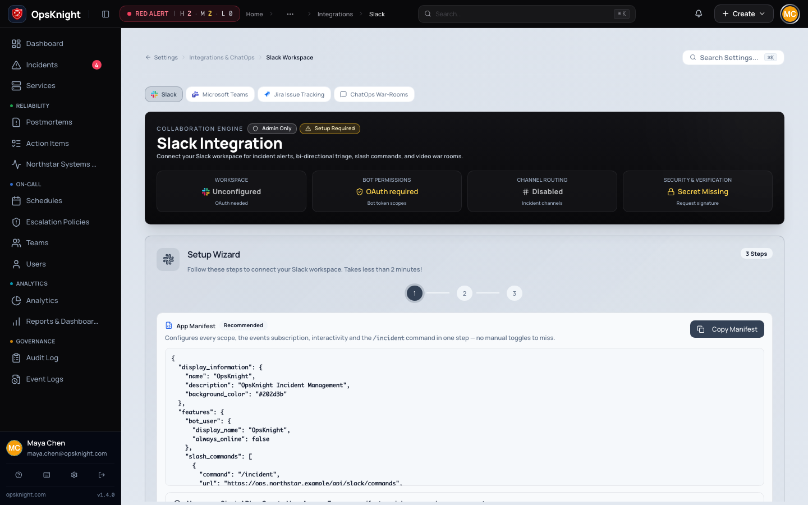

# Integrations

The machine-readable `integrations/catalog.yaml` includes inbound alert adapters,
Slack, Microsoft Teams, Jira, outbound webhooks, notification delivery, OIDC,
and SCIM. Inbound provider pages are generated from source-derived contracts;
the communication and identity pages are maintained as workflow documentation.

Each inbound page records the handler type, lifecycle actions actually present
in its adapter, authentication and conditional signature behavior, and available
delivery identity. Do not assume every provider supports acknowledge, signatures,
or durable delivery fencing merely because another provider does.

## Communication and work management

- [Slack ChatOps](./communication/slack/) — OAuth, destinations, incident
  actions, identities, war rooms, permissions, and troubleshooting.
- [Microsoft Teams ChatOps](./communication/microsoft-teams/) — Entra and Bot
  setup, Adaptive Cards, destinations, war rooms, consent, and troubleshooting.
- [Jira](./issue-tracking/jira) — issue creation, linking, synchronization, and
  authenticated webhooks.
- [Voice paging](./communication/voice) — Twilio voice delivery and callbacks.

## Where to send the routing key

Prefer a header. Send the integration key as `X-Integration-Key: <key>`,
`Authorization: Bearer <key>` or `Authorization: Token token=<key>`. A key in the
URL (`?integrationKey=...`) is accepted because some senders can only be given a
URL, but it ends up in proxy and load-balancer access logs and in the sender's own
configuration history, where anyone who can read them can send alerts as the
integration. The service Integrations tab therefore shows the URL without the key
and the header first, and offers the URL with the key under "Sender can only be
given a URL?". CloudWatch, Azure and Google Cloud Monitoring cannot add a header,
so they show the URL with the key.

OpsKnight itself never writes the key from a query string to its logs, audit
rows or error messages: the values of `key`, `integrationKey`, `routingKey`,
`token` and `secret` (and their underscore forms) are replaced with `[REDACTED]`
in any logged or audited text, absolute or relative. Rotate the key if a URL
carrying it was shared.

## Change events

Change endpoints record deploys, configuration, feature-flag and
infrastructure changes as evidence for probable-cause analysis. They never
create an alert or an incident and never page anyone. Each one uses a generic
webhook integration and is authenticated like the generic webhook endpoint:
integration key, optional HMAC signature, rate limit and delivery
de-duplication. A change is scoped to the integration's service, or to the
service its component or app labels map to once the integration has a change
service mapping. A `serviceId` in the body is ignored.

| Endpoint (`POST …?integrationId=…`)     | Records                                                                                                                                                 |
| --------------------------------------- | ------------------------------------------------------------------------------------------------------------------------------------------------------- |
| `/api/integrations/changes`             | Any change in OpsKnight's own format: `source`, `kind` (default `DEPLOY`), `summary`, `version`, `component`, `labels`, `url`, `dedupKey`, `occurredAt` |
| `/api/integrations/argocd`              | Argo CD notification → deploy                                                                                                                           |
| `/api/integrations/github-deployments`  | GitHub `deployment_status` → deploy; verified with `X-Hub-Signature-256` when a signing secret is set                                                   |
| `/api/integrations/gitlab-deployments`  | GitLab deployment event → deploy; verified with `X-Gitlab-Token` when a signing secret is set                                                           |
| `/api/integrations/kubernetes-rollouts` | Forwarded Kubernetes Event about an Argo Rollouts Rollout → deploy                                                                                      |
| `/api/integrations/launchdarkly`        | LaunchDarkly webhook → feature-flag change                                                                                                              |
| `/api/integrations/unleash`             | Unleash webhook addon → feature-flag change                                                                                                             |
| `/api/integrations/terraform`           | HCP Terraform run notification → infrastructure change                                                                                                  |

A repeated delivery is answered as `change_duplicate` instead of recording a
second change.

## Alert identity and correlation keys

Every alert correlates by the `dedup_key` its adapter derives, and a resolve
closes the incident that holds the same key. Grafana and Alertmanager-style
payloads use the alert's `fingerprint` (a hash of its whole label set). When a
sender omits it, the key is now `alertname`, `instance` and a hash of all labels,
so two series that share a name and instance but differ in another label (job,
rule UID, folder) open separate incidents, and the first one resolving no longer
closes the other. The generic webhook adds a hash of its host-style fields to the
summary-based fallback key under the same rule. Datadog is unchanged: it still
uses `aggregation_key`, then alert ID, then monitor ID, so send
`$AGGREG_KEY` or a per-group identity from multi-alert monitors.

The same alert keeps the same key across re-triggers and resolves. After an
upgrade an incident that is already open for a key built the old way is no longer
matched by the new key: its next trigger opens one new incident and the old one
needs a manual resolve. Check open incidents from Grafana-without-fingerprint
and generic-webhook integrations after the upgrade.

## Delivery history retention

Each inbound delivery leaves one row that de-duplicates retries and feeds the
integration's diagnostics and usage views. The scheduler deletes finished
deliveries after 30 days, in batches of 1,000 and at most 10,000 per hourly run,
and never touches one that is still being processed. An identical payload that
arrives again after its row is gone is treated as new. Set
`OPSKNIGHT_INBOUND_DELIVERY_RETENTION_DAYS` (1 to 3650) to change the window; see
the [configuration reference](../reference/configuration/).
