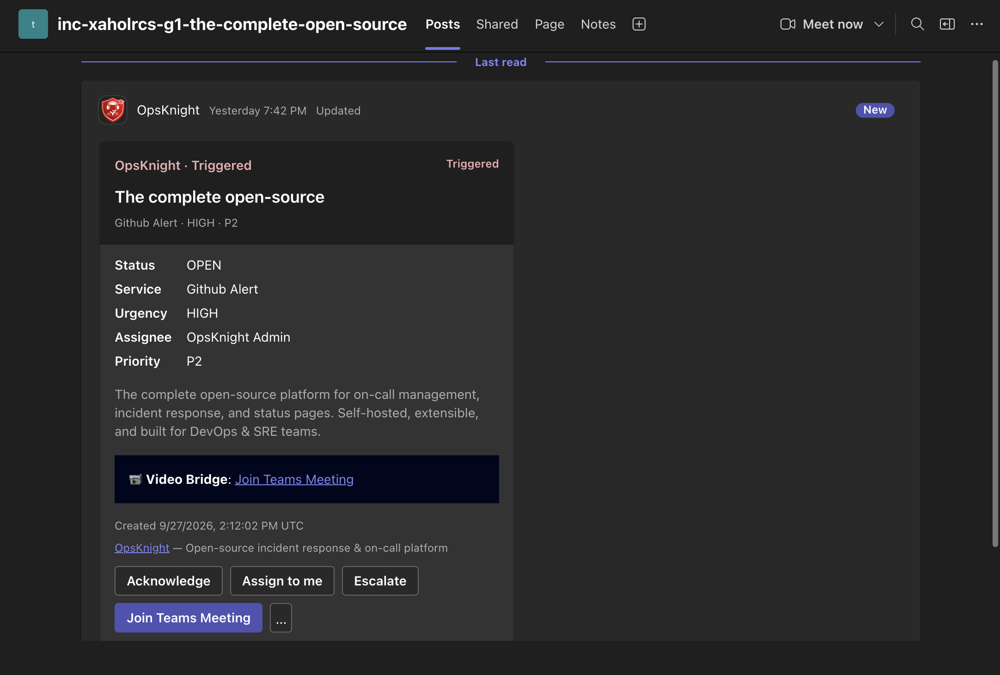

# Configure Microsoft Teams war rooms

## Before you begin

Complete the base Teams installation and obtain permission to grant optional
resource-specific consent in the target team.

War rooms require additional resource-specific consent beyond ordinary card
delivery. Enable war-room permissions in the generated package, reinstall or
update it in the target team, then select the war-room destination for the
service.

In a provisioned incident channel, the card can include the video bridge and
the actions available to the signed-in responder.

## Open the feature

As administrator, open **Settings → Integrations → Microsoft Teams** to generate/update the app package. Then open **Services → select service → Notifications → Microsoft Teams** to select the one destination that owns automatic war-room behavior. Responders create/manage the room from the incident collaboration controls.

## Configure war-room consent

1. Enable war-room permissions in the generated application package.
2. Reinstall or update the package in the target team.
3. Select the service destination that owns automatic war-room behavior.
4. Create a test incident room and verify its lifecycle.

Channel creation needs `Channel.Create.Group` and
`TeamsAppInstallation.Read.Group`. Lifecycle and membership features add
`ChannelSettings.ReadWrite.Group`, `TeamMember.Read.Group`,
`ChannelMember.Read.Group`, and `ChannelMember.ReadWrite.Group`.

Verify creation, marker reconciliation, membership synchronization, message
projection, and terminal cleanup before production use.

## What OpsKnight does

OpsKnight creates/links an incident-scoped Teams channel, stores durable identifiers/markers, publishes incident context, reconciles membership and cards, and performs terminal cleanup. The incident remains authoritative. Only one destination per service owns automatic war-room behavior.

## Verify it worked

Confirm the channel appears in the intended team, normal incident context and optional video bridge/actions are correct, expected members synchronize, card actions update OpsKnight, and closure performs documented cleanup.

## Remove or change the war room

Close/reconcile it from OpsKnight rather than manually deleting the Teams channel. If you end the video bridge or resolve the incident while the bridge is still being created, the bridge closes at once and the Teams meeting created a moment later is deleted automatically; if that deletion fails it shows as cleanup debt that an administrator can retry. To change owner destination, finish/open-room coordination, select the new service destination, and test with a new incident; do not assume existing remote rooms migrate.

## Squire in the war room

When Squire is enabled for chat (**Settings → Intelligence → AI**), mention the
bot in the war-room channel to ask about the incident, or send
`@OpsKnight investigate [focus]` to run Squire's investigation on it. Squire
replies in the thread, edits that reply with its progress, and finishes with the
investigation and links to the evidence, answering as the asker's linked
OpsKnight account; unlinked people and people who cannot read the incident are
refused.

Squire also keeps an incident summary and an investigation card in the war room,
edited in place, and replies with digests and fix verifications in that card's
thread. Updates go only to the incident's live war room and stop when the Teams
configuration or the destination is disabled. Teams always shows the bot as the
sender, so each Squire card starts with a "Squire · OpsKnight assistant" header.

## Troubleshooting

**Channel creation forbidden:** verify optional RSC permissions and team-level consent/package update.

**Room exists but OpsKnight reports ambiguity:** inspect collaboration operation/markers before retrying to avoid duplicate channels.

**Membership fails:** verify Team/Channel member read/write RSC and target user availability.

## Next steps

- [Review permissions](./permissions)
- [Use incident actions](./incident-actions)
- [Troubleshoot Teams](./troubleshooting)
