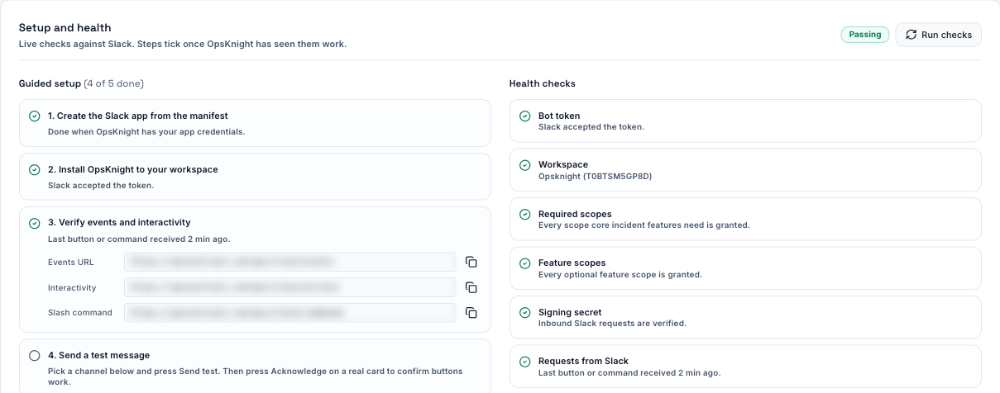

# Slack ChatOps

Connect one Slack workspace to deliver incident lifecycle messages, accept
interactive responder actions, run `/incident` commands, and create incident
war rooms. Start with the complete [Slack ChatOps setup](./connect-with-oauth),
which covers Slack app creation through production acceptance.

## Recommended setup sequence

1. [Create, connect, and validate the Slack app](./connect-with-oauth).
2. [Review scopes](./permissions-and-scopes) and reinstall after changes.
3. [Configure service channels](./configure-service-channels) and test each one.
4. [Link responder identities](./user-identity-linking).
5. Validate [notifications](./incident-notifications), [actions](./incident-actions),
   and [commands](./commands) with a synthetic incident.
6. Configure and rehearse [war rooms](./war-rooms) when required.
7. Document [rate-limit](./rate-limits), [troubleshooting](./troubleshooting),
   and [disconnect/reconnect](./disconnect-reconnect) ownership.

## Choose a task

- [Connect and configure Slack ChatOps](./connect-with-oauth)
- [Configure service channels](./configure-service-channels)
- [Send and verify a test](./send-test)
- [Understand incident notifications](./incident-notifications)
- [Acknowledge and resolve incidents](./acknowledge-resolve)
- [Use incident actions](./incident-actions) and [commands](./commands)
- [Create and operate war rooms](./war-rooms)
- [Link responder identities](./user-identity-linking)
- [Review permissions and scopes](./permissions-and-scopes)
- [Review rate limits](./rate-limits)
- [Disconnect or reconnect](./disconnect-reconnect)
- [Troubleshoot Slack](./troubleshooting)

## Check setup and health

**Settings → Integrations → Slack** has a **Setup and health** panel with live checks against Slack: the bot token, the workspace, required scopes, optional feature scopes, the signing secret, recent requests from Slack, and whether Squire is on. A guided checklist ticks as OpsKnight sees each step work, and shows the events, interactivity, and slash-command URLs to paste into the Slack app. Select **Run checks** to refresh. A missing scope shows a **Reconnect Slack** button; an app installed from an older manifest shows a notice listing what is missing (see [permissions and scopes](./permissions-and-scopes)).

The same checks are available to administrators as JSON at `/api/slack/health`.

## How the pieces relate

The OAuth installation authorizes the OpsKnight bot. Service destinations
control routine lifecycle delivery. Identity links authorize user-attributed
actions. War rooms are separate incident-scoped channels with their own
lifecycle. Configuring one does not implicitly configure the others.
