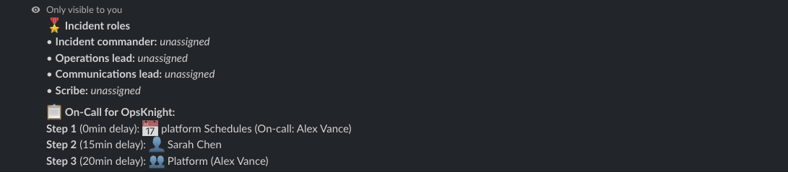
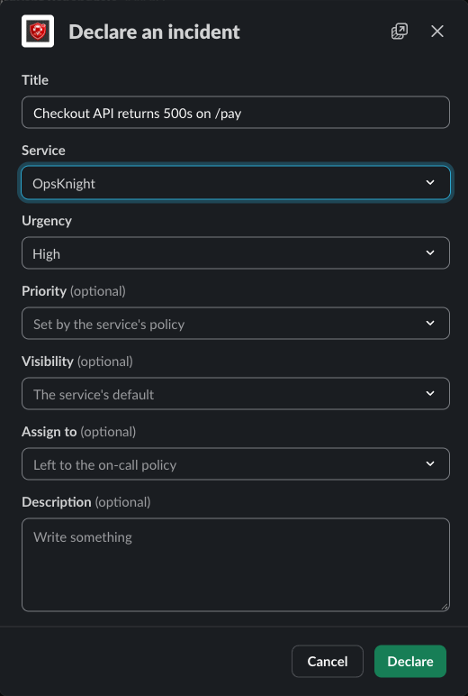

# Use Slack incident commands

## Before you begin

Install the current Slack app manifest, link your identity, and open an incident destination/war room where the command context is clear.

## Open the feature

In Slack's message composer, enter `/incident help` to display the supported command syntax.

## Configure the command

Three commands work in **any** channel; the rest work in an incident war room:

| Command | What it does |
| --- | --- |
| `/incident declare` | Opens a form to declare a new incident (see below). |
| `/incident list [service]` | Your open incidents, or a service's. If none are assigned to you, it shows the latest open incidents you can see and says so. |
| `/incident oncall [service]` | Who is on call for a service. |
| `/incident ack` | Acknowledges the incident. |
| `/incident resolve [summary]` | Resolves the incident, optionally with a summary. |
| `/incident note <text>` | Adds a note to the timeline. |
| `/incident who` | Roles and on-call chain for the incident. |
| `/incident page <@person\|team:<name>\|schedule:<name>>` | Pages a person, a team, or whoever is on call for a schedule. See below. |
| `/incident assign <@person\|me>` | Assigns the incident. |
| `/incident priority <P1-P5>` | Changes the priority. |
| `/incident urgency <high\|medium\|low>` | Changes the urgency. |
| `/incident title <text>` | Renames the incident. |
| `/incident describe <text>` | Replaces the description. |
| `/incident status <message>` | Publishes a status-page update (admins only). |
| `/incident runbook` | Lists the service's runbooks and runs one after a preview. |
| `/incident action <text> [@person] [due:YYYY-MM-DD]` | Adds a follow-up action item. |
| `/incident actions` | Lists the open action items. |
| `/incident role <commander\|ops-lead\|comms-lead\|scribe> @person\|me\|clear` | Assigns or clears an incident role. |
| `/incident postmortem` | Starts a postmortem. |
| `/incident help` | Lists the commands. |

When Squire is enabled for chat, `ask <question>` and `investigate [focus]` answer privately about the channel's incident, under your linked account's access. Provide required text and avoid sensitive information in notes/summaries.

A `note` is saved in full on the incident's notes. The timeline entry for it shows at most the first 1,500 bytes of the text, ending in an ellipsis when it was cut.

`postmortem` creates a draft postmortem from the incident's timeline and notes, or returns the existing one. It works only for a resolved incident: for an open incident the channel gets "Postmortems can only be created for resolved incidents." The draft records the affected service and the downtime in minutes, keeps the first 100 `todo:`, `action item:`, `fix:` or `followup:` notes as action items, and does not put your name into the public resolution text. Creating it is written to the audit log as `postmortem.created`.

## Complete the action

1. Enter `/incident <command>` with its argument.
2. Submit once and read the response.
3. Complete identity linking if prompted.
4. Open OpsKnight when the response says the action was queued or cannot confirm final state.

## Declare an incident from Slack

`/incident declare` opens a form with the same choices as the web create page:

- **Title** and **Service** are required. The service list is searchable.
- **Urgency** defaults to High.
- **Priority** is optional. Left empty, the service's policy sets it, as on the web.
- **Visibility** is optional: customer-facing (status pages) or internal only. Left empty, the service's default applies.
- **Assign to** is optional and is a Slack person picker. OpsKnight maps the person to an OpsKnight user by email. If they have no matching account, the incident is still declared, the on-call policy assigns it, and the reply says so.
- **Description** is optional.

OpsKnight checks that you may declare incidents on that service, using your linked account, before it creates anything. If the declaration matches an open incident, it is added there instead of creating a duplicate.

## Page, assign, and update

These work in a war-room channel and run as you, with your normal permissions.

- **`page`** pages the target for this incident. A person is assigned the incident; a schedule resolves to whoever is on call now; a team becomes the owning team and the assignee is cleared. A name that isn't `@person`, `team:` or `schedule:` is tried as a team first, then as a schedule. The result is posted in the channel ("Paged …"); a refusal, an unknown target, an unlinked person, or an empty schedule is a private message. It needs permission to manage the incident, and the person needs an active OpsKnight account. Add a responder without changing the assignee from the [More actions menu](./incident-actions).
- **`assign`** and the person picker take a person or `me`. You can type `@name`; OpsKnight finds that person in the workspace.
- **`priority`, `urgency`, `title`, `describe`** change one field and need permission to manage the incident. The card is refreshed and a thread reply says what changed ("Priority P2 → P1"). A value that is already set answers "Nothing changed".

## Post a status-page update

`/incident status <message>` and **More actions → Post status update** publish a customer-facing update. They need the administrator capability and only work for an incident that is public and whose service is on an enabled status page; otherwise they say why in a private message. The update is published as an information announcement linked to the incident on up to five status pages that show the service. Subscribers are notified only when you tick **Also notify subscribers** in the form; the command never notifies. The result is posted in the channel.

## Run a runbook

`/incident runbook` lists up to five enabled runbooks attached to the incident's service, each with a **Preview** button. Preview shows the version, the steps, the risk and approval flags, and any check that blocks the run. **Confirm and run** appears only when nothing blocks it, and the confirmation is valid for five minutes and works once, so a stale preview or a second click is refused. A runbook that needs approval starts as it does on the web and its steps wait for an approver in OpsKnight. You need permission to run runbooks and to read the incident. The channel and the card's thread get a link to the execution. Runbooks that Squire only suggests are not listed.

## Action items

`/incident action Add a canary to the deploy [@person] [due:2026-12-05]` adds a follow-up to the incident's postmortem, creating a draft postmortem if there isn't one. The title is at most 200 characters, a due date must be a real date (up to a day in the past is accepted), and an identical open title is refused as a duplicate. The owner must have an OpsKnight account. `/incident actions` lists the open, in-progress, and blocked items privately (ten at most). You need permission to manage the incident to add items. Items created this way are marked manual.

## How a command answers

A fast command shows only its answer, with no "Processing" note. Who sees the answer depends on the command:

- **Private to you:** the read-only commands (`who`, `list`, `oncall`, `help`), `ask` and `investigate`, and any error or refusal.
- **Posted in the channel:** commands that change the incident (`ack`, `resolve`, `note`, `role`, `page`, `status`, `action`, and `postmortem`) announce the result to everyone in the channel, including a resolution summary or the text of a note. Keep that in mind before putting sensitive details in them.

Commands that can take many seconds (`ask`, `investigate`, `postmortem`) first show a short "Working on it…" note so you know the request arrived.

## What OpsKnight does

OpsKnight validates the Slack signature/timestamp, parses only the supported grammar, maps identity, checks authorization/context, and applies the same product transition used by the UI.

## Verify it worked

Confirm the authoritative incident timeline/state/actor in OpsKnight and the updated Slack projection. For `who`, confirm the reported ownership matches current OpsKnight state.

## Change or undo the command

Commands create product actions; deleting Slack command text does not undo them. Use the supported incident workflow to correct state or add a clarifying note.

## Troubleshooting

**Command not recognized:** use `/incident help` and confirm the current app package registered the command.

**Wrong incident/context:** open the intended incident message/war room and retry only after confirming no action applied.

**Temporary queue error:** inspect OpsKnight worker health and operation state before retrying.

## Next steps

- [Acknowledge and resolve](./acknowledge-resolve)
- [Troubleshoot Slack](./troubleshooting)

