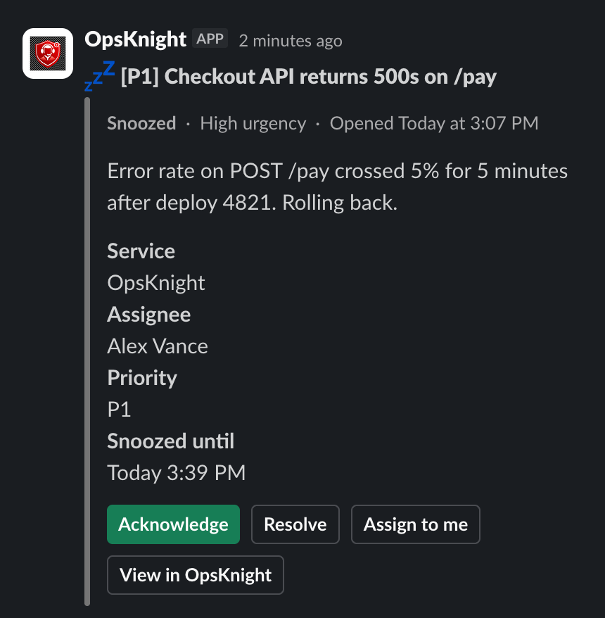

# Use Slack incident actions

This page summarizes the supported action surface. Follow [Acknowledge and resolve incidents](./acknowledge-resolve) for lifecycle effects and [Slack incident commands](./commands) for exact slash-command behavior.

## Before you begin

Connect Slack, map a service destination, and link your responder identity.

Interactive messages expose only actions allowed by the shared ChatOps policy.
Link your Slack identity before performing user-attributed actions.

1. Open the incident message or incident war-room channel.
2. Use a button on the message, or enter `/incident` with one of the commands below.

The channel card offers these buttons, depending on the incident's state:

| Button | What it does |
| --- | --- |
| **Acknowledge** | Acknowledges the incident as you. |
| **Resolve** | Resolves the incident after you confirm the dialog. |
| **Snooze…** | A menu for 15 minutes, 1 hour, or 4 hours. The card shows **Snoozed until**. |
| **Escalate** | Pages the next escalation level now, after you confirm the dialog. Shown only while the incident is open. |
| **Assign to me** | Assigns the incident to you. |
| **View in OpsKnight** | Opens the incident. |

The **More actions** menu (⋯) on the card and on the war-room status card, shown while the incident is not resolved:

| Option | What it does |
| --- | --- |
| **Add responder** | Opens a person picker. The person becomes a follower of the incident and is invited to the war room. They are not paged. Adding someone else needs permission to escalate the incident, and they need an active OpsKnight account. |
| **Reassign** | Opens a person picker and changes the assignee. |
| **Update details** | Opens a form with the title, priority, urgency, and description filled in. Only what you change is applied, and the card and thread show it ("Priority P2 → P1"). The form can't clear the description. |
| **Post status update** | Opens a form to publish a customer-facing status-page update. See [status updates](./commands#post-a-status-page-update). |

If the card also has a meeting bridge, it shows a **Join Teams / Zoom / Google Meet / Jitsi** button after the action row. The button appears only for an https link and not once the incident is resolved.

Slash commands are listed in [Slack incident commands](./commands): `declare`, `list`, `oncall`, `ack`, `resolve`, `note`, `who`, `role`, `page`, `assign`, `priority`, `urgency`, `title`, `describe`, `status`, `runbook`, `action`, `actions`, `postmortem`, `ask`, `investigate`, and `help`.

If OpsKnight refuses an action (for example you have no linked account, or the incident is no longer open), you get a private message and the card is left exactly as it was. Nobody else sees the refusal and the shared card is never replaced by it.

3. Confirm the incident timeline and Slack message show the resulting state.

After an action, confirm the OpsKnight incident timeline and the original Slack
message converge on the same state. Inbound actions require valid Slack request
signatures and timestamps and still pass OpsKnight authorization checks.
