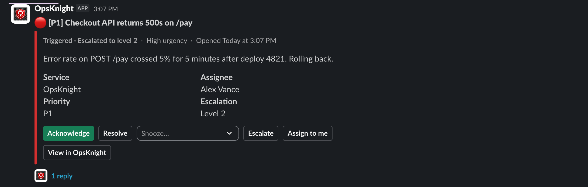
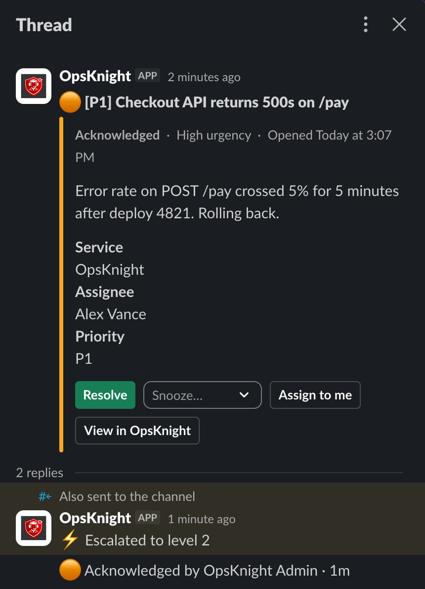
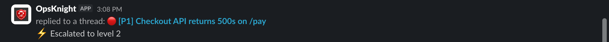
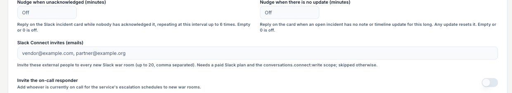

# Understand Slack incident notifications

OpsKnight is the source of truth for incident state. Each active service destination receives a projection. Subsequent lifecycle changes update or reconcile that projection using durable provider/message identities and idempotent delivery keys.

The message can expose only actions allowed by the shared ChatOps policy. A provider message is not an independent incident record; manually editing or deleting it does not change the OpsKnight incident.

## One live card per incident

A routine service destination gets **one card per incident**. OpsKnight posts it when the incident triggers and then edits that same message as the incident moves from triggered to acknowledged, snoozed, escalated, and resolved. Each change adds a short reply in the card's thread, so the channel reads as a timeline instead of a stack of repeated alerts.

The card shows:

- A colour bar and emoji for the state: red for triggered, amber for acknowledged, grey for snoozed, green for resolved.
- The priority and title in the header, then the state, urgency, and the time the incident opened. Times use Slack's local-time format, so each person sees their own time zone.
- The incident description, when there is one (long descriptions are shortened).
- **Service**, **Assignee** (a real Slack mention when OpsKnight can match the assignee's email to a Slack member), **Priority**, and, once the incident has escalated past the first level, **Escalation**. A snoozed card also shows **Snoozed until**.
- Only the buttons that still apply. A resolved incident keeps just **View in OpsKnight**.

Alert text is escaped before it is posted, so a title such as `<!channel>` appears as plain text and never notifies anyone.

Thread replies are short: "Acknowledged by …" (with the time it took), "Assigned to …", "Escalated to level 2", "Snoozed until …", "Resolved · 23m". Escalations, reopens, and re-triggers are also sent to the channel so the people watching it see that the incident needs attention again.

Every escalation refreshes the card, whether it came from the escalation engine, the web app, the API, Slack, or Teams.

## Reminders in the thread

Two optional reminders post a reply on the incident's card. Set them under **Settings → Integrations → ChatOps**; leaving a field empty turns that reminder off.

- **Nudge when unacknowledged (minutes):** while an incident is open and nobody has acknowledged it, OpsKnight replies "No one has acknowledged this yet" after this many minutes, and again every interval up to six times.
- **Nudge when there is no update (minutes):** while an incident is open or acknowledged and has had no update for this long, OpsKnight replies "No update in N minutes", repeating up to six times. A note, an acknowledgement, a reassignment, a role change, a status change, a comment, or a captured chat message counts as an update. A status-page update does not.

Each reminder checks the incident when it fires. An incident that has been acknowledged, resolved, snoozed, or suppressed in the meantime gets nothing, and turning a setting off stops the reminders. Values run from 1 to 1,440 minutes.

## Notification settings

The service's notification switches for triggered, acknowledged, and resolved incidents control **new posts**. With a switch off, OpsKnight does not post a new card or reply for that event, but a card that already exists is still edited so it never shows a stale state.

Older messages are not changed. A message posted before you upgraded, and messages sent through an incoming webhook (which cannot be edited), keep today's behaviour: each event is a new message.

## Routine destinations and war rooms

Routine service destinations receive incident lifecycle messages. A war room is a separate incident-scoped channel with provisioning, membership, context, and cleanup. Configuring one does not configure the other.

## Delivery and convergence

Provider throttling, removed bot access, deleted messages/channels, revoked tokens, or worker/database failures can delay a projection without changing the incident. Use OpsKnight delivery/operation state to diagnose and retry safely; avoid manual duplicate posts.

## Identity and actions

Viewing a message does not require an OpsKnight identity link. User-attributed actions do. OpsKnight validates Slack signatures/timestamps, maps the Slack user, then applies normal product authorization and incident-state rules.

## Related guides

- [Configure service channels](./configure-service-channels)
- [Acknowledge and resolve](./acknowledge-resolve)
- [Operate war rooms](./war-rooms)

