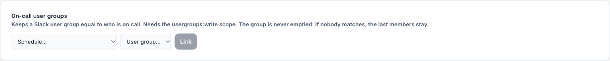

# Sync on-call to a Slack user group

## Before you begin

User groups are a paid Slack feature. Create the user group in Slack first (for example `@oncall-platform`). The Slack app needs the `usergroups:write` scope, and `usergroups:read` if you want to pick the group from a list; see [permissions and scopes](./permissions-and-scopes). An app installed before 2.3.0 must have its manifest updated and be reconnected to get them.

## Map a schedule

1. Open **Settings → Integrations → Slack** and find **On-call user groups**.
2. Choose an on-call schedule and a Slack user group. If OpsKnight can't list user groups, type the group's id.
3. Save. Use **Pause** and **Resume** to stop and restart a mapping, or remove it.

## What OpsKnight does

About once a minute OpsKnight works out who is on call for each mapped schedule, finds each person's Slack account by email, and sets the user group's members to those people. Slack replaces a group's whole membership, so OpsKnight never sends an empty list: if nobody is on call, or none of the on-call people matches a Slack account, the group keeps its previous members and the mapping shows the reason. At most 50 people are synced, people without a Slack match are skipped, and a Slack rate limit is retried on the next pass.

## Verify it worked

The mapping shows **synced** after a successful pass, or the error after a failed one (a missing scope, a disconnected workspace, or nobody to sync). In Slack, check that the user group's members are the people currently on call.

This feature needs a paid Slack plan, so it was covered by automated tests but not run against a live workspace.

## Next steps

- [Slack permissions and scopes](./permissions-and-scopes)
- [Operate war rooms](./war-rooms)
