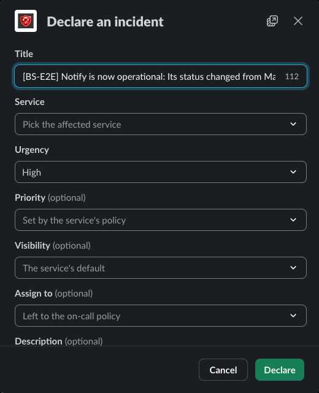
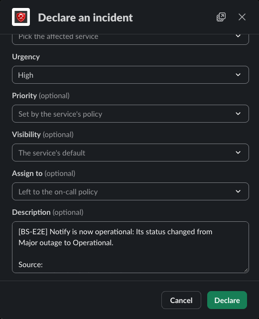
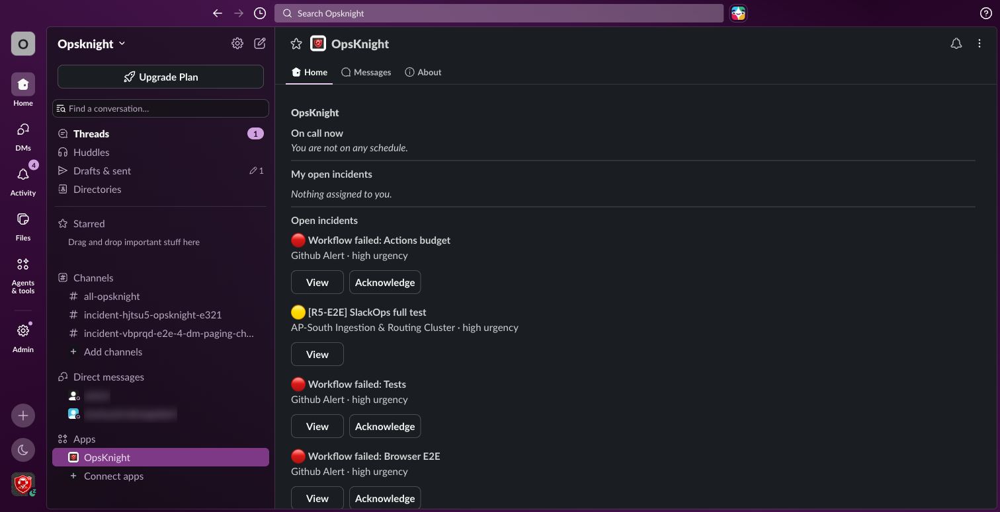

# Slack shortcuts and the Home tab

## Before you begin

Link your Slack identity (see [Link Slack responder identities](./user-identity-linking)). An app created before 2.3.0 must be updated first: paste the current manifest under **App Manifest** in the Slack API console, save, and select **Reconnect Slack** in OpsKnight. No new scope is needed.

## Declare an incident from a message

1. Hover a message, select **More actions**, then **Connect to apps**, and choose **Declare incident**. (Slack may also list it under **More message shortcuts**.)
2. The declare form opens with the title set to the first line of the message (200 characters at most) and the description set to the message text, followed by a link to the message when Slack provides one.
3. Choose the service, adjust the priority, visibility, and assignee, and submit.

The incident is created as with `/incident declare`, with the same permission check on the service, and its card is posted to the service's channel. The message shortcut replies to you privately only when Slack supplies a reply address; otherwise you see the new card.

## Declare an incident from the shortcuts menu

Open the shortcuts menu (the ⚡ button under the message box) and choose **Declare incident**. It opens the same form with nothing filled in.

## The Home tab

Open **OpsKnight** under Apps and select **Home**. It shows:

- **On call now** for you.
- **My open incidents** and **Open incidents**, up to ten each and limited to what your account may read. Each has **View** and, for an incident that is still open, **Acknowledge**.
- **Declare incident**, which opens the form.

If your Slack account isn't linked to an OpsKnight account, the Home tab says so instead of listing incidents. The tab is rebuilt each time you open it. Pressing **Acknowledge** there acknowledges the incident but does not post a message.

## Next steps

- [Use Slack incident commands](./commands)
- [Link Slack responder identities](./user-identity-linking)
