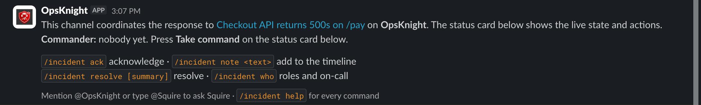
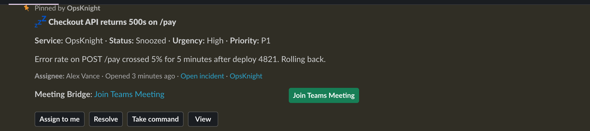
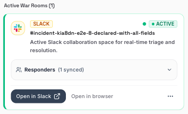

# Operate Slack incident war rooms

## Before you begin

Connect Slack with the required public or private-channel scopes and create an
active incident.

## Open the feature

Open **Incidents → select incident** and locate the **Create war room** launcher in the incident command bar. A war room is incident-scoped, not a routine service destination.

## Configure the room

Confirm the Slack provider/workspace, intended public or private channel behavior, incident, and participants. Private rooms require the optional group scopes.

## Complete the action

1. Select **Create war room** in the incident command bar.
2. Confirm Slack as the provider in the dialog and create the war room.
3. Confirm the context and intended participants appear.
4. Close the room from OpsKnight when coordination is complete.

## What OpsKnight does

OpsKnight creates or links a provider room, stores durable identity, publishes incident context with idempotent delivery keys, reconciles participants/messages, and performs terminal cleanup. The incident remains authoritative.

## What the room contains

A new room opens with a readable channel name, a plain description, and a topic that tracks the incident's state. OpsKnight then posts:

1. A short welcome that names the incident and its service, who the incident commander is, and the commands to use in the room.
2. A **status card**, pinned and bookmarked when the app has the `pins:write` and `bookmarks:write` scopes. The card shows the incident's state, service, urgency, priority, description, assignee, and the incident links, and it is edited as the incident changes.

The status card shows only the buttons that still apply. **Escalate** appears only while the incident is open, because escalation refuses anything else. A resolved incident has no buttons. If someone presses a button that OpsKnight refuses, they get a private message and the card stays as it is.

Reacting to any message in the room with 📌 saves it as a note on the incident, credited to the person who reacted. Only a confirmed member of the workspace is credited, and reacting twice never saves the same message twice.

From the incident page, the war-room panel links to the room with **Open in Slack** (opens the desktop app on the right workspace and channel) and **Open in browser**.

## Room settings

Under **Settings → Integrations → ChatOps**:

- **Private Slack war rooms** creates new Slack rooms as private channels that only invited responders can see. It needs the `groups:write` scope and is separate from status-page incident visibility. It is off by default.
- **Close Collaboration on Resolution** archives the room when the incident resolves. The optional **Archive delay (hours)** (1 to 720) keeps the room open for follow-up first; leave it empty to archive as soon as the incident resolves. The delay applies to Slack rooms; Teams rooms still archive as soon as the incident resolves.

The archive settings are read when a room closes, so a change applies to existing rooms that resolve later, and changing the delay re-times an archive that is already waiting. **Private Slack war rooms** applies only to rooms created afterwards. Existing rooms keep their names and topics.

## Optional room behaviour

All of these are off by default and are set under **Settings → Integrations → ChatOps**.

- **Invite the on-call responder** adds whoever is on call now for the schedules in the service's escalation policy (ten people at most) to new war rooms. It is applied when the room's participants are synchronized; a handover in the middle of an incident is not followed automatically.
- **Always add people to a service's war rooms** is set per service, in the service's settings under **Always add to the war room**. Choose nobody, the owning team's owners and admins, or everyone on the team, and add up to 25 named people, who do not have to belong to the team (a manager from another department, for instance). They join every new war room for that service alongside the assignee, role holders and on-call responders. Only active users with an email that matches their Slack account are added.
- **Slack Connect invitations** take a comma-separated list of up to 20 external email addresses and invite each of them to every new Slack war room. It needs a paid Slack plan and the `conversations.connect:write` scope, and it is skipped, without failing room creation, when either is missing.
- **Capture the conversation** (under **Settings → Intelligence**, off by default) saves war-room messages to the incident. Bot messages and very short messages are skipped, editing a captured message updates it, and deleting it removes it.

## Verify it worked

Verify channel creation, topic/initial context, participant synchronization,
interactive actions, pinned-note behavior, and closure. Missing
`channels:manage` prevents public-channel lifecycle operations; private rooms
also require the optional group scopes described in
[permissions and scopes](./permissions-and-scopes).

## Remove or change the room

Close/reconcile through OpsKnight instead of manually deleting the Slack channel. If a remote room was changed/deleted, inspect the collaboration operation before retrying to avoid duplicate rooms.

## Squire in the incident channel

When Squire is enabled for chat (**Settings → Intelligence → AI**, the assistant
and its chat switch), it works inside the war-room channel:

- **Ask or investigate.** Squire also answers `@OpsKnight` mentions in ordinary channels; in a war room it has the room's incident as context. Mention the app (`@OpsKnight what changed?`), or type
  `@Squire …` as plain text at the start of a message. `@OpsKnight investigate`
  (optionally `investigate <focus>`) runs Squire's investigation on the
  channel's incident. Squire replies in the thread, edits that reply with its
  progress, and ends with the investigation and links to the evidence.
  `/incident investigate [focus]` does the same privately. Squire answers as the
  asker's linked OpsKnight account: an unlinked Slack account, or a person who
  cannot read the incident in OpsKnight, is refused.
- **Automatic updates.** Squire keeps one incident summary and one
  investigation message in the channel and edits them in place as they change;
  an unchanged update is not re-sent. Digests and fix verifications are posted
  as replies in the investigation's thread (or the summary's). Updates go only
  to the incident's live war room, never to a service alert channel, and are
  skipped when ChatOps or the Slack installation is disabled. Slack rate limits
  pause updates for that channel briefly instead of retrying in a loop.
- **Identity.** With the optional `chat:write.customize` scope, Squire posts
  under its own name and avatar; otherwise its messages start with a Squire
  header. See [permissions and scopes](./permissions-and-scopes).

## Troubleshooting

**Creation forbidden:** verify `channels:manage`; private rooms also need the documented `groups:*` permissions and bot access.

**Room exists but operation is ambiguous:** inspect durable room ID/operation and provider response before retrying.

**Membership or actions fail:** check user availability, identity mapping, bot membership, scopes, and product authorization.

## Next steps

- [Use incident actions](./acknowledge-resolve)
- [Troubleshoot Slack](./troubleshooting)
